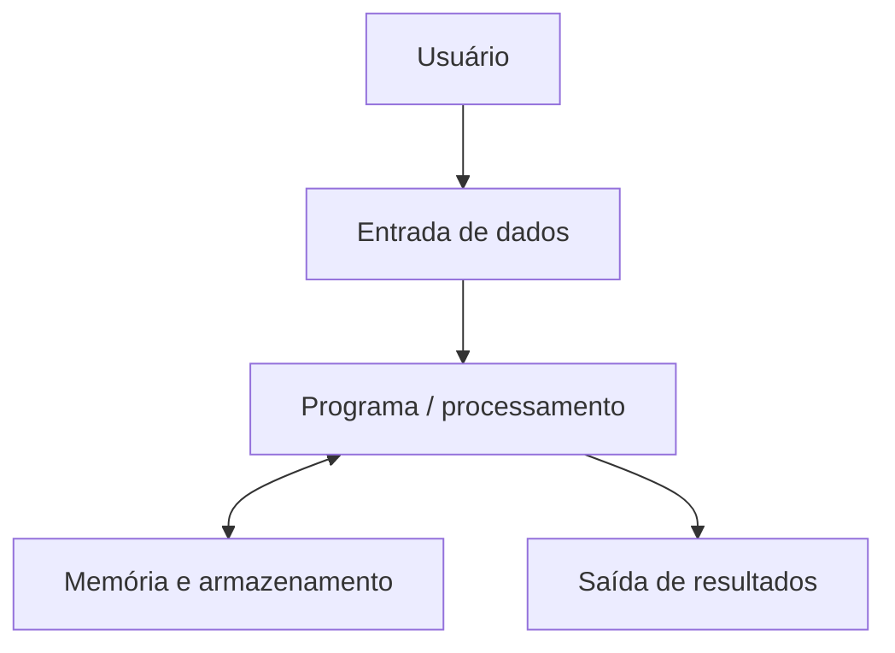

# 1. Introdução à Computação

## Abertura: de um problema a uma solução

Imagine um sistema acadêmico que precisa calcular a média de uma turma. Antes de escrever código, é necessário entender quais dados serão fornecidos, quais operações serão realizadas e qual resultado deverá ser apresentado. Essa é a base do pensamento computacional.

!!! abstract "Objetivos de aprendizagem"

    Ao final, você deverá conseguir explicar a diferença entre dado e informação, reconhecer componentes de um sistema computacional e decompor problemas em entrada, processamento e saída.

## 1.1 Dado, informação e conhecimento

- **Dado:** registro bruto, como `8.5`, `7.0` ou `6.0`.
- **Informação:** dado interpretado em um contexto, como “a média do estudante foi 7,17”.
- **Conhecimento:** entendimento que permite tomar decisões, por exemplo, identificar que o estudante atingiu a média mínima.

## 1.2 Hardware e software

**Hardware** é a parte física: processador, memória, armazenamento, teclado e monitor. **Software** é o conjunto de programas e instruções que orientam o hardware. Sistema operacional, compilador, navegador e editor de código são exemplos de software.

## 1.3 Componentes básicos

- **CPU:** executa instruções e coordena operações.
- **Memória RAM:** mantém temporariamente dados e instruções em uso.
- **Armazenamento:** preserva arquivos mesmo após desligar o equipamento.
- **Dispositivos de entrada:** teclado, mouse, câmera e sensores.
- **Dispositivos de saída:** monitor, impressora e alto-falantes.

## 1.4 Linguagens e compilação

Uma linguagem de programação permite expressar instruções com regras definidas. Em C, o código-fonte é traduzido por um compilador para um formato executável ou objeto, conforme o ambiente. Erros de sintaxe são detectados durante a compilação; erros de lógica podem permitir a compilação e ainda produzir resultados incorretos.

## 1.5 Decomposição de problemas

Considere o cálculo do custo de uma compra:

1. Entrada: quantidade de unidades e preço unitário.
2. Processamento: `total = quantidade * preco`.
3. Saída: valor total.

A decomposição reduz a complexidade e torna a solução mais fácil de testar.

!!! example "Exemplo comentado"

    Problema: calcular a distância percorrida por um veículo em velocidade constante.

    - Entrada: velocidade média e tempo.
    - Processamento: `distancia = velocidade * tempo`.
    - Saída: distância calculada.

    Atenção às unidades: se a velocidade estiver em km/h e o tempo em horas, a distância será expressa em quilômetros.

## 1.6 Pensamento computacional

- **Decomposição:** dividir o problema em partes menores.
- **Reconhecimento de padrões:** identificar semelhanças entre problemas.
- **Abstração:** concentrar-se no que é relevante.
- **Algoritmos:** definir uma sequência finita e ordenada de passos.

!!! warning "Erros comuns: atenção a estes pontos"

    - começar a programar sem compreender o enunciado;
    - confundir armazenamento permanente com memória RAM;
    - acreditar que compilar significa que o algoritmo está correto;
    - ignorar unidades e restrições dos dados.

!!! tip "Prática guiada"

    Planeje um programa que calcule o valor final de um produto após um desconto percentual. Não escreva código ainda. Identifique entrada, processamento, saída e duas situações que precisam ser testadas.

## Exercícios

### Nível 1 — Compreensão
1. Diferencie dado e informação.
2. Dê dois exemplos de hardware e dois de software.
3. Qual é a função geral da CPU?
4. Explique a diferença entre RAM e armazenamento.
5. O que é um algoritmo?
6. Por que um programa compilado ainda pode estar errado?

### Nível 2 — Aplicação
7. Identifique entrada, processamento e saída de um conversor de Celsius para Fahrenheit.
8. Faça a decomposição de um sistema que calcula a área de um retângulo.
9. Cite os dispositivos de entrada e saída de um caixa eletrônico.
10. Explique como a abstração ajuda a desenvolver um sistema de biblioteca.
11. Para calcular o preço com desconto, quais dados são necessários?
12. Apresente um exemplo de padrão reconhecível em tarefas cotidianas.

### Nível 3 — Análise e projeto
13. Planeje um algoritmo para calcular o consumo médio de combustível.
14. Descreva como um sistema acadêmico transforma notas em um boletim.
15. Um programa mostra uma média incorreta, mas compila. Que tipo de problema pode existir?
16. Proponha testes para um cálculo de desconto.
17. Decomponha o problema de registrar presença de estudantes.
18. Explique por que a validação de dados faz parte de uma solução confiável.
19. Compare uma solução manual com uma solução automatizada para organizar uma fila.
20. Escolha um problema real e descreva suas entradas, processamento e saídas.

!!! success "Gabarito comentado — respostas esperadas"

    1. Dado é um registro bruto; informação é dado contextualizado.
    2. Exemplos: teclado e monitor; sistema operacional e editor.
    3. Executar instruções e coordenar operações do sistema.
    4. RAM é volátil e temporária; armazenamento mantém arquivos.
    5. Sequência finita e ordenada de passos para resolver um problema.
    6. Porque a compilação não garante a lógica correta.
    7. Entrada: temperatura em Celsius; processamento: `F = C * 9/5 + 32`; saída: Fahrenheit.
    8. Entrada: base e altura; processamento: `area = base * altura`; saída: área.
    9. Entrada: teclado, leitor de cartão; saída: tela, impressora de recibo.
    10. Permite focar em livros, usuários, empréstimos e regras relevantes.
    11. Preço original e percentual de desconto.
    12. Respostas variam; deve haver uma regularidade identificável.
    13. Entrada: distância e litros; processamento: distância/litros; saída: km/L.
    14. Recebe notas, calcula resultados e organiza-os em uma apresentação compreensível.
    15. Erro lógico ou dados de entrada inadequados.
    16. Testar desconto zero, desconto usual, limite permitido e dados inválidos.
    17. Separar identificação da turma, registro de presença, cálculo e relatório.
    18. Impede ou identifica valores que violam as regras do problema.
    19. A automação pode acelerar o processo, mas precisa de regras claras e tratamento de exceções.
    20. Resposta pessoal avaliada pela coerência entre entradas, processamento e saídas.

## Resumo visual

**Problema → decomposição → algoritmo → implementação → testes → melhoria**

## Glossário

- **Compilador:** traduz código-fonte.
- **CPU:** unidade central de processamento.
- **RAM:** memória principal volátil.
- **Abstração:** seleção dos detalhes relevantes.
- **Decomposição:** divisão de um problema em partes menores.

## Referências para estudo

- Cormen, T. H. et al. *Introduction to Algorithms*. MIT Press.
- Brookshear, J. G.; Brylow, D. *Computer Science: An Overview*. Pearson.
- Documentação e materiais introdutórios de computação indicados pela disciplina.
