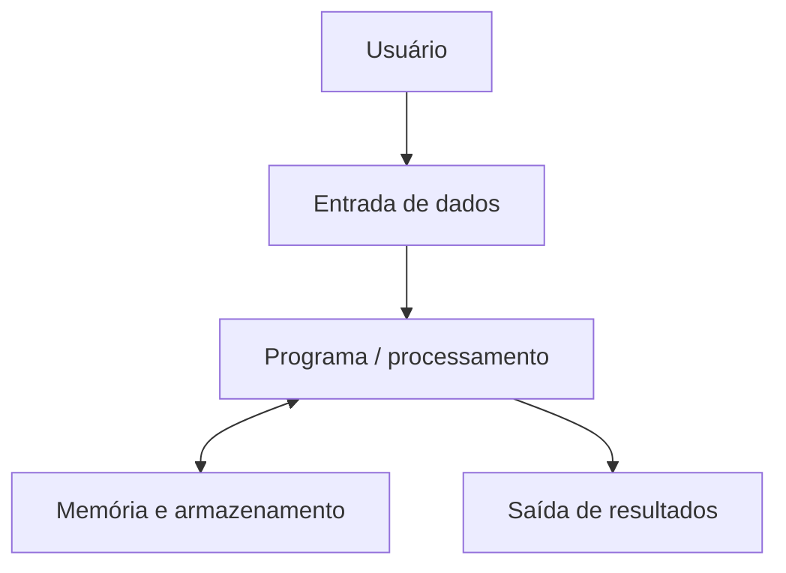
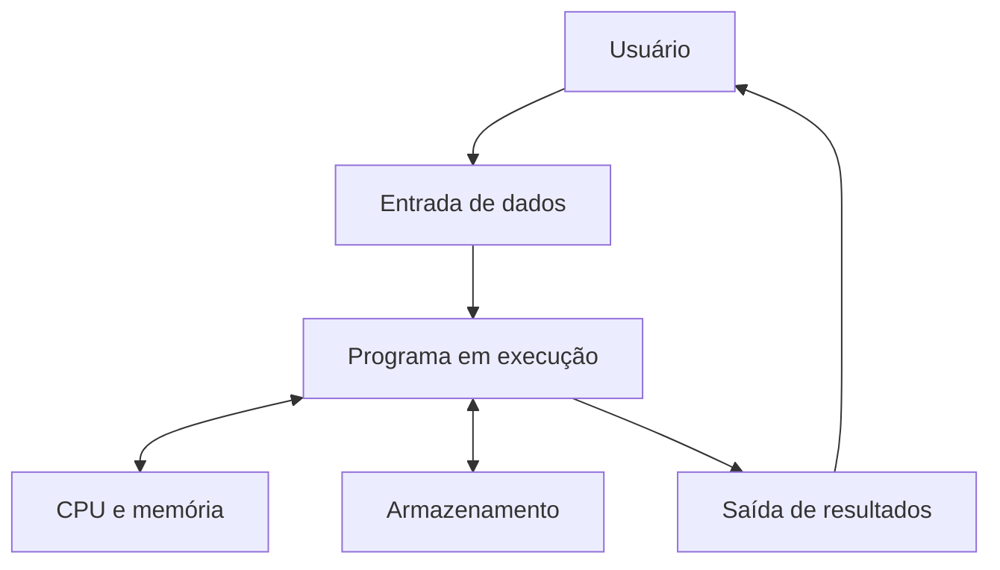
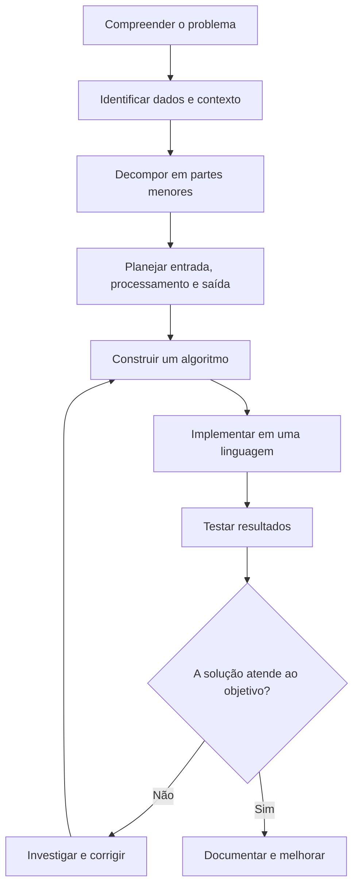

# 1. Introdução à Computação

!!! info "Objetivos de aprendizagem"
    Ao concluir este capítulo, você deverá ser capaz de:

    - diferenciar dado, informação e conhecimento;
    - explicar a relação entre hardware e software;
    - reconhecer os componentes básicos de um sistema computacional;
    - descrever, em linhas gerais, como um programa em C é compilado;
    - decompor um problema em entrada, processamento e saída;
    - explicar os quatro pilares do pensamento computacional;
    - planejar e testar uma solução antes de implementá-la.

<p class="texto"> A Computação é uma área do conhecimento dedicada ao estudo e ao desenvolvimento de métodos, técnicas e tecnologias para a coleta, o processamento, o armazenamento e a análise de dados. Seu propósito é transformar dados em informações úteis, contribuindo para a produção de conhecimento e para a resolução de problemas em diferentes contextos da sociedade. Para isso, a Computação envolve a integração de três elementos fundamentais: hardware, que corresponde aos componentes físicos dos dispositivos computacionais; software, que compreende os programas e as instruções responsáveis por orientar o funcionamento desses dispositivos; e dados, que representam os elementos utilizados para produzir informações relevantes.</p>

Entre as diversas atividades da Computação, destaca-se o desenvolvimento de sistemas, que consiste na criação de soluções informatizadas para atender às necessidades específicas de pessoas, empresas e outras organizações. Essa atividade envolve diferentes etapas, como a identificação de um problema, o levantamento de requisitos, o planejamento da solução, a elaboração de algoritmos, a implementação de programas, a realização de testes e a manutenção do sistema ao longo de seu ciclo de vida.

O principal objetivo do desenvolvimento de sistemas é construir soluções eficientes, confiáveis e funcionais, capazes de automatizar tarefas, otimizar processos, reduzir a ocorrência de erros e facilitar a tomada de decisões. Para alcançar esses resultados, é necessário compreender o problema a ser resolvido e definir procedimentos lógicos que orientem o processamento dos dados e a obtenção dos resultados esperados.

!!! abstract "Exemplo prático: Sistema Acadêmico"
    Imagine um sistema acadêmico que precisa calcular a média dos estudantes de uma turma. O sistema deverá ser capax de identificar quem atingiu a média mínima e gerar um relatório. Fazer isso manualmente pode funcionar para poucas pessoas, mas fica demorado e sujeito a erros quando a quantidade de registros aumenta. Antes de escrever um programa, precisamos compreender o problema:

      - **Quais dados serão fornecidos?** As notas de cada estudante.
      - **O que precisa ser feito?** Calcular a média e comparar o resultado com a média mínima.
      - **O que deve ser apresentado?** A média e uma indicação do resultado.
      - **Como verificar se a solução funciona?** Testar com diferentes notas, inclusive valores inválidos.

    Esse raciocínio é parte da resolução de problemas com computadores. Programar não é apenas escrever comandos em uma linguagem: é compreender uma situação, organizar uma solução e verificar se ela atende ao objetivo.

Esse exemplo demonstra como os conceitos fundamentais da Computação se relacionam com a programação e o desenvolvimento de sistemas. A partir da compreensão dos problemas e da definição de uma sequência lógica de instruções, é possível construir soluções computacionais capazes de transformar dados em resultados úteis. Essa compreensão constitui uma das bases para o estudo de Algoritmos e Lógica de Programação, disciplina que apresenta os princípios necessários para desenvolver o raciocínio lógico e estruturar soluções que possam ser implementadas em uma linguagem de programação.

## 1.1 Dado, informação e conhecimento

Esses três termos estão relacionados, mas não significam a mesma coisa.

### Dado

Um **dado** é um registro bruto de um valor ou de uma observação. Isoladamente, ele pode não explicar o que representa.

Exemplos:

- `8.5`
- `23`
- `120`
- `Aprovado`

O valor `8.5`, por exemplo, poderia representar uma nota, uma temperatura ou uma medida. Sem contexto, não sabemos qual interpretação é adequada.

### Informação

Uma **informação** é obtida quando os dados são organizados e interpretados em um contexto.

Observe:

- Dados: `8.0`, `7.0` e `9.0`.
- Contexto: notas de três avaliações de uma estudante.
- Informação: a média aritmética das avaliações é `8.0`.

O contexto permite entender o significado dos valores.

### Conhecimento

O **conhecimento** envolve interpretar informações e utilizá-las para compreender uma situação ou tomar uma decisão.

Por exemplo:

- Informação: a média da estudante é `8.0`.
- Regra da disciplina: a média mínima para aprovação é `6.0`.
- Conhecimento aplicado: como a média é superior à mínima, a estudante atingiu esse critério de aprovação.

A decisão depende tanto da informação quanto da regra utilizada. Em um sistema real, outras regras institucionais também podem ser necessárias.

!!! abstract "Exemplo resolvido: Sistema de Vendas"
    Uma loja registra que vendeu `12` unidades de um produto cujo preço unitário é `R$ 15,00`.

      1. **Dados de entrada:** quantidade igual a 12 e preço unitário igual a R$ 15,00.
      2. **Processamento:** multiplicar a quantidade pelo preço unitário.
      3. **Informação produzida:** o valor total da venda é R$ 180,00.
      4. **Uso da informação:** a loja pode comparar as vendas de diferentes produtos ou períodos para planejar o estoque.

    A informação não surge por mágica: ela é produzida pela organização e pelo processamento dos dados.

### Atividade interativa: classifique os exemplos

Lembre-se que **Dado** é o registro; **informação** é o dado contextualizado; **conhecimento** é a compreensão que ajuda a interpretar e agir. A fronteira entre informação e conhecimento depende do contexto e do uso que se faz deles. Com base nisso, leia cada situação e escolha a classificação mais adequada. Em seguida, confira o feedback.

<div class="atividade-interativa" id="atividade-dado-info">
  <p><strong>Situação 1.</strong> O registro de uma avaliação contém apenas o valor <code>7,5</code>, sem indicar a que se refere.</p>
  <div class="opcoes-atividade">
    <button type="button" data-correct="true" class="botao">Dado</button>
    <button type="button" data-correct="false" class="botao">Informação</button>
    <button type="button" data-correct="false" class="botao">Conhecimento</button>
  </div>
  <p class="feedback-atividade" aria-live="polite"></p>
  <hr>
  <p><strong>Situação 2.</strong> Um relatório informa que a média de uma estudante foi 8,0.</p>
  <div class="opcoes-atividade">
    <button type="button" data-correct="false" class="botao">Dado isolado</button>
    <button type="button" data-correct="true" class="botao">Informação</button>
    <button type="button" data-correct="false" class="botao">Conhecimento</button>
  </div>
  <p class="feedback-atividade" aria-live="polite"></p>
  <hr>
  <p><strong>Situação 3.</strong> Ao comparar a média 8,0 com a média mínima 6,0, o sistema conclui que o critério de nota foi atingido.</p>
  <div class="opcoes-atividade">
    <button type="button" data-correct="false" class="botao">Dado</button>
    <button type="button" data-correct="false" class="botao">Informação</button>
    <button type="button" data-correct="true" class="botao">Conhecimento </button>
  </div>
  <p class="feedback-atividade" aria-live="polite"></p>
</div>
    
## 1.2 Hardware e software

**Hardware** é a parte física: processador, memória, armazenamento, teclado e monitor. **Software** é o conjunto de programas e instruções que orientam o hardware. Sistema operacional, compilador, navegador e editor de código são exemplos de software.



## 1.3 Componentes básicos

- **CPU:** executa instruções e coordena operações.
- **Memória RAM:** mantém temporariamente dados e instruções em uso.
- **Armazenamento:** preserva arquivos mesmo após desligar o equipamento.
- **Dispositivos de entrada:** teclado, mouse, câmera e sensores.
- **Dispositivos de saída:** monitor, impressora e alto-falantes.

## 1.4 Linguagens e compilação

Uma linguagem de programação permite expressar instruções com regras definidas. Em C, o código-fonte é traduzido por um compilador para um formato executável ou objeto, conforme o ambiente. Erros de sintaxe são detectados durante a compilação; erros de lógica podem permitir a compilação e ainda produzir resultados incorretos.

## 1.5 Decomposição de problemas

Considere o cálculo do custo de uma compra:

1. Entrada: quantidade de unidades e preço unitário.
2. Processamento: `total = quantidade * preco`.
3. Saída: valor total.

A decomposição reduz a complexidade e torna a solução mais fácil de testar.

!!! example "Exemplo comentado"

    Problema: calcular a distância percorrida por um veículo em velocidade constante.

    - Entrada: velocidade média e tempo.
    - Processamento: `distancia = velocidade * tempo`.
    - Saída: distância calculada.

    Atenção às unidades: se a velocidade estiver em km/h e o tempo em horas, a distância será expressa em quilômetros.

## 1.6 Pensamento computacional

- **Decomposição:** dividir o problema em partes menores.
- **Reconhecimento de padrões:** identificar semelhanças entre problemas.
- **Abstração:** concentrar-se no que é relevante.
- **Algoritmos:** definir uma sequência finita e ordenada de passos.

!!! warning "Erros comuns: atenção a estes pontos"

    - começar a programar sem compreender o enunciado;
    - confundir armazenamento permanente com memória RAM;
    - acreditar que compilar significa que o algoritmo está correto;
    - ignorar unidades e restrições dos dados.

!!! tip "Prática guiada"

    Planeje um programa que calcule o valor final de um produto após um desconto percentual. Não escreva código ainda. Identifique entrada, processamento, saída e duas situações que precisam ser testadas.

## Exercícios

### Nível 1 — Compreensão
1. Diferencie dado e informação.
2. Dê dois exemplos de hardware e dois de software.
3. Qual é a função geral da CPU?
4. Explique a diferença entre RAM e armazenamento.
5. O que é um algoritmo?
6. Por que um programa compilado ainda pode estar errado?

### Nível 2 — Aplicação
7. Identifique entrada, processamento e saída de um conversor de Celsius para Fahrenheit.
8. Faça a decomposição de um sistema que calcula a área de um retângulo.
9. Cite os dispositivos de entrada e saída de um caixa eletrônico.
10. Explique como a abstração ajuda a desenvolver um sistema de biblioteca.
11. Para calcular o preço com desconto, quais dados são necessários?
12. Apresente um exemplo de padrão reconhecível em tarefas cotidianas.

### Nível 3 — Análise e projeto
13. Planeje um algoritmo para calcular o consumo médio de combustível.
14. Descreva como um sistema acadêmico transforma notas em um boletim.
15. Um programa mostra uma média incorreta, mas compila. Que tipo de problema pode existir?
16. Proponha testes para um cálculo de desconto.
17. Decomponha o problema de registrar presença de estudantes.
18. Explique por que a validação de dados faz parte de uma solução confiável.
19. Compare uma solução manual com uma solução automatizada para organizar uma fila.
20. Escolha um problema real e descreva suas entradas, processamento e saídas.

!!! success "Gabarito comentado — respostas esperadas"

    1. Dado é um registro bruto; informação é dado contextualizado.
    2. Exemplos: teclado e monitor; sistema operacional e editor.
    3. Executar instruções e coordenar operações do sistema.
    4. RAM é volátil e temporária; armazenamento mantém arquivos.
    5. Sequência finita e ordenada de passos para resolver um problema.
    6. Porque a compilação não garante a lógica correta.
    7. Entrada: temperatura em Celsius; processamento: `F = C * 9/5 + 32`; saída: Fahrenheit.
    8. Entrada: base e altura; processamento: `area = base * altura`; saída: área.
    9. Entrada: teclado, leitor de cartão; saída: tela, impressora de recibo.
    10. Permite focar em livros, usuários, empréstimos e regras relevantes.
    11. Preço original e percentual de desconto.
    12. Respostas variam; deve haver uma regularidade identificável.
    13. Entrada: distância e litros; processamento: distância/litros; saída: km/L.
    14. Recebe notas, calcula resultados e organiza-os em uma apresentação compreensível.
    15. Erro lógico ou dados de entrada inadequados.
    16. Testar desconto zero, desconto usual, limite permitido e dados inválidos.
    17. Separar identificação da turma, registro de presença, cálculo e relatório.
    18. Impede ou identifica valores que violam as regras do problema.
    19. A automação pode acelerar o processo, mas precisa de regras claras e tratamento de exceções.
    20. Resposta pessoal avaliada pela coerência entre entradas, processamento e saídas.

## Resumo visual

**Problema → decomposição → algoritmo → implementação → testes → melhoria**

## Glossário

- **Compilador:** traduz código-fonte.
- **CPU:** unidade central de processamento.
- **RAM:** memória principal volátil.
- **Abstração:** seleção dos detalhes relevantes.
- **Decomposição:** divisão de um problema em partes menores.

## Referências para estudo

- Cormen, T. H. et al. *Introduction to Algorithms*. MIT Press.
- Brookshear, J. G.; Brylow, D. *Computer Science: An Overview*. Pearson.
- Documentação e materiais introdutórios de computação indicados pela disciplina.

## 1.2 Hardware e software

Um sistema computacional reúne componentes físicos e programas que trabalham em conjunto.

### Hardware

**Hardware** é a parte física do sistema computacional, ou seja, os componentes que podemos tocar ou que fazem parte fisicamente do equipamento.

Exemplos:

- teclado e mouse;
- monitor;
- processador;
- memória RAM;
- unidade de armazenamento SSD;
- câmera, microfone e sensores.

### Software

**Software** é o conjunto de programas, instruções e dados que orientam as operações realizadas pelo computador.

Exemplos:

- sistema operacional;
- navegador de internet;
- editor de código;
- compilador;
- sistema acadêmico;
- aplicativo de mensagens.

O hardware oferece os recursos físicos. O software utiliza esses recursos para realizar tarefas. Um aplicativo não funciona sem uma plataforma computacional capaz de executá-lo; da mesma forma, um computador sem programas não realiza automaticamente a tarefa específica que o usuário deseja.

### Exemplo do cotidiano

Ao digitar uma mensagem em um celular:

1. O teclado físico ou virtual recebe a interação do usuário.
2. O aplicativo interpreta as teclas selecionadas.
3. O processador executa as instruções do aplicativo e do sistema operacional.
4. A tela apresenta o texto.
5. Ao salvar ou enviar a mensagem, outros componentes e serviços podem participar do processo.

Esse exemplo mostra que hardware e software não são concorrentes: eles trabalham em conjunto.

### Diagrama: interação em um sistema computacional



O diagrama representa um modelo simplificado. A comunicação real entre os componentes depende da arquitetura do equipamento, do sistema operacional e do programa utilizado.

!!! warning "Não confunda"
    - **Hardware:** componentes físicos.
    - **Software:** programas e instruções.
    - **Arquivo:** conjunto de dados armazenado, como um documento ou uma imagem. O arquivo não é, por si só, o dispositivo físico que o guarda.

### Verifique sua compreensão

Classifique cada item como hardware ou software.

<div class="atividade-interativa" id="atividade-hardware-software">
  <p><strong>1. Memória RAM</strong></p>
  <div class="opcoes-atividade">
    <button type="button" data-correct="true">Hardware</button>
    <button type="button" data-correct="false">Software</button>
  </div>
  <p class="feedback-atividade" aria-live="polite"></p>
  <p><strong>2. Navegador de internet</strong></p>
  <div class="opcoes-atividade">
    <button type="button" data-correct="false">Hardware</button>
    <button type="button" data-correct="true">Software</button>
  </div>
  <p class="feedback-atividade" aria-live="polite"></p>
  <p><strong>3. SSD</strong></p>
  <div class="opcoes-atividade">
    <button type="button" data-correct="true">Hardware</button>
    <button type="button" data-correct="false">Software</button>
  </div>
  <p class="feedback-atividade" aria-live="polite"></p>
</div>

## 1.3 Componentes básicos de um sistema computacional

Para entender como um programa funciona, é útil conhecer alguns componentes do computador.

### CPU — Unidade Central de Processamento

A **CPU** executa instruções e coordena operações do sistema. Ela participa de cálculos, comparações e movimentação de dados entre componentes.

Uma analogia possível é a de uma cozinha: a CPU executa as etapas de uma receita, mas depende dos ingredientes, dos utensílios e das instruções disponíveis. A analogia ajuda a visualizar a relação entre componentes, mas não descreve literalmente o funcionamento eletrônico do processador.

### Memória RAM

A **memória RAM** guarda temporariamente dados e instruções que estão sendo utilizados. Ela permite acesso rápido às informações necessárias aos programas em execução.

A RAM é volátil: normalmente, seu conteúdo não é preservado quando o equipamento é desligado.

### Armazenamento

O **armazenamento** — por exemplo, um SSD ou HD — mantém arquivos e programas mesmo quando o equipamento está desligado, desde que não haja falha ou exclusão dos dados.

RAM e armazenamento cumprem funções diferentes. Ter mais armazenamento significa poder guardar mais dados; ter mais RAM pode ajudar a manter mais programas e dados de trabalho disponíveis ao mesmo tempo.

### Dispositivos de entrada

São os recursos utilizados para enviar dados ou comandos ao computador.

Exemplos:

- teclado;
- mouse;
- câmera;
- microfone;
- leitor de código de barras;
- sensores.

### Dispositivos de saída

São os recursos que apresentam resultados do processamento.

Exemplos:

- monitor;
- impressora;
- alto-falantes;
- projetor.

Um mesmo equipamento pode desempenhar mais de uma função. Uma tela sensível ao toque, por exemplo, pode apresentar informações e receber interações do usuário.

### Quadro comparativo

| Componente | Função principal | Exemplo |
|---|---|---|
| CPU | Executar instruções e coordenar operações | Processador do computador |
| RAM | Manter temporariamente dados em uso | Memória principal |
| Armazenamento | Preservar programas e arquivos | SSD |
| Entrada | Receber dados ou comandos | Teclado |
| Saída | Apresentar resultados | Monitor |

### Exemplo resolvido: abrir um arquivo

Ao abrir um documento salvo no computador:

1. O usuário seleciona o arquivo por meio de um dispositivo de entrada.
2. O sistema solicita os dados ao dispositivo de armazenamento.
3. O programa que abre o documento utiliza a CPU e a RAM para processar e manter os dados necessários.
4. O monitor apresenta o conteúdo ao usuário.

Esse é um modelo simplificado para fins didáticos. Na prática, o sistema operacional e outros componentes participam dessas etapas.

### Atividade: associe o componente à função

<div class="atividade-interativa" id="atividade-componentes">
  <p>Escolha o componente correspondente a cada descrição.</p>
  <label for="comp1">1. Mantém temporariamente dados utilizados pelos programas.</label>
  <select id="comp1">
    <option value="">Selecione...</option>
    <option value="cpu">CPU</option>
    <option value="ram">Memória RAM</option>
    <option value="ssd">Armazenamento SSD</option>
    <option value="monitor">Monitor</option>
  </select>
  <label for="comp2">2. Preserva arquivos mesmo após desligar o computador.</label>
  <select id="comp2">
    <option value="">Selecione...</option>
    <option value="cpu">CPU</option>
    <option value="ram">Memória RAM</option>
    <option value="ssd">Armazenamento SSD</option>
    <option value="monitor">Monitor</option>
  </select>
  <label for="comp3">3. Executa instruções e realiza operações.</label>
  <select id="comp3">
    <option value="">Selecione...</option>
    <option value="cpu">CPU</option>
    <option value="ram">Memória RAM</option>
    <option value="ssd">Armazenamento SSD</option>
    <option value="monitor">Monitor</option>
  </select>
  <button type="button" id="corrigir-componentes">Conferir respostas</button>
  <p class="feedback-atividade" id="feedback-componentes" aria-live="polite"></p>
</div>

!!! tip "Dica de estudo"
    Se você confundir RAM e armazenamento, lembre-se desta pergunta: “O que está sendo utilizado agora?” remete frequentemente à RAM; “O que precisa continuar guardado depois que eu desligar?” remete ao armazenamento.

## 1.4 Linguagens de programação e compilação

Um computador executa instruções representadas de acordo com sua arquitetura. As linguagens de programação permitem que pessoas expressem essas instruções por meio de regras e estruturas definidas.

### Código-fonte

O **código-fonte** é o texto escrito pelo programador em uma linguagem de programação, como C. Ele deve respeitar as regras da linguagem.

Exemplo em C:

```c
#include <stdio.h>

int main(void) {
    printf("Olá, mundo!\n");
    return 0;
}
```

Esse programa apresenta a mensagem `Olá, mundo!` e termina indicando que a execução foi concluída normalmente.

### Compilador

Um **compilador** é um programa que traduz o código-fonte para uma representação que pode ser processada nas etapas seguintes de construção do programa. Em ambientes comuns de C, o processo pode gerar arquivos-objeto e, depois, um executável por meio da ligação (*linkedição*).

O fluxo simplificado é:


As etapas exatas variam conforme o compilador e o ambiente de desenvolvimento. Alguns ambientes escondem parte delas do usuário.

### Tipos de problemas em um programa

É importante distinguir problemas diferentes.

**Erro de sintaxe:** ocorre quando o código não respeita as regras gramaticais da linguagem.

```c
#include <stdio.h>

int main(void) {
    printf("Olá, mundo!\n"
    return 0;
}
```

Nesse exemplo, falta fechar a chamada de `printf` com `);`. O compilador normalmente informa um erro, embora a mensagem possa apontar para a linha em que o problema foi percebido, e não exatamente onde começou.

**Erro de lógica:** o programa pode compilar e executar, mas produzir um resultado diferente do esperado.

```c
int largura = 5;
int altura = 3;
int area = largura + altura; /* incorreto para calcular a área */
```

Para calcular a área de um retângulo, a operação correta é `largura * altura`. A soma é uma expressão válida em C, mas não representa a fórmula desejada.

**Problema nos dados de entrada:** mesmo com uma fórmula correta, valores inadequados podem levar a resultados sem sentido. Um cálculo de preço, por exemplo, pode precisar rejeitar quantidades negativas ou descontos fora dos limites definidos pelo problema.

!!! warning "Compilar não significa provar que o programa está correto"
    A compilação verifica aspectos do código e pode encontrar diversos problemas, mas não garante que o algoritmo atenda ao objetivo. Por isso, é necessário testar o programa com valores variados e conferir os resultados esperados.

### Atividade interativa: identifique o problema

<div class="atividade-interativa" id="atividade-erros">
  <p><strong>Situação 1.</strong> O programa não compila porque falta um ponto e vírgula após uma instrução.</p>
  <div class="opcoes-atividade">
    <button type="button" data-correct="true">Erro de sintaxe</button>
    <button type="button" data-correct="false">Erro de lógica</button>
    <button type="button" data-correct="false">Dispositivo de saída</button>
  </div>
  <p class="feedback-atividade" aria-live="polite"></p>
  <hr>
  <p><strong>Situação 2.</strong> O programa compila, mas calcula a área de um retângulo somando a largura e a altura.</p>
  <div class="opcoes-atividade">
    <button type="button" data-correct="false">Erro de sintaxe</button>
    <button type="button" data-correct="true">Erro de lógica</button>
    <button type="button" data-correct="false">Erro de hardware</button>
  </div>
  <p class="feedback-atividade" aria-live="polite"></p>
</div>

## 1.5 Decomposição de problemas

Um problema complexo pode ficar mais fácil de resolver quando é dividido em etapas menores. Essa estratégia é chamada de **decomposição**.

Uma forma inicial de organizar muitos problemas computacionais é identificar:

- **Entrada:** quais dados serão fornecidos?
- **Processamento:** quais cálculos ou regras serão aplicados?
- **Saída:** quais resultados deverão ser apresentados?

Esse modelo é uma ferramenta de planejamento. Alguns sistemas também precisam armazenar dados, interagir com outros sistemas, validar informações e tratar situações excepcionais.

### Exemplo resolvido 1: calcular o total de uma compra

**Problema:** calcular o valor de uma compra sabendo a quantidade de unidades e o preço de cada unidade.

**Etapa 1 — Entrada**

- quantidade de unidades;
- preço unitário.

**Etapa 2 — Processamento**

Multiplicar a quantidade pelo preço unitário:

\[
\text{total} = \text{quantidade} \times \text{preço unitário}
\]

**Etapa 3 — Saída**

Apresentar o valor total da compra.

**Teste com valores conhecidos**

Se a quantidade for 4 e o preço unitário for R$ 7,50:

\[
\text{total} = 4 \times 7{,}50 = 30{,}00
\]

O resultado esperado é R$ 30,00.

### Exemplo resolvido 2: calcular a distância percorrida

Um veículo mantém velocidade média constante de 60 km/h durante 2 horas. A distância pode ser calculada por:

\[
\text{distância} = \text{velocidade} \times \text{tempo}
\]

Substituindo os valores:

\[
\text{distância} = 60 \times 2 = 120\text{ km}
\]

- **Entrada:** velocidade média e tempo.
- **Processamento:** multiplicar velocidade por tempo.
- **Saída:** distância calculada.

**Atenção às unidades:** se a velocidade estiver em km/h, o tempo deve estar em horas para que o resultado seja expresso em quilômetros.

### Exemplo resolvido 3: aplicar um desconto

Uma loja precisa calcular o preço final de um produto após um desconto percentual.

- **Entrada:** preço original e percentual de desconto.
- **Processamento:** calcular o desconto e subtraí-lo do preço original.
- **Saída:** preço final.

As fórmulas são:

\[
\text{valor do desconto} = \text{preço original} \times \frac{\text{percentual}}{100}
\]

\[
\text{preço final} = \text{preço original} - \text{valor do desconto}
\]

Se o preço original for R$ 200,00 e o desconto for 10%:

\[
\text{desconto} = 200 \times \frac{10}{100} = 20
\]

\[
\text{preço final} = 200 - 20 = 180
\]

O preço final será R$ 180,00. Antes de implementar a solução, também precisamos decidir quais entradas são válidas, como um preço não negativo e um percentual entre 0 e 100, caso essas sejam as regras do problema.

### Laboratório interativo: decomponha um problema

Escolha um problema e observe suas entradas, seu processamento e suas saídas.

<div class="atividade-interativa" id="laboratorio-decomposicao">
  <label for="problema-decomposicao">Problema</label>
  <select id="problema-decomposicao">
    <option value="compra">Calcular o total de uma compra</option>
    <option value="retangulo">Calcular a área de um retângulo</option>
    <option value="combustivel">Calcular o consumo médio de combustível</option>
  </select>
  <div class="resultado-decomposicao" id="resultado-decomposicao" aria-live="polite">
    <p><strong>Entrada:</strong> quantidade e preço unitário.</p>
    <p><strong>Processamento:</strong> quantidade × preço unitário.</p>
    <p><strong>Saída:</strong> valor total da compra.</p>
  </div>
</div>

### Testar antes de programar

Uma solução deve ser testada com mais de um conjunto de dados. Para o cálculo do desconto, por exemplo, podemos considerar:

| Preço original | Desconto | Resultado esperado |
|---:|---:|---:|
| R$ 100,00 | 0% | R$ 100,00 |
| R$ 100,00 | 10% | R$ 90,00 |
| R$ 200,00 | 25% | R$ 150,00 |
| R$ 50,00 | 100% | R$ 0,00 |

Também é importante testar entradas inválidas, como preço negativo ou desconto maior que 100%, quando as regras do sistema não permitirem esses valores.

## 1.6 Pensamento computacional

**Pensamento computacional** é uma abordagem para formular e resolver problemas de forma organizada, utilizando estratégias que também podem ser expressas por algoritmos e executadas por computadores. Ele pode ser aplicado à programação, mas também a situações cotidianas.

Quatro pilares frequentemente utilizados para explicar essa abordagem são decomposição, reconhecimento de padrões, abstração e algoritmos.

### 1. Decomposição

Consiste em dividir um problema maior em partes menores que possam ser compreendidas e resolvidas.

**Exemplo:** para desenvolver um sistema de biblioteca, podemos separar o problema em cadastro de livros, cadastro de usuários, empréstimos, devoluções e relatórios.

### 2. Reconhecimento de padrões

Consiste em identificar semelhanças ou regularidades entre problemas ou situações.

**Exemplo:** calcular o total de uma compra de vários produtos e calcular o custo de várias passagens envolvem multiplicações e somas semelhantes. Reconhecer essa estrutura ajuda a reaproveitar estratégias.

### 3. Abstração

Consiste em selecionar os detalhes relevantes para o problema e deixar de lado os que não influenciam a solução naquele momento.

**Exemplo:** para calcular a área de um retângulo, precisamos de sua largura e altura. A cor do retângulo não interfere nesse cálculo e pode ser ignorada.

A abstração não significa que os detalhes descartados nunca sejam importantes. Eles podem ser necessários para outro objetivo.

### 4. Algoritmos

Um **algoritmo** é uma sequência finita e ordenada de passos para realizar uma tarefa ou resolver um problema. Os passos precisam ser suficientemente claros para que possam ser executados e verificados.

Exemplo de algoritmo cotidiano para preparar uma bebida:

1. Separar os ingredientes e utensílios.
2. Colocar a quantidade definida de água no recipiente.
3. Aquecer a água.
4. Misturar os ingredientes conforme as instruções.
5. Servir a bebida.

Em programação, o algoritmo precisa ser adaptado às regras do problema e representado de forma adequada, por exemplo, em pseudocódigo, fluxograma ou linguagem de programação.

### Os quatro pilares trabalhando juntos

Considere o problema de calcular as médias de uma turma:

1. **Decomposição:** separar a leitura das notas, o cálculo da média, a verificação do critério e a apresentação do resultado.
2. **Reconhecimento de padrões:** perceber que a mesma operação de cálculo será repetida para cada estudante.
3. **Abstração:** concentrar-se nas notas e nas regras de média, sem considerar informações irrelevantes para esse cálculo.
4. **Algoritmo:** organizar os passos em uma sequência que possa ser executada.

Os pilares se complementam. Não precisam ser aplicados como etapas rígidas e isoladas: durante a resolução, podemos voltar a uma etapa anterior e melhorar nossa compreensão do problema.

### Atividade interativa: qual pilar está sendo utilizado?

<div class="atividade-interativa" id="atividade-pilares">
  <p><strong>Situação 1.</strong> Separar um sistema escolar em cadastro, notas, frequência e relatórios.</p>
  <div class="opcoes-atividade">
    <button type="button" data-correct="true">Decomposição</button>
    <button type="button" data-correct="false">Abstração</button>
    <button type="button" data-correct="false">Reconhecimento de padrões</button>
    <button type="button" data-correct="false">Algoritmos</button>
  </div>
  <p class="feedback-atividade" aria-live="polite"></p>
  <hr>
  <p><strong>Situação 2.</strong> Ignorar a cor de um retângulo ao calcular sua área.</p>
  <div class="opcoes-atividade">
    <button type="button" data-correct="false">Decomposição</button>
    <button type="button" data-correct="true">Abstração</button>
    <button type="button" data-correct="false">Reconhecimento de padrões</button>
    <button type="button" data-correct="false">Algoritmos</button>
  </div>
  <p class="feedback-atividade" aria-live="polite"></p>
  <hr>
  <p><strong>Situação 3.</strong> Perceber que diferentes cálculos de preço final utilizam operações semelhantes.</p>
  <div class="opcoes-atividade">
    <button type="button" data-correct="false">Decomposição</button>
    <button type="button" data-correct="false">Abstração</button>
    <button type="button" data-correct="true">Reconhecimento de padrões</button>
    <button type="button" data-correct="false">Algoritmos</button>
  </div>
  <p class="feedback-atividade" aria-live="polite"></p>
  <hr>
  <p><strong>Situação 4.</strong> Organizar instruções finitas e ordenadas para calcular uma média.</p>
  <div class="opcoes-atividade">
    <button type="button" data-correct="false">Decomposição</button>
    <button type="button" data-correct="false">Abstração</button>
    <button type="button" data-correct="false">Reconhecimento de padrões</button>
    <button type="button" data-correct="true">Algoritmos</button>
  </div>
  <p class="feedback-atividade" aria-live="polite"></p>
</div>

## Erros comuns: atenção a estes pontos

!!! warning "Começar a programar antes de entender o problema"
    **Por que atrapalha:** você pode produzir um código que executa, mas não resolve a necessidade real.

    **Como evitar:** escreva o objetivo, as entradas, as regras de processamento e as saídas antes de escolher os comandos.

!!! warning "Confundir memória RAM com armazenamento"
    **Por que atrapalha:** os componentes têm funções diferentes.

    **Como evitar:** lembre-se de que a RAM mantém temporariamente dados em uso, enquanto SSDs e HDs são utilizados para preservar arquivos.

!!! warning "Acreditar que compilar garante a correção"
    **Por que atrapalha:** um programa pode ser sintaticamente válido e produzir resultados incorretos.

    **Como evitar:** teste valores simples cujo resultado você consegue calcular manualmente e compare a saída com o resultado esperado.

!!! warning "Ignorar unidades e limites"
    **Por que atrapalha:** misturar horas e minutos, por exemplo, pode levar a cálculos incorretos; entradas fora das regras também podem gerar resultados inválidos.

    **Como evitar:** registre as unidades, defina os limites aceitos e teste casos comuns e casos extremos.

## Prática guiada: planeje uma solução

### Desafio — preço com desconto

Uma loja quer um programa que receba o preço original de um produto e o percentual de desconto e apresente o preço final.

Antes de escrever código, complete o planejamento.

<div class="atividade-interativa" id="pratica-desconto">
  <label for="entrada-desconto">Quais são os dados de entrada?</label>
  <textarea id="entrada-desconto" rows="2" placeholder="Ex.: preço original e percentual de desconto"></textarea>
  <label for="processamento-desconto">Qual processamento deve ser realizado?</label>
  <textarea id="processamento-desconto" rows="2" placeholder="Descreva os cálculos necessários"></textarea>
  <label for="saida-desconto">Qual é a saída esperada?</label>
  <textarea id="saida-desconto" rows="2" placeholder="O que o programa deve apresentar?"></textarea>
  <label for="testes-desconto">Indique dois testes para verificar a solução.</label>
  <textarea id="testes-desconto" rows="3" placeholder="Informe os valores de entrada e os resultados esperados"></textarea>
  <details>
    <summary>Mostrar uma possível resposta</summary>
    <p><strong>Entrada:</strong> preço original e percentual de desconto.</p>
    <p><strong>Processamento:</strong> calcular o desconto multiplicando o preço pelo percentual dividido por 100; subtrair o desconto do preço original.</p>
    <p><strong>Saída:</strong> preço final após o desconto.</p>
    <p><strong>Teste 1:</strong> preço de R$ 100,00 e desconto de 10%; resultado esperado R$ 90,00.</p>
    <p><strong>Teste 2:</strong> preço de R$ 80,00 e desconto de 0%; resultado esperado R$ 80,00.</p>
    <p>Também seria adequado testar entradas inválidas, conforme as regras definidas para o sistema.</p>
  </details>
</div>

!!! note "Critério de autoavaliação"
    Sua resposta está adequada se identifica os dados necessários, descreve uma fórmula coerente, informa o resultado que será apresentado e propõe testes com resultados verificáveis. Pode haver mais de uma forma correta de organizar a solução.

## Exercícios

Tente resolver as questões sem consultar o gabarito. Nas questões de planejamento, explique seu raciocínio: o objetivo não é apenas chegar a uma resposta, mas aprender a justificar as escolhas.

### Nível 1 — Compreensão

1. Explique, com suas palavras, a diferença entre dado, informação e conhecimento.
2. Uma tabela contém os valores `18`, `22` e `20`, sem indicar o que representam. Por que não é possível interpretá-los com segurança apenas com esses valores?
3. Cite três exemplos de hardware e três exemplos de software.
4. Explique a relação entre hardware e software.
5. Qual é a função geral da CPU?
6. Diferencie memória RAM e armazenamento.
7. Dê dois exemplos de dispositivos de entrada e dois de saída.
8. O que é código-fonte?
9. Qual é a função de um compilador em um ambiente de programação em C?
10. Explique por que um programa pode compilar e ainda assim estar incorreto.

### Nível 2 — Aplicação

11. Um sistema recebe duas notas, calcula a média aritmética e apresenta o resultado. Identifique entrada, processamento e saída.
12. Um sistema precisa calcular a área de um retângulo. Identifique as entradas, a fórmula de processamento e a saída.
13. Um caixa eletrônico permite inserir um cartão, digitar uma senha e imprimir um comprovante. Cite exemplos de entrada, processamento e saída.
14. Um veículo percorreu 240 km e consumiu 20 litros de combustível. Qual foi o consumo médio em km/L? Mostre o cálculo.
15. Uma compra tem preço original de R$ 150,00 e desconto de 20%. Calcule o valor do desconto e o preço final.
16. Para calcular a área de um retângulo, quais características são relevantes? Cite também uma característica que pode ser ignorada nesse cálculo.
17. Classifique cada situação como decomposição, reconhecimento de padrões, abstração ou algoritmo:
    - a) Dividir o desenvolvimento de um sistema em módulos.
    - b) Perceber que vários problemas exigem calcular uma soma.
    - c) Ignorar a cor de um objeto ao calcular seu volume.
    - d) Definir uma sequência de passos para calcular uma média.
18. Um programa calcula `largura + altura` para obter a área de um retângulo. O código compila, mas o resultado está errado. Identifique o tipo de problema e proponha a correção.

### Nível 3 — Análise e projeto

19. Planeje um algoritmo para calcular o consumo médio de combustível de um veículo. Indique entradas, processamento, saída e pelo menos dois testes.
20. Descreva como um sistema acadêmico pode transformar notas em um boletim. Identifique os dados necessários, as regras que precisam ser conhecidas e os resultados apresentados.
21. Um programa calcula descontos incorretos para alguns produtos. Elabore um plano de investigação que considere dados de entrada, fórmula, limites e testes.
22. Planeje um sistema de registro de presença. Divida o problema em partes menores e indique quais dados seriam relevantes.
23. Uma biblioteca deseja desenvolver um sistema de empréstimo de livros. Explique como aplicaria os quatro pilares do pensamento computacional ao planejamento.
24. Compare uma solução manual e uma automatizada para organizar uma fila de atendimento. Apresente uma vantagem, uma limitação e uma situação excepcional que ambas precisariam considerar.
25. Escolha um problema cotidiano que possa ser resolvido com apoio de um programa. Descreva seu objetivo, entradas, processamento, saídas, possíveis dados inválidos e dois testes.

## Gabarito comentado

!!! tip "Antes de consultar"
    Para questões abertas, compare sua resposta com os critérios apresentados. Uma formulação diferente pode estar correta se mantiver o conceito e justificar adequadamente a solução.

### Nível 1 — Compreensão

**1.** Dado é um registro; informação é um dado interpretado em contexto; conhecimento é a compreensão que permite interpretar a informação e orientar decisões.

**2.** Falta contexto. Os números podem representar idades, notas, temperaturas ou outra medida. É necessário conhecer o significado dos valores e suas unidades.

**3.** Exemplos de hardware: teclado, CPU e monitor. Exemplos de software: sistema operacional, navegador e editor de código. Outras respostas são válidas se estiverem classificadas corretamente.

**4.** Hardware são os componentes físicos e software são os programas e instruções que utilizam esses componentes para realizar tarefas.

**5.** A CPU executa instruções e coordena operações do sistema computacional.

**6.** A RAM mantém temporariamente dados e instruções em uso e é normalmente volátil. O armazenamento, como SSD ou HD, preserva arquivos mesmo quando o equipamento está desligado.

**7.** Entrada: teclado e câmera. Saída: monitor e impressora. Há outros exemplos válidos.

**8.** É o texto de um programa escrito em uma linguagem de programação, seguindo suas regras.

**9.** O compilador traduz o código-fonte para uma representação usada nas etapas de construção do programa. Em ambientes comuns de C, podem existir etapas de geração de arquivos-objeto e linkedição antes da execução.

**10.** A compilação não garante que a lógica esteja correta. Uma expressão válida pode implementar a fórmula errada ou não atender às regras do problema.

### Nível 2 — Aplicação

**11.** Entrada: duas notas. Processamento: somar as notas e dividir por 2. Saída: média calculada.

**12.** Entrada: largura e altura. Processamento: `área = largura × altura`. Saída: valor da área, em unidades quadradas. As dimensões precisam estar em unidades compatíveis.

**13.** Entrada: cartão e senha digitada. Processamento: ler os dados, verificar autenticação e executar a operação solicitada conforme as regras. Saída: mensagens na tela e, quando solicitado, comprovante impresso. O exemplo é simplificado e não descreve todos os controles de segurança de um caixa eletrônico.

**14.** Consumo médio = distância ÷ litros = `240 ÷ 20 = 12 km/L`.

**15.** Desconto = `150 × 20/100 = R$ 30,00`. Preço final = `150 − 30 = R$ 120,00`.

**16.** Largura e altura são relevantes. A cor pode ser ignorada no cálculo geométrico da área, pois não altera a fórmula.

**17.** a) Decomposição. b) Reconhecimento de padrões. c) Abstração. d) Algoritmo.

**18.** É um erro de lógica. A área deve ser calculada por `largura * altura`, e não por `largura + altura`.

### Nível 3 — Análise e projeto

**19.** Uma solução possível:
- Entrada: distância percorrida e quantidade de combustível consumida.
- Processamento: `consumo = distância / litros`.
- Saída: consumo em km/L.
- Testes: 240 km e 20 L devem produzir 12 km/L; 100 km e 10 L devem produzir 10 km/L. Também é necessário definir como tratar zero ou valores negativos para litros e distância.

**20.** A resposta deve mencionar as notas e a identificação do estudante, as regras de cálculo e os critérios acadêmicos aplicáveis, o cálculo dos resultados e a apresentação organizada do boletim. Não se deve presumir uma regra institucional sem consultá-la.

**21.** Verificar se os dados de entrada são válidos, conferir a fórmula percentual, testar desconto zero e outros percentuais permitidos, testar limites e comparar os resultados com cálculos manuais conhecidos. A resposta deve distinguir erro de fórmula de problema nos dados.

**22.** Uma decomposição possível inclui identificar turma e estudante, registrar presença ou ausência, validar o registro, armazenar os dados e produzir um relatório. Dados relevantes incluem identificação do estudante, turma, data e situação de presença.

**23.** Decomposição: separar cadastro, busca, empréstimos e devoluções. Reconhecimento de padrões: identificar operações semelhantes entre empréstimos. Abstração: selecionar os dados necessários, como livro, usuário, prazo e situação. Algoritmos: definir os passos e regras para emprestar e devolver livros.

**24.** A solução manual pode ser simples e funcionar sem infraestrutura tecnológica, mas pode ser mais lenta e sujeita a inconsistências. A automatizada pode acelerar registros e consultas, mas depende de equipamentos, software e procedimentos confiáveis. Ambas devem considerar exceções, como prioridade de atendimento ou falha de registro. Outras comparações justificadas são válidas.

**25.** A resposta deve definir um problema concreto e coerente, indicar entradas, processamento e saídas, considerar pelo menos uma validação e apresentar dois testes com resultados esperados. Avalie se as etapas são compatíveis entre si.

## Resumo visual



### Checklist de aprendizagem

Antes de avançar, confira se você consegue:

- [ ] explicar a diferença entre dado, informação e conhecimento;
- [ ] dar exemplos de hardware e software;
- [ ] diferenciar CPU, RAM e armazenamento;
- [ ] explicar a função geral de um compilador;
- [ ] diferenciar erro de sintaxe e erro de lógica;
- [ ] identificar entrada, processamento e saída em um problema;
- [ ] explicar os quatro pilares do pensamento computacional;
- [ ] planejar testes com resultados esperados.

Se algum item ainda estiver difícil, retorne à seção correspondente e refaça a atividade antes de continuar.

## Glossário

- **Abstração:** seleção dos detalhes relevantes para um problema.
- **Algoritmo:** sequência finita e ordenada de passos para realizar uma tarefa.
- **Armazenamento:** recurso utilizado para preservar programas e dados.
- **Código-fonte:** instruções escritas em uma linguagem de programação.
- **Compilador:** programa que traduz código-fonte para uma representação utilizada na construção de um programa.
- **Conhecimento:** compreensão de informações que permite interpretá-las e orientar decisões.
- **CPU:** Unidade Central de Processamento; executa instruções e coordena operações.
- **Dado:** registro de um valor ou observação.
- **Decomposição:** divisão de um problema em partes menores.
- **Hardware:** componentes físicos de um sistema computacional.
- **Informação:** dados organizados e interpretados em um contexto.
- **Memória RAM:** memória volátil utilizada para manter temporariamente dados e instruções em uso.
- **Reconhecimento de padrões:** identificação de semelhanças e regularidades.
- **Software:** programas, instruções e dados utilizados para realizar tarefas.

## Referências para estudo

- BROOKSHEAR, J. Glenn; BRYLOW, Dennis. *Computer Science: An Overview*. Pearson.
- CORMEN, Thomas H. et al. *Introduction to Algorithms*. MIT Press.
- KENYON, T. *The Computer Handbook*. Academic Press. Consulte a edição disponível na biblioteca.
- Materiais e orientações de aula da disciplina de Algoritmos e Lógica de Programação.

!!! note "Sobre as referências"
    Verifique a edição e os dados bibliográficos das obras consultadas antes de elaborar uma lista formal de referências acadêmicas. Esta seção oferece indicações iniciais de estudo, não substitui a conferência bibliográfica.
