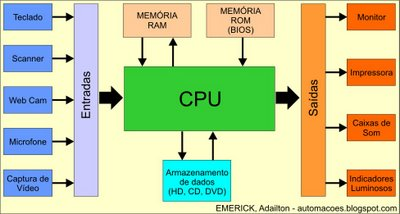
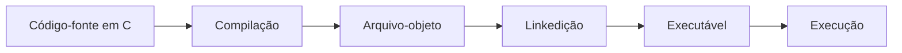

# 1. Introdução à Computação

<p class="texto"> A Computação é uma área do conhecimento dedicada ao estudo e ao desenvolvimento de métodos, técnicas e tecnologias para a coleta, o processamento, o armazenamento e a análise de dados. Seu propósito é transformar dados em informações úteis, contribuindo para a produção de conhecimento e para a resolução de problemas em diferentes contextos da sociedade. Para isso, a Computação envolve a integração de três elementos fundamentais: hardware, que corresponde aos componentes físicos dos dispositivos computacionais; software, que compreende os programas e as instruções responsáveis por orientar o funcionamento desses dispositivos; e dados, que representam os elementos utilizados para produzir informações relevantes.</p>

<p class="texto"> Entre as diversas atividades da Computação, destaca-se o desenvolvimento de sistemas, que consiste na criação de soluções informatizadas para atender às necessidades específicas de pessoas, empresas e outras organizações. Essa atividade envolve diferentes etapas, como a identificação de um problema, o levantamento de requisitos, o planejamento da solução, a elaboração de algoritmos, a implementação de programas, a realização de testes e a manutenção do sistema ao longo de seu ciclo de vida. </p>

<p class="texto"> O principal objetivo do desenvolvimento de sistemas é construir soluções eficientes, confiáveis e funcionais, capazes de automatizar tarefas, otimizar processos, reduzir a ocorrência de erros e facilitar a tomada de decisões. Para alcançar esses resultados, é necessário compreender o problema a ser resolvido e definir procedimentos lógicos que orientem o processamento dos dados e a obtenção dos resultados esperados. </p>

!!! abstract "Exemplo prático: Sistema Acadêmico"
    <p class="texto">Imagine um sistema acadêmico que precisa calcular a média dos estudantes de uma turma. O sistema deverá ser capax de identificar quem atingiu a média mínima e gerar um relatório. Fazer isso manualmente pode funcionar para poucas pessoas, mas fica demorado e sujeito a erros quando a quantidade de registros aumenta. Antes de escrever um programa, precisamos compreender o problema:</p>
    <ul>
      <li><b>Quais dados serão fornecidos?</b> As notas de cada estudante.</li>
      <li><b>O que precisa ser feito?</b> Calcular a média e comparar o resultado com a média mínima.</li>
      <li><b>O que deve ser apresentado?</b> A média e uma indicação do resultado.</li>
      <li><b>Como verificar se a solução funciona?</b> Testar com diferentes notas, inclusive valores inválidos.</li>
    </ul>
    <p class="texto"> Esse raciocínio é parte da resolução de problemas com computadores. Programar não é apenas escrever comandos em uma linguagem: é compreender uma situação, organizar uma solução e verificar se ela atende ao objetivo. </p>

<p class="texto"> Esse exemplo demonstra como os conceitos fundamentais da Computação se relacionam com a programação e o desenvolvimento de sistemas. A partir da compreensão dos problemas e da definição de uma sequência lógica de instruções, é possível construir soluções computacionais capazes de transformar dados em resultados úteis. Essa compreensão constitui uma das bases para o estudo de Algoritmos e Lógica de Programação, disciplina que apresenta os princípios necessários para desenvolver o raciocínio lógico e estruturar soluções que possam ser implementadas em uma linguagem de programação. </p>

## 1.1 Dado, informação e conhecimento

<p class="texto"> Para compreender como os sistemas computacionais contribuem para a resolução de problemas, é necessário entender o papel dos dados no processamento realizado por um computador. Afinal, os sistemas não apenas recebem e armazenam valores: eles executam operações sobre esses dados para produzir resultados que possam ser interpretados e utilizados pelas pessoas. Entretanto, um valor isolado nem sempre possui significado suficiente para orientar uma decisão. É nesse contexto que se torna importante distinguir dado, informação e conhecimento, conceitos fundamentais para compreender como os sistemas transformam registros em resultados úteis e como esses resultados podem apoiar a tomada de decisões.</p>

!!! example "DADO"
    Um **dado** é um registro bruto de um valor ou de uma observação. Isoladamente, ele pode não explicar o que representa. Exemplos:
        - `8.5`
        - `23`
        - `120`
        - `Aprovado`
    O valor `8.5`, por exemplo, poderia representar uma nota, uma temperatura ou uma medida. Sem contexto, não sabemos qual interpretação é adequada.

### Informação

Uma **informação** é obtida quando os dados são organizados e interpretados em um contexto.

Observe:

- Dados: `8.0`, `7.0` e `9.0`.
- Contexto: notas de três avaliações de uma estudante.
- Informação: a média aritmética das avaliações é `8.0`.

O contexto permite entender o significado dos valores.

### Conhecimento

O **conhecimento** envolve interpretar informações e utilizá-las para compreender uma situação ou tomar uma decisão.

Por exemplo:

- Informação: a média da estudante é `8.0`.
- Regra da disciplina: a média mínima para aprovação é `6.0`.
- Conhecimento aplicado: como a média é superior à mínima, a estudante atingiu esse critério de aprovação.

A decisão depende tanto da informação quanto da regra utilizada. Em um sistema real, outras regras institucionais também podem ser necessárias.

!!! abstract "Exemplo resolvido: Sistema de Vendas"
    Uma loja registra que vendeu `12` unidades de um produto cujo preço unitário é `R$ 15,00`.

      1. **Dados de entrada:** quantidade igual a 12 e preço unitário igual a R$ 15,00.
      2. **Processamento:** multiplicar a quantidade pelo preço unitário.
      3. **Informação produzida:** o valor total da venda é R$ 180,00.
      4. **Uso da informação:** a loja pode comparar as vendas de diferentes produtos ou períodos para planejar o estoque.

    A informação não surge por mágica: ela é produzida pela organização e pelo processamento dos dados.

!!! success "Atividade interativa: Classifique os exemplos"
    <p class=texto">Lembre-se que **Dado** é o registro; **informação** é o dado contextualizado; **conhecimento** é a compreensão que ajuda a interpretar e agir. A fronteira entre informação e conhecimento depende do contexto e do uso que se faz deles. Com base nisso, leia cada situação e escolha a classificação mais adequada. Em seguida, confira o feedback.</p>
    <div class="atividade-interativa" id="atividade-dado-info">
      <p><strong>Situação 1.</strong> O registro de uma avaliação contém apenas o valor <code>7,5</code>, sem indicar a que se refere.</p>
      <div class="opcoes-atividade">
        <button type="button" data-correct="true" class="botao">Dado</button>
        <button type="button" data-correct="false" class="botao">Informação</button>
        <button type="button" data-correct="false" class="botao">Conhecimento</button>
      </div>
    <p class="feedback-atividade" aria-live="polite"></p>
    <hr>
      <p><strong>Situação 2.</strong> Um relatório informa que a média de uma estudante foi 8,0.</p>
      <div class="opcoes-atividade">
        <button type="button" data-correct="false" class="botao">Dado isolado</button>
        <button type="button" data-correct="true" class="botao">Informação</button>
        <button type="button" data-correct="false" class="botao">Conhecimento</button>
      </div>
    <p class="feedback-atividade" aria-live="polite"></p>
    <hr>
      <p><strong>Situação 3.</strong> Ao comparar a média 8,0 com a média mínima 6,0, o sistema conclui que o critério de nota foi atingido.</p>
      <div class="opcoes-atividade">
        <button type="button" data-correct="false" class="botao">Dado</button>
        <button type="button" data-correct="false" class="botao">Informação</button>
        <button type="button" data-correct="true" class="botao">Conhecimento </button>
      </div>
    <p class="feedback-atividade" aria-live="polite"></p>
</div>

    
## 1.2 Hardware

<p class="texto"><b>Hardware</b> é a parte física do sistema computacional, ou seja, os componentes que podemos tocar ou que fazem parte fisicamente do equipamento. São exemplos de hardware: processador, memória, unidade de armazenamento, câmera, microfone, sensores, teclado, mouse e monitor, entre outros. </p>

## 1.3 Software

<p class="texto"><b>Software</b> é o conjunto de programas, instruções e dados que orientam as operações realizadas pelo computador. Sistema operacional, compilador, navegador, aplicativos de mensagens e editor de código são exemplos de software. </p>

## 1.4 Funcionamento de um computador 

<p class="texto"> O hardware oferece os recursos físicos. O software utiliza esses recursos para realizar tarefas. Um aplicativo não funciona sem uma plataforma computacional capaz de executá-lo; da mesma forma, um computador sem programas não realiza automaticamente a tarefa específica que o usuário deseja. </p>

<p class="texto">  Um computador funciona recebendo dados, processando essas informações por meio de instruções lógicas e devolvendo um resultado. Esse ciclo básico é dividido em quatro etapas principais: entrada, processamento, armazenamento e saída. </p>



<p class="texto"> O diagrama representa um modelo simplificado. A comunicação real entre os componentes depende da arquitetura do equipamento, do sistema operacional e do programa utilizado. </p>

!!! abstract "Exemplo do cotidiano: Enviar mensagem"
    <p class="texto">Ao digitar uma mensagem em um celular:</p>
    <ol>
     <li>O teclado físico ou virtual recebe a interação do usuário.</li>
     <li>O aplicativo interpreta as teclas selecionadas.</li>
     <li>O processador executa as instruções do aplicativo e do sistema operacional.</li>
     <li>A tela apresenta o texto.</li>
     <li>Ao salvar ou enviar a mensagem, outros componentes e serviços podem participar do processo.</li>
    <p class="texto">Esse exemplo mostra que hardware e software não são concorrentes: eles trabalham em conjunto.</p>

!!! success "Atividade interativa: Classifique os exemplos"
    Classifique cada item como hardware ou software.
    <div class="atividade-interativa" id="atividade-hardware-software">
      <p><strong>1. Memória RAM</strong></p>
      <div class="opcoes-atividade">
        <button type="button" data-correct="true" class="botao">Hardware</button>
        <button type="button" data-correct="false" class="botao">Software</button>
      </div>
      <p class="feedback-atividade" aria-live="polite"></p>
      <p><strong>2. Navegador de internet</strong></p>
      <div class="opcoes-atividade">
        <button type="button" data-correct="false" class="botao">Hardware</button>
        <button type="button" data-correct="true" class="botao">Software</button>
      </div>
      <p class="feedback-atividade" aria-live="polite"></p>
      <p><strong>3. SSD</strong></p>
      <div class="opcoes-atividade">
        <button type="button" data-correct="true" class="botao">Hardware</button>
        <button type="button" data-correct="false" class="botao">Software</button>
      </div>
      <p class="feedback-atividade" aria-live="polite"></p>
    </div>

## 1.5 Componentes básicos de um sistema computacional

Para entender como um programa funciona, é útil conhecer alguns componentes do computador.

### CPU — Unidade Central de Processamento

A **CPU** executa instruções e coordena operações do sistema. Ela participa de cálculos, comparações e movimentação de dados entre componentes. Uma analogia possível é a de uma cozinha: a CPU executa as etapas de uma receita, mas depende dos ingredientes, dos utensílios e das instruções disponíveis. A analogia ajuda a visualizar a relação entre componentes, mas não descreve literalmente o funcionamento eletrônico do processador.

### Memória RAM

A **memória RAM** guarda temporariamente dados e instruções que estão sendo utilizados. Ela permite acesso rápido às informações necessárias aos programas em execução. 
A RAM é volátil: normalmente, seu conteúdo não é preservado quando o equipamento é desligado.

### Disco rígido

Um SSD ou HD — mantém arquivos e programas mesmo quando o equipamento está desligado, desde que não haja falha ou exclusão dos dados. RAM e disco rígido cumprem funções diferentes. Ter mais armazenamento significa poder guardar mais dados; ter mais RAM pode ajudar a manter mais programas e dados de trabalho disponíveis ao mesmo tempo.

### Dispositivos de entrada

São os recursos utilizados para enviar dados ou comandos ao computador.

Exemplos:

- teclado;
- mouse;
- câmera;
- microfone;
- leitor de código de barras;
- sensores.

### Dispositivos de saída

São os recursos que apresentam resultados do processamento.

Exemplos:

- monitor;
- impressora;
- alto-falantes;
- projetor.

Um mesmo equipamento pode desempenhar mais de uma função. Uma tela sensível ao toque, por exemplo, pode apresentar informações e receber interações do usuário.

### Quadro comparativo

| Componente | Função principal | Exemplo |
|---|---|---|
| CPU | Executar instruções e coordenar operações | Processador do computador |
| RAM | Manter temporariamente dados em uso | Memória principal |
| Armazenamento | Preservar programas e arquivos | SSD |
| Entrada | Receber dados ou comandos | Teclado |
| Saída | Apresentar resultados | Monitor |

### Exemplo resolvido: abrir um arquivo

Ao abrir um documento salvo no computador:

1. O usuário seleciona o arquivo por meio de um dispositivo de entrada.
2. O sistema solicita os dados ao dispositivo de armazenamento.
3. O programa que abre o documento utiliza a CPU e a RAM para processar e manter os dados necessários.
4. O monitor apresenta o conteúdo ao usuário.

Esse é um modelo simplificado para fins didáticos. Na prática, o sistema operacional e outros componentes participam dessas etapas.

### Atividade: associe o componente à função

<div class="atividade-interativa" id="atividade-componentes">
  <p>Escolha o componente correspondente a cada descrição.</p>
  <label for="comp1">1. Mantém temporariamente dados utilizados pelos programas.</label>
  <select id="comp1">
    <option value="">Selecione...</option>
    <option value="cpu">CPU</option>
    <option value="ram">Memória RAM</option>
    <option value="ssd">Armazenamento SSD</option>
    <option value="monitor">Monitor</option>
  </select>
  <label for="comp2">2. Preserva arquivos mesmo após desligar o computador.</label>
  <select id="comp2">
    <option value="">Selecione...</option>
    <option value="cpu">CPU</option>
    <option value="ram">Memória RAM</option>
    <option value="ssd">Armazenamento SSD</option>
    <option value="monitor">Monitor</option>
  </select>
  <label for="comp3">3. Executa instruções e realiza operações.</label>
  <select id="comp3">
    <option value="">Selecione...</option>
    <option value="cpu">CPU</option>
    <option value="ram">Memória RAM</option>
    <option value="ssd">Armazenamento SSD</option>
    <option value="monitor">Monitor</option>
  </select>
  <button type="button" id="corrigir-componentes">Conferir respostas</button>
  <p class="feedback-atividade" id="feedback-componentes" aria-live="polite"></p>
</div>

!!! tip "Dica de estudo"
    Se você confundir RAM e armazenamento, lembre-se desta pergunta: “O que está sendo utilizado agora?” remete frequentemente à RAM; “O que precisa continuar guardado depois que eu desligar?” remete ao armazenamento.

## 1.6 Linguagens de programação e compilação

Um computador executa instruções representadas de acordo com sua arquitetura. As linguagens de programação permitem que pessoas expressem essas instruções por meio de regras e estruturas definidas.

### Código-fonte

O **código-fonte** é o texto escrito pelo programador em uma linguagem de programação, como C. Ele deve respeitar as regras da linguagem.

Exemplo em C:

```c
#include <stdio.h>

int main(void) {
    printf("Olá, mundo!\n");
    return 0;
}
```

Esse programa apresenta a mensagem `Olá, mundo!` e termina indicando que a execução foi concluída normalmente.

### Compilador

Um **compilador** é um programa que traduz o código-fonte para uma representação que pode ser processada nas etapas seguintes de construção do programa. Em ambientes comuns de C, o processo pode gerar arquivos-objeto e, depois, um executável por meio da ligação (*linkedição*).

O fluxo simplificado é:



As etapas exatas variam conforme o compilador e o ambiente de desenvolvimento. Alguns ambientes escondem parte delas do usuário.

### Tipos de problemas em um programa

É importante distinguir problemas diferentes.

**Erro de sintaxe:** ocorre quando o código não respeita as regras gramaticais da linguagem.

```c
#include <stdio.h>

int main(void) {
    printf("Olá, mundo!\n"
    return 0;
}
```

Nesse exemplo, falta fechar a chamada de `printf` com `);`. O compilador normalmente informa um erro, embora a mensagem possa apontar para a linha em que o problema foi percebido, e não exatamente onde começou.

**Erro de lógica:** o programa pode compilar e executar, mas produzir um resultado diferente do esperado.

```c
int largura = 5;
int altura = 3;
int area = largura + altura; /* incorreto para calcular a área */
```

Para calcular a área de um retângulo, a operação correta é `largura * altura`. A soma é uma expressão válida em C, mas não representa a fórmula desejada.

**Problema nos dados de entrada:** mesmo com uma fórmula correta, valores inadequados podem levar a resultados sem sentido. Um cálculo de preço, por exemplo, pode precisar rejeitar quantidades negativas ou descontos fora dos limites definidos pelo problema.

!!! warning "Compilar não significa provar que o programa está correto"
    A compilação verifica aspectos do código e pode encontrar diversos problemas, mas não garante que o algoritmo atenda ao objetivo. Por isso, é necessário testar o programa com valores variados e conferir os resultados esperados.

### Atividade interativa: identifique o problema

<div class="atividade-interativa" id="atividade-erros">
  <p><strong>Situação 1.</strong> O programa não compila porque falta um ponto e vírgula após uma instrução.</p>
  <div class="opcoes-atividade">
    <button type="button" data-correct="true">Erro de sintaxe</button>
    <button type="button" data-correct="false">Erro de lógica</button>
    <button type="button" data-correct="false">Dispositivo de saída</button>
  </div>
  <p class="feedback-atividade" aria-live="polite"></p>
  <hr>
  <p><strong>Situação 2.</strong> O programa compila, mas calcula a área de um retângulo somando a largura e a altura.</p>
  <div class="opcoes-atividade">
    <button type="button" data-correct="false">Erro de sintaxe</button>
    <button type="button" data-correct="true">Erro de lógica</button>
    <button type="button" data-correct="false">Erro de hardware</button>
  </div>
  <p class="feedback-atividade" aria-live="polite"></p>
</div>

## 1.7 Decomposição de problemas

Um problema complexo pode ficar mais fácil de resolver quando é dividido em etapas menores. Essa estratégia é chamada de **decomposição**. Uma forma inicial de organizar muitos problemas computacionais é identificar:

- **Entrada:** quais dados serão fornecidos?
- **Processamento:** quais cálculos ou regras serão aplicados?
- **Saída:** quais resultados deverão ser apresentados?

Esse modelo é uma ferramenta de planejamento. Alguns sistemas também precisam armazenar dados, interagir com outros sistemas, validar informações e tratar situações excepcionais.

### Exemplo resolvido 1: calcular o total de uma compra

**Problema:** calcular o valor de uma compra sabendo a quantidade de unidades e o preço de cada unidade.

**Etapa 1 — Entrada**

- quantidade de unidades;
- preço unitário.

**Etapa 2 — Processamento**

Multiplicar a quantidade pelo preço unitário:

\[
\text{total} = \text{quantidade} \times \text{preço unitário}
\]

**Etapa 3 — Saída**

Apresentar o valor total da compra.

**Teste com valores conhecidos**

Se a quantidade for 4 e o preço unitário for R$ 7,50:

\[
\text{total} = 4 \times 7{,}50 = 30{,}00
\]

O resultado esperado é R$ 30,00.

### Exemplo resolvido 2: calcular a distância percorrida

Um veículo mantém velocidade média constante de 60 km/h durante 2 horas. A distância pode ser calculada por:

\[
\text{distância} = \text{velocidade} \times \text{tempo}
\]

Substituindo os valores:

\[
\text{distância} = 60 \times 2 = 120\text{ km}
\]

- **Entrada:** velocidade média e tempo.
- **Processamento:** multiplicar velocidade por tempo.
- **Saída:** distância calculada.

**Atenção às unidades:** se a velocidade estiver em km/h, o tempo deve estar em horas para que o resultado seja expresso em quilômetros.

### Exemplo resolvido 3: aplicar um desconto

Uma loja precisa calcular o preço final de um produto após um desconto percentual.

- **Entrada:** preço original e percentual de desconto.
- **Processamento:** calcular o desconto e subtraí-lo do preço original.
- **Saída:** preço final.

As fórmulas são:

\[
\text{valor do desconto} = \text{preço original} \times \frac{\text{percentual}}{100}
\]

\[
\text{preço final} = \text{preço original} - \text{valor do desconto}
\]

Se o preço original for R$ 200,00 e o desconto for 10%:

\[
\text{desconto} = 200 \times \frac{10}{100} = 20
\]

\[
\text{preço final} = 200 - 20 = 180
\]

O preço final será R$ 180,00. Antes de implementar a solução, também precisamos decidir quais entradas são válidas, como um preço não negativo e um percentual entre 0 e 100, caso essas sejam as regras do problema.

### Laboratório interativo: decomponha um problema

Escolha um problema e observe suas entradas, seu processamento e suas saídas.

<div class="atividade-interativa" id="laboratorio-decomposicao">
  <label for="problema-decomposicao">Problema</label>
  <select id="problema-decomposicao">
    <option value="compra">Calcular o total de uma compra</option>
    <option value="retangulo">Calcular a área de um retângulo</option>
    <option value="combustivel">Calcular o consumo médio de combustível</option>
  </select>
  <div class="resultado-decomposicao" id="resultado-decomposicao" aria-live="polite">
    <p><strong>Entrada:</strong> quantidade e preço unitário.</p>
    <p><strong>Processamento:</strong> quantidade × preço unitário.</p>
    <p><strong>Saída:</strong> valor total da compra.</p>
  </div>
</div>

### Testar antes de programar

Uma solução deve ser testada com mais de um conjunto de dados. Para o cálculo do desconto, por exemplo, podemos considerar:

| Preço original | Desconto | Resultado esperado |
|---:|---:|---:|
| R$ 100,00 | 0% | R$ 100,00 |
| R$ 100,00 | 10% | R$ 90,00 |
| R$ 200,00 | 25% | R$ 150,00 |
| R$ 50,00 | 100% | R$ 0,00 |

Também é importante testar entradas inválidas, como preço negativo ou desconto maior que 100%, quando as regras do sistema não permitirem esses valores.

## 1.6 Pensamento computacional

- **Decomposição:** dividir o problema em partes menores.
- **Reconhecimento de padrões:** identificar semelhanças entre problemas.
- **Abstração:** concentrar-se no que é relevante.
- **Algoritmos:** definir uma sequência finita e ordenada de passos.

!!! warning "Erros comuns: atenção a estes pontos"

    - começar a programar sem compreender o enunciado;
    - confundir armazenamento permanente com memória RAM;
    - acreditar que compilar significa que o algoritmo está correto;
    - ignorar unidades e restrições dos dados.

!!! tip "Prática guiada"

    Planeje um programa que calcule o valor final de um produto após um desconto percentual. Não escreva código ainda. Identifique entrada, processamento, saída e duas situações que precisam ser testadas.


## 1.6 Pensamento computacional

**Pensamento computacional** é uma abordagem para formular e resolver problemas de forma organizada, utilizando estratégias que também podem ser expressas por algoritmos e executadas por computadores. Ele pode ser aplicado à programação, mas também a situações cotidianas.

Quatro pilares frequentemente utilizados para explicar essa abordagem são decomposição, reconhecimento de padrões, abstração e algoritmos.

### 1. Decomposição

Consiste em dividir um problema maior em partes menores que possam ser compreendidas e resolvidas.

**Exemplo:** para desenvolver um sistema de biblioteca, podemos separar o problema em cadastro de livros, cadastro de usuários, empréstimos, devoluções e relatórios.

### 2. Reconhecimento de padrões

Consiste em identificar semelhanças ou regularidades entre problemas ou situações.

**Exemplo:** calcular o total de uma compra de vários produtos e calcular o custo de várias passagens envolvem multiplicações e somas semelhantes. Reconhecer essa estrutura ajuda a reaproveitar estratégias.

### 3. Abstração

Consiste em selecionar os detalhes relevantes para o problema e deixar de lado os que não influenciam a solução naquele momento.

**Exemplo:** para calcular a área de um retângulo, precisamos de sua largura e altura. A cor do retângulo não interfere nesse cálculo e pode ser ignorada.

A abstração não significa que os detalhes descartados nunca sejam importantes. Eles podem ser necessários para outro objetivo.

### 4. Algoritmos

Um **algoritmo** é uma sequência finita e ordenada de passos para realizar uma tarefa ou resolver um problema. Os passos precisam ser suficientemente claros para que possam ser executados e verificados.

Exemplo de algoritmo cotidiano para preparar uma bebida:

1. Separar os ingredientes e utensílios.
2. Colocar a quantidade definida de água no recipiente.
3. Aquecer a água.
4. Misturar os ingredientes conforme as instruções.
5. Servir a bebida.

Em programação, o algoritmo precisa ser adaptado às regras do problema e representado de forma adequada, por exemplo, em pseudocódigo, fluxograma ou linguagem de programação.

### Os quatro pilares trabalhando juntos

Considere o problema de calcular as médias de uma turma:

1. **Decomposição:** separar a leitura das notas, o cálculo da média, a verificação do critério e a apresentação do resultado.
2. **Reconhecimento de padrões:** perceber que a mesma operação de cálculo será repetida para cada estudante.
3. **Abstração:** concentrar-se nas notas e nas regras de média, sem considerar informações irrelevantes para esse cálculo.
4. **Algoritmo:** organizar os passos em uma sequência que possa ser executada.

Os pilares se complementam. Não precisam ser aplicados como etapas rígidas e isoladas: durante a resolução, podemos voltar a uma etapa anterior e melhorar nossa compreensão do problema.

### Atividade interativa: qual pilar está sendo utilizado?

<div class="atividade-interativa" id="atividade-pilares">
  <p><strong>Situação 1.</strong> Separar um sistema escolar em cadastro, notas, frequência e relatórios.</p>
  <div class="opcoes-atividade">
    <button type="button" data-correct="true">Decomposição</button>
    <button type="button" data-correct="false">Abstração</button>
    <button type="button" data-correct="false">Reconhecimento de padrões</button>
    <button type="button" data-correct="false">Algoritmos</button>
  </div>
  <p class="feedback-atividade" aria-live="polite"></p>
  <hr>
  <p><strong>Situação 2.</strong> Ignorar a cor de um retângulo ao calcular sua área.</p>
  <div class="opcoes-atividade">
    <button type="button" data-correct="false">Decomposição</button>
    <button type="button" data-correct="true">Abstração</button>
    <button type="button" data-correct="false">Reconhecimento de padrões</button>
    <button type="button" data-correct="false">Algoritmos</button>
  </div>
  <p class="feedback-atividade" aria-live="polite"></p>
  <hr>
  <p><strong>Situação 3.</strong> Perceber que diferentes cálculos de preço final utilizam operações semelhantes.</p>
  <div class="opcoes-atividade">
    <button type="button" data-correct="false">Decomposição</button>
    <button type="button" data-correct="false">Abstração</button>
    <button type="button" data-correct="true">Reconhecimento de padrões</button>
    <button type="button" data-correct="false">Algoritmos</button>
  </div>
  <p class="feedback-atividade" aria-live="polite"></p>
  <hr>
  <p><strong>Situação 4.</strong> Organizar instruções finitas e ordenadas para calcular uma média.</p>
  <div class="opcoes-atividade">
    <button type="button" data-correct="false">Decomposição</button>
    <button type="button" data-correct="false">Abstração</button>
    <button type="button" data-correct="false">Reconhecimento de padrões</button>
    <button type="button" data-correct="true">Algoritmos</button>
  </div>
  <p class="feedback-atividade" aria-live="polite"></p>
</div>

## Erros comuns: atenção a estes pontos

!!! warning "Começar a programar antes de entender o problema"
    **Por que atrapalha:** você pode produzir um código que executa, mas não resolve a necessidade real.

    **Como evitar:** escreva o objetivo, as entradas, as regras de processamento e as saídas antes de escolher os comandos.

!!! warning "Confundir memória RAM com armazenamento"
    **Por que atrapalha:** os componentes têm funções diferentes.

    **Como evitar:** lembre-se de que a RAM mantém temporariamente dados em uso, enquanto SSDs e HDs são utilizados para preservar arquivos.

!!! warning "Acreditar que compilar garante a correção"
    **Por que atrapalha:** um programa pode ser sintaticamente válido e produzir resultados incorretos.

    **Como evitar:** teste valores simples cujo resultado você consegue calcular manualmente e compare a saída com o resultado esperado.

!!! warning "Ignorar unidades e limites"
    **Por que atrapalha:** misturar horas e minutos, por exemplo, pode levar a cálculos incorretos; entradas fora das regras também podem gerar resultados inválidos.

    **Como evitar:** registre as unidades, defina os limites aceitos e teste casos comuns e casos extremos.

## Prática guiada: planeje uma solução

### Desafio — preço com desconto

Uma loja quer um programa que receba o preço original de um produto e o percentual de desconto e apresente o preço final.

Antes de escrever código, complete o planejamento.

<div class="atividade-interativa" id="pratica-desconto">
  <label for="entrada-desconto">Quais são os dados de entrada?</label>
  <textarea id="entrada-desconto" rows="2" placeholder="Ex.: preço original e percentual de desconto"></textarea>
  <label for="processamento-desconto">Qual processamento deve ser realizado?</label>
  <textarea id="processamento-desconto" rows="2" placeholder="Descreva os cálculos necessários"></textarea>
  <label for="saida-desconto">Qual é a saída esperada?</label>
  <textarea id="saida-desconto" rows="2" placeholder="O que o programa deve apresentar?"></textarea>
  <label for="testes-desconto">Indique dois testes para verificar a solução.</label>
  <textarea id="testes-desconto" rows="3" placeholder="Informe os valores de entrada e os resultados esperados"></textarea>
  <details>
    <summary>Mostrar uma possível resposta</summary>
    <p><strong>Entrada:</strong> preço original e percentual de desconto.</p>
    <p><strong>Processamento:</strong> calcular o desconto multiplicando o preço pelo percentual dividido por 100; subtrair o desconto do preço original.</p>
    <p><strong>Saída:</strong> preço final após o desconto.</p>
    <p><strong>Teste 1:</strong> preço de R$ 100,00 e desconto de 10%; resultado esperado R$ 90,00.</p>
    <p><strong>Teste 2:</strong> preço de R$ 80,00 e desconto de 0%; resultado esperado R$ 80,00.</p>
    <p>Também seria adequado testar entradas inválidas, conforme as regras definidas para o sistema.</p>
  </details>
</div>

## Exercícios

[Acesse os exercícios desta introdução.](01-exercicios.md)

