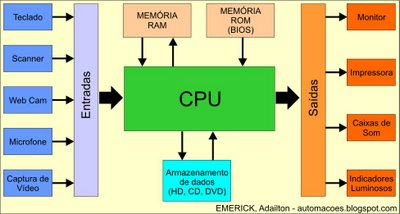

# 1. Introdução à Computação

 A Computação é uma área do conhecimento dedicada ao estudo e ao desenvolvimento de métodos, técnicas e tecnologias para a coleta, o processamento, o armazenamento e a análise de dados. Seu propósito é transformar dados em informações úteis, contribuindo para a produção de conhecimento e para a resolução de problemas em diferentes contextos da sociedade. Para isso, a Computação envolve a integração de três elementos fundamentais: hardware, que corresponde aos componentes físicos dos dispositivos computacionais; software, que compreende os programas e as instruções responsáveis por orientar o funcionamento desses dispositivos; e dados, que representam os elementos utilizados para produzir informações relevantes.

 Entre as diversas atividades da Computação, destaca-se o desenvolvimento de sistemas, que consiste na criação de soluções informatizadas para atender às necessidades específicas de pessoas, empresas e outras organizações. Essa atividade envolve diferentes etapas, como a identificação de um problema, o levantamento de requisitos, o planejamento da solução, a elaboração de algoritmos, a implementação de programas, a realização de testes e a manutenção do sistema ao longo de seu ciclo de vida. 

 O principal objetivo do desenvolvimento de sistemas é construir soluções eficientes, confiáveis e funcionais, capazes de automatizar tarefas, otimizar processos, reduzir a ocorrência de erros e facilitar a tomada de decisões. Para alcançar esses resultados, é necessário compreender o problema a ser resolvido e definir procedimentos lógicos que orientem o processamento dos dados e a obtenção dos resultados esperados. 

!!! example "Exemplo prático: Sistema Acadêmico"
    
Imagine um sistema acadêmico que precisa calcular a média dos estudantes de uma turma. O sistema deverá ser capax de identificar quem atingiu a média mínima e gerar um relatório. Fazer isso manualmente pode funcionar para poucas pessoas, mas fica demorado e sujeito a erros quando a quantidade de registros aumenta. Antes de escrever um programa, precisamos compreender o problema:

    <ul>
      <li><b>Quais dados serão fornecidos?</b> As notas de cada estudante.</li>
      <li><b>O que precisa ser feito?</b> Calcular a média e comparar o resultado com a média mínima.</li>
      <li><b>O que deve ser apresentado?</b> A média e uma indicação do resultado.</li>
      <li><b>Como verificar se a solução funciona?</b> Testar com diferentes notas, inclusive valores inválidos.</li>
    </ul>
    
 Esse raciocínio é parte da resolução de problemas com computadores. Programar não é apenas escrever comandos em uma linguagem: é compreender uma situação, organizar uma solução e verificar se ela atende ao objetivo. 

 Esse exemplo demonstra como os conceitos fundamentais da Computação se relacionam com a programação e o desenvolvimento de sistemas. A partir da compreensão dos problemas e da definição de uma sequência lógica de instruções, é possível construir soluções computacionais capazes de transformar dados em resultados úteis. Essa compreensão constitui uma das bases para o estudo de Algoritmos e Lógica de Programação, disciplina que apresenta os princípios necessários para desenvolver o raciocínio lógico e estruturar soluções que possam ser implementadas em uma linguagem de programação. 

## 1.1 Dado, informação e conhecimento

 Para compreender como os sistemas computacionais contribuem para a resolução de problemas, é necessário entender o papel dos dados no processamento realizado por um computador. Afinal, os sistemas não apenas recebem e armazenam valores: eles executam operações sobre esses dados para produzir resultados que possam ser interpretados e utilizados pelas pessoas. Entretanto, um valor isolado nem sempre possui significado suficiente para orientar uma decisão. É nesse contexto que se torna importante distinguir dado, informação e conhecimento, conceitos fundamentais para compreender como os sistemas transformam registros em resultados úteis e como esses resultados podem apoiar a tomada de decisões.

!!! example "DADO"
    
 Um **dado** é um registro bruto de um valor ou de uma observação. Isoladamente, ele pode não explicar o que representa. Exemplos: `8.5`, `23`, `120` ou `Aprovado`. O valor `8.5`, por exemplo, poderia representar uma nota, uma temperatura ou uma medida. Sem contexto, não sabemos qual interpretação é adequada.

!!! example "INFORMAÇÃO"
     
Uma **informação** é obtida quando os dados são organizados e interpretados em um contexto. Observe:
    - Dados: `8.0`, `7.0` e `9.0`.
    - Contexto: notas de três avaliações de uma estudante.
    - Informação: a média aritmética das avaliações é `8.0`.
    O contexto permite entender o significado dos valores.

!!! example "CONHECIMENTO"
     
O **conhecimento** envolve interpretar informações e utilizá-las para compreender uma situação ou tomar uma decisão. Por exemplo:
    - Informação: a média da estudante é `8.0`.
    - Regra da disciplina: a média mínima para aprovação é `6.0`.
    - Conhecimento aplicado: como a média é superior à mínima, a estudante atingiu esse critério de aprovação.
    A decisão depende tanto da informação quanto da regra utilizada. Em um sistema real, outras regras institucionais também podem ser necessárias.

 
Com base nos conceitos vistos, suponha que uma loja registra que vendeu '12' unidades de um produto cujo preço unitário é 'R$ 15.00'. Nesse exemplo,  nós temos podemos classificar a quantidade igual a 12 e o preço unitário a R$ 15,00 como dados de entrada. Para o processamento, será necessário multiplicar a quantidade pelo preço unitário. A informação produzida será o valor total da venda, sendo este igual a R

!!! abstract "Exemplo resolvido: Sistema de Vendas"
    Uma loja registra que vendeu `12` unidades de um produto cujo preço unitário é `R$ 15,00`.

      1. **Dados de entrada:** quantidade igual a 12 e preço unitário igual a R$ 15,00.
      2. **Processamento:** multiplicar a quantidade pelo preço unitário.
      3. **Informação produzida:** o valor total da venda é R$ 180,00.
      4. **Uso da informação:** a loja pode comparar as vendas de diferentes produtos ou períodos para planejar o estoque.

    A informação não surge por mágica: ela é produzida pela organização e pelo processamento dos dados.

!!! success "Atividade interativa: Classifique os exemplos"
    
Lembre-se que **Dado** é o registro; **informação** é o dado contextualizado; **conhecimento** é a compreensão que ajuda a interpretar e agir. A fronteira entre informação e conhecimento depende do contexto e do uso que se faz deles. Com base nisso, leia cada situação e escolha a classificação mais adequada. Em seguida, confira o feedback.

    

      
<strong>Situação 1.</strong> O registro de uma avaliação contém apenas o valor <code>7,5</code>, sem indicar a que se refere.

      

        <button type="button" data-correct="true" class="botao">Dado</button>
        <button type="button" data-correct="false" class="botao">Informação</button>
        <button type="button" data-correct="false" class="botao">Conhecimento</button>
      

    

    

      
<strong>Situação 2.</strong> Um relatório informa que a média de uma estudante foi 8,0.

      

        <button type="button" data-correct="false" class="botao">Dado isolado</button>
        <button type="button" data-correct="true" class="botao">Informação</button>
        <button type="button" data-correct="false" class="botao">Conhecimento</button>
      

    

    

      
<strong>Situação 3.</strong> Ao comparar a média 8,0 com a média mínima 6,0, o sistema conclui que o critério de nota foi atingido.

      

        <button type="button" data-correct="false" class="botao">Dado</button>
        <button type="button" data-correct="false" class="botao">Informação</button>
        <button type="button" data-correct="true" class="botao">Conhecimento </button>
      

    

    
## 1.2 Hardware

<b>Hardware</b> é a parte física do sistema computacional, ou seja, os componentes que podemos tocar ou que fazem parte fisicamente do equipamento. São exemplos de hardware: processador, memória, unidade de armazenamento, câmera, microfone, sensores, teclado, mouse e monitor, entre outros. 

## 1.3 Software

<b>Software</b> é o conjunto de programas, instruções e dados que orientam as operações realizadas pelo computador. Sistema operacional, compilador, navegador, aplicativos de mensagens e editor de código são exemplos de software. 

## 1.4 Funcionamento de um computador 

 O hardware oferece os recursos físicos. O software utiliza esses recursos para realizar tarefas. Um aplicativo não funciona sem uma plataforma computacional capaz de executá-lo; da mesma forma, um computador sem programas não realiza automaticamente a tarefa específica que o usuário deseja. 

  Um computador funciona recebendo dados, processando essas informações por meio de instruções lógicas e devolvendo um resultado. Esse ciclo básico é dividido em quatro etapas principais: entrada, processamento, armazenamento e saída. 

 O diagrama representa um modelo simplificado. A comunicação real entre os componentes depende da arquitetura do equipamento, do sistema operacional e do programa utilizado. 

!!! abstract "Exemplo do cotidiano: Enviar mensagem"
    
Ao digitar uma mensagem em um celular:

    <ol>
     <li>O teclado físico ou virtual recebe a interação do usuário.</li>
     <li>O aplicativo interpreta as teclas selecionadas.</li>
     <li>O processador executa as instruções do aplicativo e do sistema operacional.</li>
     <li>A tela apresenta o texto.</li>
     <li>Ao salvar ou enviar a mensagem, outros componentes e serviços podem participar do processo.</li>
    
Esse exemplo mostra que hardware e software não são concorrentes: eles trabalham em conjunto.

!!! success "Atividade interativa: Classifique os exemplos"
    Classifique cada item como hardware ou software.
    

      
<strong>1. Memória RAM</strong>

      

        <button type="button" data-correct="true" class="botao">Hardware</button>
        <button type="button" data-correct="false" class="botao">Software</button>
      

      

      
<strong>2. Navegador de internet</strong>

      

        <button type="button" data-correct="false" class="botao">Hardware</button>
        <button type="button" data-correct="true" class="botao">Software</button>
      

      

      
<strong>3. SSD</strong>

      

        <button type="button" data-correct="true" class="botao">Hardware</button>
        <button type="button" data-correct="false" class="botao">Software</button>
      

      

    

## 1.5 Componentes básicos de um sistema computacional

Para entender como um programa funciona, é útil conhecer alguns componentes do computador.

### CPU — Unidade Central de Processamento

A **CPU** executa instruções e coordena operações do sistema. Ela participa de cálculos, comparações e movimentação de dados entre componentes. Uma analogia possível é a de uma cozinha: a CPU executa as etapas de uma receita, mas depende dos ingredientes, dos utensílios e das instruções disponíveis. A analogia ajuda a visualizar a relação entre componentes, mas não descreve literalmente o funcionamento eletrônico do processador.

### Memória RAM

A **memória RAM** guarda temporariamente dados e instruções que estão sendo utilizados. Ela permite acesso rápido às informações necessárias aos programas em execução. 
A RAM é volátil: normalmente, seu conteúdo não é preservado quando o equipamento é desligado.

### Disco rígido

Um SSD ou HD — mantém arquivos e programas mesmo quando o equipamento está desligado, desde que não haja falha ou exclusão dos dados. RAM e disco rígido cumprem funções diferentes. Ter mais armazenamento significa poder guardar mais dados; ter mais RAM pode ajudar a manter mais programas e dados de trabalho disponíveis ao mesmo tempo.

### Dispositivos de entrada

São os recursos utilizados para enviar dados ou comandos ao computador.

Exemplos:

- teclado;
- mouse;
- câmera;
- microfone;
- leitor de código de barras;
- sensores.

### Dispositivos de saída

São os recursos que apresentam resultados do processamento.

Exemplos:

- monitor;
- impressora;
- alto-falantes;
- projetor.

Um mesmo equipamento pode desempenhar mais de uma função. Uma tela sensível ao toque, por exemplo, pode apresentar informações e receber interações do usuário.

### Quadro comparativo

| Componente | Função principal | Exemplo |
|---|---|---|
| CPU | Executar instruções e coordenar operações | Processador do computador |
| RAM | Manter temporariamente dados em uso | Memória principal |
| Armazenamento | Preservar programas e arquivos | SSD |
| Entrada | Receber dados ou comandos | Teclado |
| Saída | Apresentar resultados | Monitor |

### Exemplo resolvido: abrir um arquivo

Ao abrir um documento salvo no computador:

1. O usuário seleciona o arquivo por meio de um dispositivo de entrada.
2. O sistema solicita os dados ao dispositivo de armazenamento.
3. O programa que abre o documento utiliza a CPU e a RAM para processar e manter os dados necessários.
4. O monitor apresenta o conteúdo ao usuário.

Esse é um modelo simplificado para fins didáticos. Na prática, o sistema operacional e outros componentes participam dessas etapas.

### Atividade: associe o componente à função

  
Escolha o componente correspondente a cada descrição.

  <label for="comp1">1. Mantém temporariamente dados utilizados pelos programas.</label>
  <select id="comp1">
    <option value="">Selecione...</option>
    <option value="cpu">CPU</option>
    <option value="ram">Memória RAM</option>
    <option value="ssd">Armazenamento SSD</option>
    <option value="monitor">Monitor</option>
  </select>
  <label for="comp2">2. Preserva arquivos mesmo após desligar o computador.</label>
  <select id="comp2">
    <option value="">Selecione...</option>
    <option value="cpu">CPU</option>
    <option value="ram">Memória RAM</option>
    <option value="ssd">Armazenamento SSD</option>
    <option value="monitor">Monitor</option>
  </select>
  <label for="comp3">3. Executa instruções e realiza operações.</label>
  <select id="comp3">
    <option value="">Selecione...</option>
    <option value="cpu">CPU</option>
    <option value="ram">Memória RAM</option>
    <option value="ssd">Armazenamento SSD</option>
    <option value="monitor">Monitor</option>
  </select>
  <button type="button" id="corrigir-componentes">Conferir respostas</button>
  

!!! tip "Dica de estudo"
    Se você confundir RAM e armazenamento, lembre-se desta pergunta: “O que está sendo utilizado agora?” remete frequentemente à RAM; “O que precisa continuar guardado depois que eu desligar?” remete ao armazenamento.

## Exercícios

[Acesse os exercícios desta introdução.](01-exercicios.md)

