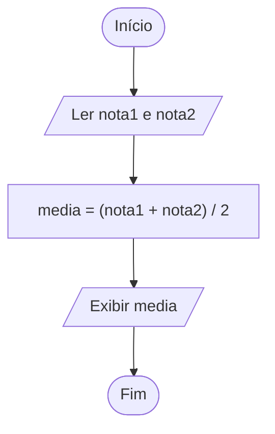

# 2. Algoritmos e Fluxogramas

## Abertura

Um algoritmo é um plano de solução. Ele deve ser claro o suficiente para que outra pessoa consiga seguir seus passos e verificar o resultado.

!!! abstract "Objetivos de aprendizagem"

    - definir algoritmo e suas propriedades;
    - representar soluções em linguagem natural, pseudocódigo e fluxograma;
    - identificar entrada, processamento e saída;
    - simular um algoritmo com teste de mesa.

## 2.1 Propriedades desejáveis

Um algoritmo deve ter passos precisos, sequência lógica, término para as entradas previstas e resultados coerentes. A solução também deve considerar restrições e casos especiais.

## 2.2 Representações

| Representação | Vantagem | Limitação |
|---|---|---|
| Linguagem natural | Fácil de ler | Pode ser ambígua |
| Pseudocódigo | Estruturado e independente de linguagem | Convenções podem variar |
| Fluxograma | Evidencia o fluxo | Diagramas grandes ficam difíceis de manter |
| Código | Pode ser compilado/executado | Depende da sintaxe da linguagem |

## 2.3 Entrada, processamento e saída

Exemplo: calcular a média de duas notas.

```text
Leia nota1
Leia nota2
media <- (nota1 + nota2) / 2
Escreva media
```

## 2.4 Fluxogramas

Símbolos usuais: oval para início/fim, paralelogramo para entrada/saída, retângulo para processamento, losango para decisão e setas para direção do fluxo.



## 2.5 Teste de mesa

| Passo | nota1 | nota2 | media | Ação |
|---|---:|---:|---:|---|
| 1 | 6 | — | — | Ler nota1 |
| 2 | 6 | 8 | — | Ler nota2 |
| 3 | 6 | 8 | 7 | Calcular |
| 4 | 6 | 8 | 7 | Exibir 7 |

## 2.6 Estratégia para resolver problemas

1. Leia o enunciado e destaque verbos e dados.
2. Determine entradas, saídas e restrições.
3. Escreva os passos em ordem.
4. Simule com dados pequenos.
5. Teste casos comuns e limites.
6. Só então traduza para uma linguagem.

!!! example "Exemplo resolvido"

    Problema: calcular o total de uma compra de três produtos com preços informados.

    ```text
    Início
      Leia p1, p2, p3
      total <- p1 + p2 + p3
      Escreva total
    Fim
    ```

    Teste: para 10, 12 e 8, o total esperado é 30.

!!! warning "Erros comuns: atenção a estes pontos"

    - omitir uma entrada necessária;
    - usar uma variável antes de atribuir valor;
    - inverter a ordem das operações;
    - esquecer de mostrar o resultado;
    - desenhar setas sem indicar o fluxo claramente.

!!! tip "Prática guiada"

    Desenvolva o algoritmo para converter minutos em horas e minutos restantes. Por exemplo, 135 minutos devem resultar em 2 horas e 15 minutos.

## Exercícios

1. Defina algoritmo com suas palavras.
2. Cite três propriedades de um bom algoritmo.
3. Diferencie pseudocódigo e código-fonte.
4. Desenhe um fluxograma que leia um nome e o exiba.
5. Escreva um algoritmo para somar dois números.
6. Escreva um algoritmo para calcular a área de um triângulo.
7. Identifique entrada, processamento e saída de um conversor de moeda.
8. Faça o teste de mesa de `x <- 4; y <- 3; z <- x * y + 2`.
9. Descreva o fluxo de um algoritmo que calcula a média de três notas.
10. Crie um algoritmo para converter quilômetros em metros.
11. Represente em pseudocódigo o cálculo do perímetro de um retângulo.
12. Explique por que um fluxograma precisa de setas.
13. Crie um algoritmo que leia idade e exiba a idade no próximo ano.
14. Faça teste de mesa para `a <- 10; b <- a - 4; a <- b * 2`.
15. Escreva os passos de uma rotina de autenticação sem entrar em detalhes de segurança.
16. Planeje um algoritmo para calcular o preço com imposto percentual.
17. Identifique ambiguidades em “adicione alguns valores e mostre o resultado”.
18. Crie entradas de teste para um cálculo de média.
19. Compare duas representações para o mesmo algoritmo.
20. Escolha um problema cotidiano e entregue pseudocódigo e fluxograma.

!!! success "Gabarito comentado"

    1. Sequência finita de passos para resolver uma tarefa.
    2. Clareza, precisão, término e resultado coerente.
    3. Pseudocódigo é uma representação estruturada; código segue uma linguagem formal.
    4. Início → ler nome → exibir nome → fim.
    5. Ler A e B; soma ← A+B; exibir soma.
    6. Ler base e altura; área ← base*altura/2; exibir área.
    7. Entrada: valor e taxa; processamento: conversão; saída: valor convertido.
    8. `z = 4*3+2 = 14`.
    9. Ler três notas, somar, dividir por três, exibir.
    10. Ler km; metros ← km*1000; exibir metros.
    11. `perimetro <- 2 * (base + altura)`.
    12. Para mostrar a ordem e a direção de execução.
    13. Ler idade; próxima ← idade+1; exibir próxima.
    14. Inicialmente a=10; b=6; depois a=12.
    15. Solicitar credenciais, validar conforme as regras, informar resultado; em sistemas reais, seguir práticas seguras.
    16. total ← preço + preço*taxa/100.
    17. “Alguns” não define quantidade nem formato de saída.
    18. Valores iguais, valores distintos, limites e entradas inválidas.
    19. Resposta deve comparar clareza, concisão e facilidade de execução.
    20. Avaliar coerência e completude.

## Resumo

**Compreender → modelar → representar → simular → implementar → testar.**

## Glossário e referências

**Pseudocódigo:** representação estruturada. **Fluxograma:** representação gráfica do fluxo. **Teste de mesa:** execução manual simulada.

Referências: Cormen et al., *Introduction to Algorithms*; materiais da disciplina de Algoritmos e Lógica de Programação.
