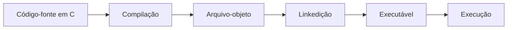

## 1.6 Linguagens de programação e compilação

Um computador executa instruções representadas de acordo com sua arquitetura. As linguagens de programação permitem que pessoas expressem essas instruções por meio de regras e estruturas definidas.

### Código-fonte

O **código-fonte** é o texto escrito pelo programador em uma linguagem de programação, como C. Ele deve respeitar as regras da linguagem.

Exemplo em C:

```c
#include <stdio.h>

int main(void) {
    printf("Olá, mundo!\n");
    return 0;
}
```

Esse programa apresenta a mensagem `Olá, mundo!` e termina indicando que a execução foi concluída normalmente.

### Compilador

Um **compilador** é um programa que traduz o código-fonte para uma representação que pode ser processada nas etapas seguintes de construção do programa. Em ambientes comuns de C, o processo pode gerar arquivos-objeto e, depois, um executável por meio da ligação (*linkedição*).

O fluxo simplificado é:



As etapas exatas variam conforme o compilador e o ambiente de desenvolvimento. Alguns ambientes escondem parte delas do usuário.

### Tipos de problemas em um programa

É importante distinguir problemas diferentes.

**Erro de sintaxe:** ocorre quando o código não respeita as regras gramaticais da linguagem.

```c
#include <stdio.h>

int main(void) {
    printf("Olá, mundo!\n"
    return 0;
}
```

Nesse exemplo, falta fechar a chamada de `printf` com `);`. O compilador normalmente informa um erro, embora a mensagem possa apontar para a linha em que o problema foi percebido, e não exatamente onde começou.

**Erro de lógica:** o programa pode compilar e executar, mas produzir um resultado diferente do esperado.

```c
int largura = 5;
int altura = 3;
int area = largura + altura; /* incorreto para calcular a área */
```

Para calcular a área de um retângulo, a operação correta é `largura * altura`. A soma é uma expressão válida em C, mas não representa a fórmula desejada.

**Problema nos dados de entrada:** mesmo com uma fórmula correta, valores inadequados podem levar a resultados sem sentido. Um cálculo de preço, por exemplo, pode precisar rejeitar quantidades negativas ou descontos fora dos limites definidos pelo problema.

!!! warning "Compilar não significa provar que o programa está correto"
    A compilação verifica aspectos do código e pode encontrar diversos problemas, mas não garante que o algoritmo atenda ao objetivo. Por isso, é necessário testar o programa com valores variados e conferir os resultados esperados.

### Atividade interativa: identifique o problema

<div class="atividade-interativa" id="atividade-erros">
  <p><strong>Situação 1.</strong> O programa não compila porque falta um ponto e vírgula após uma instrução.</p>
  <div class="opcoes-atividade">
    <button type="button" data-correct="true">Erro de sintaxe</button>
    <button type="button" data-correct="false">Erro de lógica</button>
    <button type="button" data-correct="false">Dispositivo de saída</button>
  </div>
  <p class="feedback-atividade" aria-live="polite"></p>
  <hr>
  <p><strong>Situação 2.</strong> O programa compila, mas calcula a área de um retângulo somando a largura e a altura.</p>
  <div class="opcoes-atividade">
    <button type="button" data-correct="false">Erro de sintaxe</button>
    <button type="button" data-correct="true">Erro de lógica</button>
    <button type="button" data-correct="false">Erro de hardware</button>
  </div>
  <p class="feedback-atividade" aria-live="polite"></p>
</div>

## 1.7 Decomposição de problemas

Um problema complexo pode ficar mais fácil de resolver quando é dividido em etapas menores. Essa estratégia é chamada de **decomposição**. Uma forma inicial de organizar muitos problemas computacionais é identificar:

- **Entrada:** quais dados serão fornecidos?
- **Processamento:** quais cálculos ou regras serão aplicados?
- **Saída:** quais resultados deverão ser apresentados?

Esse modelo é uma ferramenta de planejamento. Alguns sistemas também precisam armazenar dados, interagir com outros sistemas, validar informações e tratar situações excepcionais.

### Exemplo resolvido 1: calcular o total de uma compra

**Problema:** calcular o valor de uma compra sabendo a quantidade de unidades e o preço de cada unidade.

**Etapa 1 — Entrada**

- quantidade de unidades;
- preço unitário.

**Etapa 2 — Processamento**

Multiplicar a quantidade pelo preço unitário:

\[
\text{total} = \text{quantidade} \times \text{preço unitário}
\]

**Etapa 3 — Saída**

Apresentar o valor total da compra.

**Teste com valores conhecidos**

Se a quantidade for 4 e o preço unitário for R$ 7,50:

\[
\text{total} = 4 \times 7{,}50 = 30{,}00
\]

O resultado esperado é R$ 30,00.

### Exemplo resolvido 2: calcular a distância percorrida

Um veículo mantém velocidade média constante de 60 km/h durante 2 horas. A distância pode ser calculada por:

\[
\text{distância} = \text{velocidade} \times \text{tempo}
\]

Substituindo os valores:

\[
\text{distância} = 60 \times 2 = 120\text{ km}
\]

- **Entrada:** velocidade média e tempo.
- **Processamento:** multiplicar velocidade por tempo.
- **Saída:** distância calculada.

**Atenção às unidades:** se a velocidade estiver em km/h, o tempo deve estar em horas para que o resultado seja expresso em quilômetros.

### Exemplo resolvido 3: aplicar um desconto

Uma loja precisa calcular o preço final de um produto após um desconto percentual.

- **Entrada:** preço original e percentual de desconto.
- **Processamento:** calcular o desconto e subtraí-lo do preço original.
- **Saída:** preço final.

As fórmulas são:

\[
\text{valor do desconto} = \text{preço original} \times \frac{\text{percentual}}{100}
\]

\[
\text{preço final} = \text{preço original} - \text{valor do desconto}
\]

Se o preço original for R$ 200,00 e o desconto for 10%:

\[
\text{desconto} = 200 \times \frac{10}{100} = 20
\]

\[
\text{preço final} = 200 - 20 = 180
\]

O preço final será R$ 180,00. Antes de implementar a solução, também precisamos decidir quais entradas são válidas, como um preço não negativo e um percentual entre 0 e 100, caso essas sejam as regras do problema.

### Laboratório interativo: decomponha um problema

Escolha um problema e observe suas entradas, seu processamento e suas saídas.

<div class="atividade-interativa" id="laboratorio-decomposicao">
  <label for="problema-decomposicao">Problema</label>
  <select id="problema-decomposicao">
    <option value="compra">Calcular o total de uma compra</option>
    <option value="retangulo">Calcular a área de um retângulo</option>
    <option value="combustivel">Calcular o consumo médio de combustível</option>
  </select>
  <div class="resultado-decomposicao" id="resultado-decomposicao" aria-live="polite">
    <p><strong>Entrada:</strong> quantidade e preço unitário.</p>
    <p><strong>Processamento:</strong> quantidade × preço unitário.</p>
    <p><strong>Saída:</strong> valor total da compra.</p>
  </div>
</div>

### Testar antes de programar

Uma solução deve ser testada com mais de um conjunto de dados. Para o cálculo do desconto, por exemplo, podemos considerar:

| Preço original | Desconto | Resultado esperado |
|---:|---:|---:|
| R$ 100,00 | 0% | R$ 100,00 |
| R$ 100,00 | 10% | R$ 90,00 |
| R$ 200,00 | 25% | R$ 150,00 |
| R$ 50,00 | 100% | R$ 0,00 |

Também é importante testar entradas inválidas, como preço negativo ou desconto maior que 100%, quando as regras do sistema não permitirem esses valores.

## 1.6 Pensamento computacional

- **Decomposição:** dividir o problema em partes menores.
- **Reconhecimento de padrões:** identificar semelhanças entre problemas.
- **Abstração:** concentrar-se no que é relevante.
- **Algoritmos:** definir uma sequência finita e ordenada de passos.

!!! warning "Erros comuns: atenção a estes pontos"

    - começar a programar sem compreender o enunciado;
    - confundir armazenamento permanente com memória RAM;
    - acreditar que compilar significa que o algoritmo está correto;
    - ignorar unidades e restrições dos dados.

!!! tip "Prática guiada"

    Planeje um programa que calcule o valor final de um produto após um desconto percentual. Não escreva código ainda. Identifique entrada, processamento, saída e duas situações que precisam ser testadas.


## 1.6 Pensamento computacional

**Pensamento computacional** é uma abordagem para formular e resolver problemas de forma organizada, utilizando estratégias que também podem ser expressas por algoritmos e executadas por computadores. Ele pode ser aplicado à programação, mas também a situações cotidianas.

Quatro pilares frequentemente utilizados para explicar essa abordagem são decomposição, reconhecimento de padrões, abstração e algoritmos.

### 1. Decomposição

Consiste em dividir um problema maior em partes menores que possam ser compreendidas e resolvidas.

**Exemplo:** para desenvolver um sistema de biblioteca, podemos separar o problema em cadastro de livros, cadastro de usuários, empréstimos, devoluções e relatórios.

### 2. Reconhecimento de padrões

Consiste em identificar semelhanças ou regularidades entre problemas ou situações.

**Exemplo:** calcular o total de uma compra de vários produtos e calcular o custo de várias passagens envolvem multiplicações e somas semelhantes. Reconhecer essa estrutura ajuda a reaproveitar estratégias.

### 3. Abstração

Consiste em selecionar os detalhes relevantes para o problema e deixar de lado os que não influenciam a solução naquele momento.

**Exemplo:** para calcular a área de um retângulo, precisamos de sua largura e altura. A cor do retângulo não interfere nesse cálculo e pode ser ignorada.

A abstração não significa que os detalhes descartados nunca sejam importantes. Eles podem ser necessários para outro objetivo.

### 4. Algoritmos

Um **algoritmo** é uma sequência finita e ordenada de passos para realizar uma tarefa ou resolver um problema. Os passos precisam ser suficientemente claros para que possam ser executados e verificados.

Exemplo de algoritmo cotidiano para preparar uma bebida:

1. Separar os ingredientes e utensílios.
2. Colocar a quantidade definida de água no recipiente.
3. Aquecer a água.
4. Misturar os ingredientes conforme as instruções.
5. Servir a bebida.

Em programação, o algoritmo precisa ser adaptado às regras do problema e representado de forma adequada, por exemplo, em pseudocódigo, fluxograma ou linguagem de programação.

### Os quatro pilares trabalhando juntos

Considere o problema de calcular as médias de uma turma:

1. **Decomposição:** separar a leitura das notas, o cálculo da média, a verificação do critério e a apresentação do resultado.
2. **Reconhecimento de padrões:** perceber que a mesma operação de cálculo será repetida para cada estudante.
3. **Abstração:** concentrar-se nas notas e nas regras de média, sem considerar informações irrelevantes para esse cálculo.
4. **Algoritmo:** organizar os passos em uma sequência que possa ser executada.

Os pilares se complementam. Não precisam ser aplicados como etapas rígidas e isoladas: durante a resolução, podemos voltar a uma etapa anterior e melhorar nossa compreensão do problema.

### Atividade interativa: qual pilar está sendo utilizado?

<div class="atividade-interativa" id="atividade-pilares">
  <p><strong>Situação 1.</strong> Separar um sistema escolar em cadastro, notas, frequência e relatórios.</p>
  <div class="opcoes-atividade">
    <button type="button" data-correct="true">Decomposição</button>
    <button type="button" data-correct="false">Abstração</button>
    <button type="button" data-correct="false">Reconhecimento de padrões</button>
    <button type="button" data-correct="false">Algoritmos</button>
  </div>
  <p class="feedback-atividade" aria-live="polite"></p>
  <hr>
  <p><strong>Situação 2.</strong> Ignorar a cor de um retângulo ao calcular sua área.</p>
  <div class="opcoes-atividade">
    <button type="button" data-correct="false">Decomposição</button>
    <button type="button" data-correct="true">Abstração</button>
    <button type="button" data-correct="false">Reconhecimento de padrões</button>
    <button type="button" data-correct="false">Algoritmos</button>
  </div>
  <p class="feedback-atividade" aria-live="polite"></p>
  <hr>
  <p><strong>Situação 3.</strong> Perceber que diferentes cálculos de preço final utilizam operações semelhantes.</p>
  <div class="opcoes-atividade">
    <button type="button" data-correct="false">Decomposição</button>
    <button type="button" data-correct="false">Abstração</button>
    <button type="button" data-correct="true">Reconhecimento de padrões</button>
    <button type="button" data-correct="false">Algoritmos</button>
  </div>
  <p class="feedback-atividade" aria-live="polite"></p>
  <hr>
  <p><strong>Situação 4.</strong> Organizar instruções finitas e ordenadas para calcular uma média.</p>
  <div class="opcoes-atividade">
    <button type="button" data-correct="false">Decomposição</button>
    <button type="button" data-correct="false">Abstração</button>
    <button type="button" data-correct="false">Reconhecimento de padrões</button>
    <button type="button" data-correct="true">Algoritmos</button>
  </div>
  <p class="feedback-atividade" aria-live="polite"></p>
</div>

## Erros comuns: atenção a estes pontos

!!! warning "Começar a programar antes de entender o problema"
    **Por que atrapalha:** você pode produzir um código que executa, mas não resolve a necessidade real.

    **Como evitar:** escreva o objetivo, as entradas, as regras de processamento e as saídas antes de escolher os comandos.

!!! warning "Confundir memória RAM com armazenamento"
    **Por que atrapalha:** os componentes têm funções diferentes.

    **Como evitar:** lembre-se de que a RAM mantém temporariamente dados em uso, enquanto SSDs e HDs são utilizados para preservar arquivos.

!!! warning "Acreditar que compilar garante a correção"
    **Por que atrapalha:** um programa pode ser sintaticamente válido e produzir resultados incorretos.

    **Como evitar:** teste valores simples cujo resultado você consegue calcular manualmente e compare a saída com o resultado esperado.

!!! warning "Ignorar unidades e limites"
    **Por que atrapalha:** misturar horas e minutos, por exemplo, pode levar a cálculos incorretos; entradas fora das regras também podem gerar resultados inválidos.

    **Como evitar:** registre as unidades, defina os limites aceitos e teste casos comuns e casos extremos.

## Prática guiada: planeje uma solução

### Desafio — preço com desconto

Uma loja quer um programa que receba o preço original de um produto e o percentual de desconto e apresente o preço final.

Antes de escrever código, complete o planejamento.

<div class="atividade-interativa" id="pratica-desconto">
  <label for="entrada-desconto">Quais são os dados de entrada?</label>
  <textarea id="entrada-desconto" rows="2" placeholder="Ex.: preço original e percentual de desconto"></textarea>
  <label for="processamento-desconto">Qual processamento deve ser realizado?</label>
  <textarea id="processamento-desconto" rows="2" placeholder="Descreva os cálculos necessários"></textarea>
  <label for="saida-desconto">Qual é a saída esperada?</label>
  <textarea id="saida-desconto" rows="2" placeholder="O que o programa deve apresentar?"></textarea>
  <label for="testes-desconto">Indique dois testes para verificar a solução.</label>
  <textarea id="testes-desconto" rows="3" placeholder="Informe os valores de entrada e os resultados esperados"></textarea>
  <details>
    <summary>Mostrar uma possível resposta</summary>
    <p><strong>Entrada:</strong> preço original e percentual de desconto.</p>
    <p><strong>Processamento:</strong> calcular o desconto multiplicando o preço pelo percentual dividido por 100; subtrair o desconto do preço original.</p>
    <p><strong>Saída:</strong> preço final após o desconto.</p>
    <p><strong>Teste 1:</strong> preço de R$ 100,00 e desconto de 10%; resultado esperado R$ 90,00.</p>
    <p><strong>Teste 2:</strong> preço de R$ 80,00 e desconto de 0%; resultado esperado R$ 80,00.</p>
    <p>Também seria adequado testar entradas inválidas, conforme as regras definidas para o sistema.</p>
  </details>
</div>
