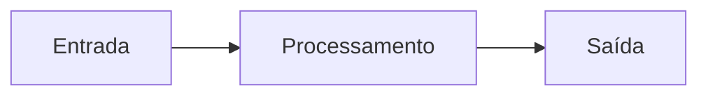

# 4. Estrutura Sequencial

## Abertura

Na estrutura sequencial, as instruções são executadas uma após a outra, na ordem em que aparecem. É a forma mais direta de organizar um algoritmo.

## Objetivos

- organizar algoritmos com entrada, processamento e saída;
- usar atribuições corretamente;
- construir cálculos sequenciais;
- simular a alteração de variáveis ao longo do programa.

## 4.1 Modelo Entrada–Processamento–Saída



## 4.2 Atribuição e sequência

Em pseudocódigo, `total <- preco * quantidade` calcula a expressão à direita e atribui o resultado à variável à esquerda. A ordem importa: uma variável precisa receber um valor antes de ser usada.

## 4.3 Entrada e saída em C

`printf()` apresenta mensagens e resultados. `scanf()` lê dados formatados; para variáveis numéricas simples, geralmente recebe o endereço da variável com `&`. A leitura de textos e a validação de entradas serão aprofundadas em exemplos posteriores.

```c
#include <stdio.h>

int main(void) {
    double base, altura, area;

    printf("Informe a base: ");
    if (scanf("%lf", &base) != 1) {
        printf("Entrada invalida.\n");
        return 1;
    }

    printf("Informe a altura: ");
    if (scanf("%lf", &altura) != 1) {
        printf("Entrada invalida.\n");
        return 1;
    }

    area = base * altura;
    printf("Area: %.2f\n", area);
    return 0;
}
```

## 4.4 Exemplo resolvido: conversão de temperatura

Fórmula: \(F = C \times 9/5 + 32\).

```c
#include <stdio.h>

int main(void) {
    double celsius, fahrenheit;

    printf("Temperatura em Celsius: ");
    if (scanf("%lf", &celsius) != 1) {
        printf("Valor invalido.\n");
        return 1;
    }

    fahrenheit = celsius * 9.0 / 5.0 + 32.0;
    printf("Fahrenheit: %.2f\n", fahrenheit);
    return 0;
}
```

## 4.5 Teste de mesa

Para `a = 4`, `b = 3`, `c = a * b + 2`:

| Instrução | a | b | c |
|---|---:|---:|---:|
| Inicialização | 4 | 3 | — |
| `c = a * b + 2` | 4 | 3 | 14 |

## Erros comuns

- calcular antes de ler os dados;
- sobrescrever uma variável necessária mais adiante;
- esquecer parênteses em fórmulas;
- usar especificador de formato incompatível;
- não verificar se `scanf()` conseguiu ler o valor.

## Prática guiada

Crie um programa que leia salário e percentual de reajuste e apresente o valor do reajuste e o novo salário. Teste com percentual zero e com um percentual positivo.

## Exercícios

1. Defina estrutura sequencial.
2. Identifique entrada, processamento e saída de um cálculo de perímetro.
3. Escreva pseudocódigo para somar três valores.
4. Escreva pseudocódigo para calcular a média de quatro notas.
5. Calcule a área de um retângulo de base 8 e altura 3.
6. Converta 25 °C para Fahrenheit.
7. Escreva algoritmo para converter horas em minutos.
8. Escreva algoritmo para calcular o preço de cinco unidades.
9. O que acontece se uma variável for usada antes de receber valor?
10. Por que verificar o retorno de `scanf()`?
11. Escreva um programa C que leia dois inteiros e exiba a soma.
12. Escreva um programa C que calcule a área de um triângulo.
13. Escreva um algoritmo para calcular o salário após reajuste.
14. Escreva um algoritmo para calcular o consumo médio (km/L).
15. Identifique a ordem correta para calcular uma média.
16. Faça teste de mesa para `x=5; y=x+2; x=y*3`.
17. Planeje uma calculadora de gorjeta percentual.
18. Explique por que `9/5` pode ser problemático em uma fórmula com inteiros.
19. Crie testes para uma conversão de temperatura.
20. Desenvolva um programa sequencial de sua escolha e documente as variáveis.

## Gabarito comentado

1. Execução das instruções em sequência.
2. Entrada: dimensões; processamento: fórmula; saída: perímetro.
3. Ler a, b, c; soma ← a+b+c; exibir soma.
4. Ler notas; média ← soma/4; exibir.
5. 24 unidades quadradas.
6. 77 °F.
7. minutos ← horas*60.
8. total ← preço_unitário*5.
9. O resultado pode ser indeterminado/incorreto; em C, ler variável não inicializada é um erro grave.
10. Para detectar entrada inválida ou ausência de valor.
11. Ler dois inteiros e exibir `a+b`, validando as leituras.
12. `area = base * altura / 2.0`.
13. reajuste ← salário*percentual/100; novo ← salário+reajuste.
14. consumo ← distância/litros, validando litros diferentes de zero.
15. Ler todos os valores, somar, dividir pela quantidade, exibir.
16. Inicialmente x=5; y=7; depois x=21.
17. Gorjeta ← conta*percentual/100; total ← conta+gorjeta.
18. Divisão inteira pode truncar o resultado; use `9.0/5.0`.
19. Zero, valor negativo se permitido, valores típicos e entrada inválida.
20. Avaliar clareza, cálculo e validação.

## Resumo

Uma estrutura sequencial correta respeita a ordem **ler → calcular → exibir**.

## Glossário e referências

**Atribuição:** associação de um valor a uma variável. **Formato:** regra de leitura/exibição. **Validação:** verificação de dados.

Referência: cppreference.com, documentação de `printf` e `scanf`; materiais da disciplina.
