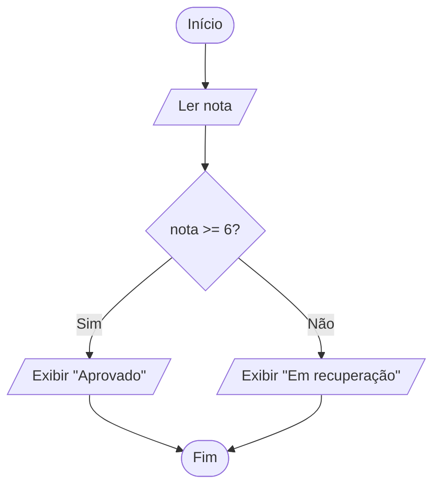

# 5. Estruturas Condicionais

## Abertura

Sistemas tomam decisões o tempo todo: aprovar uma compra, classificar uma nota, verificar uma senha ou determinar uma tarifa. Em algoritmos, decisões são representadas por condições.

## Objetivos

- construir condições relacionais e lógicas;
- usar seleção simples, composta e encadeada;
- compreender `if`, `else if`, `else` e `switch`;
- testar os caminhos possíveis de uma decisão.

## 5.1 Seleção simples e composta

```text
Se temperatura > 30 então
    Escreva "Está quente"
FimSe
```

Com alternativa:

```text
Se idade >= 18 então
    Escreva "Maior de idade"
Senão
    Escreva "Menor de idade"
FimSe
```

## 5.2 Fluxograma de decisão



## 5.3 Condições compostas

Use `&&` quando todas as condições precisarem ser verdadeiras; use `||` quando bastar uma delas. Parênteses ajudam a explicitar a intenção.

## 5.4 Implementação em C

```c
#include <stdio.h>

int main(void) {
    double nota;

    printf("Nota (0 a 10): ");
    if (scanf("%lf", &nota) != 1 || nota < 0 || nota > 10) {
        printf("Nota invalida.\n");
        return 1;
    }

    if (nota >= 6.0) {
        printf("Aprovado.\n");
    } else {
        printf("Reprovado.\n");
    }
    return 0;
}
```

## 5.5 Seleção encadeada e `switch`

Use `else if` para faixas ou critérios mutuamente exclusivos. `switch` é útil quando uma expressão integral ou caractere deve ser comparada a valores discretos. Em C, cada `case` normalmente termina com `break` para evitar a execução do próximo caso.

## Exemplo: faixa de nota

```c
if (nota >= 9.0) {
    printf("Excelente\n");
} else if (nota >= 7.0) {
    printf("Bom\n");
} else if (nota >= 6.0) {
    printf("Suficiente\n");
} else {
    printf("Insuficiente\n");
}
```

A ordem das condições é importante: comece pela faixa mais alta quando os intervalos se sobrepõem.

## Erros comuns

- confundir `=` com `==`;
- esquecer limites em uma faixa;
- criar intervalos que se sobrepõem ou deixam lacunas;
- colocar `;` imediatamente após `if`;
- esquecer `break` em `switch`;
- não validar valores fora do domínio esperado.

## Prática guiada

Leia uma temperatura e classifique-a como “fria” (abaixo de 15), “agradável” (de 15 até 25) ou “quente” (acima de 25). Defina explicitamente os limites e teste 14.9, 15, 25 e 25.1.

## Exercícios

1. Explique o propósito de uma condicional.
2. Escreva pseudocódigo para verificar se um número é positivo.
3. Verifique se um número é par ou ímpar.
4. Verifique se uma pessoa pode votar considerando idade como único critério didático.
5. Classifique uma nota como aprovada (>=6) ou não aprovada.
6. Escreva uma condição para verificar se um valor está entre 10 e 20, inclusive.
7. Explique a diferença entre `&&` e `||`.
8. Classifique um número como positivo, negativo ou zero.
9. Determine o maior entre dois números.
10. Determine o maior entre três números.
11. Crie uma tarifa com desconto para estudantes.
12. Converta um número de 1 a 7 em dia da semana usando `switch`.
13. Identifique o erro em `if (x = 10)`.
14. Explique por que a ordem de `else if` importa.
15. Crie faixas de classificação para uma nota entre 0 e 10.
16. Faça tabela-verdade de `A && !B`.
17. Escreva condição para aceitar usuário se tem cadastro e senha válida.
18. Teste uma classificação de temperatura com valores de limite.
19. Desenvolva calculadora com `switch` para `+`, `-`, `*`, `/`.
20. Analise um conjunto de condições e indique lacunas ou sobreposições.

## Gabarito comentado

1. Escolher caminhos diferentes com base em uma condição.
2. Se `n>0`, exibir positivo.
3. Se `n%2==0`, par; caso contrário, ímpar.
4. Se idade >= limite legal adotado no exercício, permitir; especificar o limite.
5. Se nota>=6, aprovada; senão, não aprovada.
6. `x>=10 && x<=20`.
7. `&&` exige ambas; `||` exige ao menos uma.
8. Testar `>0`, `<0`, senão zero.
9. Comparar A e B, incluindo igualdade.
10. Comparar os três, tratando empates.
11. Aplicar regra claramente definida e testar elegibilidade.
12. `switch` com casos 1 a 7 e `default` inválido.
13. Usou atribuição; para comparação, `x == 10`.
14. A primeira condição verdadeira encerra a cadeia.
15. Definir intervalos completos, sem sobreposição.
16. A é verdadeiro e B falso resulta verdadeiro; nos demais casos, falso.
17. `temCadastro && senhaValida`.
18. Incluir os valores imediatamente abaixo, iguais e acima dos limites.
19. Validar operador e impedir divisão por zero.
20. Verificar que todos os valores possíveis são cobertos uma única vez, conforme a regra.

## Resumo

Condições tornam o algoritmo capaz de escolher caminhos. A qualidade depende de regras explícitas e testes de limite.

## Glossário e referências

**Condicional:** estrutura de seleção. **Condição composta:** combinação lógica de testes. **Faixa:** intervalo de valores.

Referência: documentação C em cppreference.com; materiais da disciplina.
