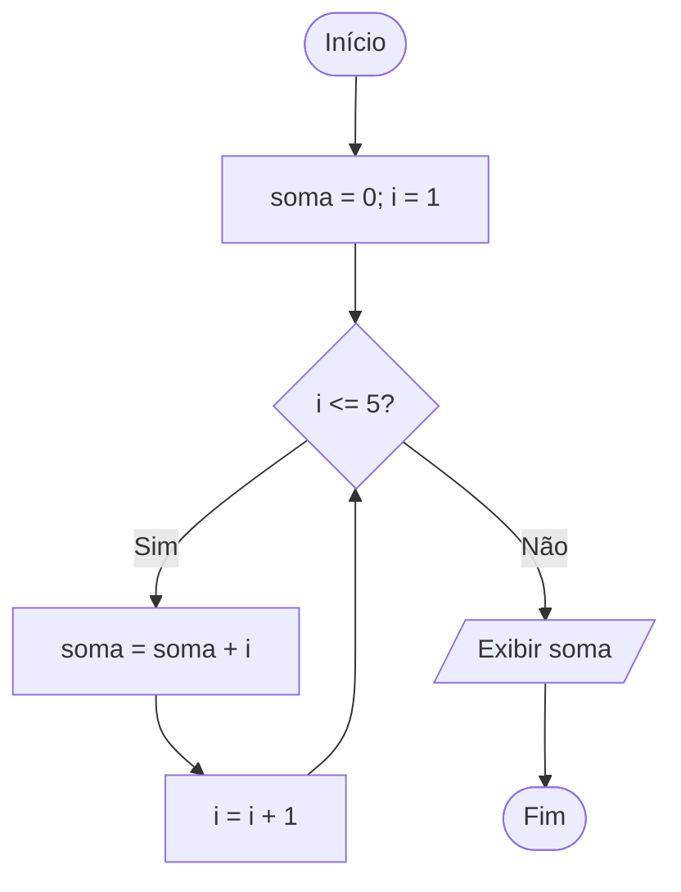

# 6. Estruturas de Repetição

## Abertura

Repetir uma operação manualmente em código torna o programa longo e propenso a erros. Laços permitem executar um bloco enquanto uma condição for satisfeita ou por uma quantidade controlada de vezes.

!!! abstract "Objetivos de aprendizagem"

    - distinguir repetição controlada por condição e por contador;
    - utilizar `while`, `do-while` e `for`;
    - trabalhar com contadores e acumuladores;
    - evitar laços infinitos e erros de limite.

## 6.1 `while`

A condição é verificada antes de cada execução. Se for falsa inicialmente, o bloco pode não executar nenhuma vez.

```c
int contador = 1;
while (contador <= 5) {
    printf("%d\n", contador);
    contador++;
}
```

## 6.2 `do-while`

O bloco executa pelo menos uma vez, pois a condição é verificada no final.

```c
int opcao;
do {
    printf("1 - Continuar; 0 - Sair: ");
    if (scanf("%d", &opcao) != 1) {
        printf("Entrada invalida.\n");
        return 1;
    }
} while (opcao != 0 && opcao != 1);
```

## 6.3 `for`

É conveniente quando inicialização, condição e atualização podem ser organizadas em uma única linha.

```c
for (int i = 0; i < 5; i++) {
    printf("%d\n", i);
}
```

## 6.4 Contador e acumulador

- **Contador:** registra quantas vezes algo ocorreu.
- **Acumulador:** soma ou combina valores ao longo das iterações.

Exemplo de soma de 1 a 5:

| Iteração | i | soma antes | soma depois |
|---:|---:|---:|---:|
| 1 | 1 | 0 | 1 |
| 2 | 2 | 1 | 3 |
| 3 | 3 | 3 | 6 |
| 4 | 4 | 6 | 10 |
| 5 | 5 | 10 | 15 |

## 6.5 Fluxograma



!!! example "Exemplo resolvido: média de N notas"

    Leia a quantidade `n`, valide que seja positiva, acumule as notas em um laço e divida a soma por `n`. A média só pode ser calculada depois de todas as notas serem lidas.

!!! warning "Erros comuns: atenção a estes pontos"

    - esquecer de atualizar o contador;
    - usar `<` quando o enunciado exige incluir o limite;
    - iniciar o acumulador com valor diferente de zero sem justificativa;
    - dividir por zero quando `n` não é válido;
    - alterar a variável de controle em mais de um lugar;
    - confundir `i++` com `soma++`.

!!! tip "Prática guiada"

    Leia números até que o usuário informe zero e calcule a soma dos números diferentes de zero. Defina se o zero final faz parte da soma (não faz) e teste entrada inicial zero.

## Exercícios

1. Qual a diferença entre `while` e `do-while`?
2. Quando `for` é uma boa escolha?
3. Imprima números de 1 a 10.
4. Imprima números pares de 2 a 20.
5. Calcule a soma de 1 a 100.
6. Calcule o produto dos inteiros de 1 a 5.
7. Conte quantos valores positivos existem entre 10 entradas.
8. Leia 5 notas e calcule a média.
9. Leia valores até zero e conte quantos foram informados antes dele.
10. Imprima a tabuada de um número.
11. Faça teste de mesa para `i=1; soma=0; enquanto i<=3: soma+=i; i++`.
12. Explique como surge um laço infinito.
13. Corrija um laço que nunca incrementa seu contador.
14. Exiba contagem regressiva de 10 até 0.
15. Calcule a média de N valores com validação de N.
16. Encontre o maior de 8 valores.
17. Conte números divisíveis por 3 entre 1 e 100.
18. Compare `for` e `while` para percorrer 10 posições.
19. Crie um menu que continue até a opção sair.
20. Desenvolva um algoritmo que calcule a soma de números pares até N.

!!! success "Gabarito comentado"

    1. `while` testa antes; `do-while` testa depois e executa pelo menos uma vez.
    2. Quando o número de iterações ou a atualização é conhecida.
    3. `for (int i=1; i<=10; i++)`.
    4. `for (int i=2; i<=20; i+=2)`.
    5. 5050.
    6. 120.
    7. Inicializar contador em zero e incrementá-lo quando valor>0.
    8. Somar as cinco notas e dividir por cinco.
    9. Incrementar contador apenas para valores diferentes de zero.
    10. Multiplicar o número por 1 a 10.
    11. Soma final 6.
    12. A condição permanece verdadeira porque o estado não avança para encerrá-la.
    13. Atualizar o contador em cada iteração.
    14. Iniciar em 10 e decrementar até 0, inclusive.
    15. Validar `n>0`, somar n valores e dividir por n.
    16. Inicializar maior com o primeiro valor lido e comparar os demais.
    17. Existem 33 múltiplos positivos de 3 até 100.
    18. Ambos podem funcionar; `for` costuma tornar o controle mais compacto.
    19. Repetir leitura e processamento enquanto opção != sair.
    20. Somar `i` quando `i%2==0`, percorrendo o intervalo definido.

## Resumo

Todo laço precisa de **inicialização**, **condição de continuidade** e **atualização**.

## Glossário e referências

**Iteração:** execução de uma repetição. **Contador:** acompanha ocorrências. **Acumulador:** reúne valores.

Referência: cppreference.com, estruturas de controle em C.
