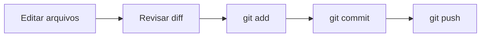

# 12. Testes, Estilo de Código e Git

## Abertura

Um programa não está pronto apenas porque compila. É necessário verificar resultados, testar limites, organizar o código e manter um histórico das alterações para poder colaborar e recuperar versões anteriores.

!!! abstract "Objetivos de aprendizagem"

    - distinguir testes de sintaxe, execução e lógica;
    - planejar casos de teste, incluindo limites e entradas inválidas;
    - depurar com método;
    - aplicar estilo consistente;
    - compreender repositório, commit, branch, push e pull.

## 12.1 Estratégia de testes

Para cada requisito, defina entradas e resultado esperado antes de executar o programa.

| Tipo de teste | Exemplo para uma média |
|---|---|
| Caso comum | Notas 6 e 8 → média 7 |
| Limite | Nota mínima e máxima permitidas |
| Caso inválido | Texto quando se espera número |
| Caso especial | Quantidade de notas igual a zero |
| Regressão | Repetir testes após alterar o código |

## 12.2 Teste de mesa e depuração

O teste de mesa simula a execução manual. A depuração observa a execução real, por exemplo, com pontos de interrupção, inspeção de variáveis e execução passo a passo. Em ambos os casos, formule uma hipótese e procure evidências.

## 12.3 Estilo de código

- use nomes que expliquem a finalidade;
- mantenha indentação consistente;
- divida responsabilidades em funções;
- evite duplicação desnecessária;
- comente decisões ou regras não óbvias;
- remova código morto;
- compile com avisos habilitados.

Exemplo:

```c
double calcularMedia(double soma, int quantidade) {
    if (quantidade <= 0) {
        return 0.0; // Alternativa didática; outra interface pode sinalizar erro.
    }
    return soma / quantidade;
}
```

Em um sistema real, retornar `0.0` pode confundir “média zero” com erro. Uma interface melhor pode retornar um indicador de sucesso e colocar o resultado em um parâmetro de saída.

## 12.4 Git: conceitos básicos

- **Repositório:** histórico e arquivos controlados pelo Git.
- **Working tree:** arquivos de trabalho.
- **Stage/index:** conjunto preparado para o próximo commit.
- **Commit:** registro de um conjunto de alterações.
- **Branch:** linha independente de desenvolvimento.
- **Push:** envia commits para um repositório remoto.
- **Pull:** integra alterações do remoto ao ambiente local.

## 12.5 Fluxo básico

```bash
git status
git add arquivo.c
git commit -m "Implementa cálculo da média"
git push
```

Antes do commit, revise o que foi preparado com `git diff --staged`. O comando `git status` ajuda a compreender o estado do repositório.



## 12.6 Mensagens e colaboração

Mensagens de commit devem descrever a mudança: `Corrige limite do vetor` é mais útil que `alterações`. Faça commits pequenos e coerentes. Não inclua senhas, chaves ou dados pessoais no repositório.

!!! warning "Erros comuns: atenção a estes pontos"

    - testar apenas um caso;
    - mudar o código sem repetir testes relacionados;
    - fazer commit sem revisar alterações;
    - acreditar que `git add` já cria um commit;
    - esquecer de enviar commits ao remoto;
    - incluir arquivos temporários ou segredos;
    - usar Git sem entender em qual branch está trabalhando.

!!! tip "Prática guiada"

    Escolha um programa anterior, crie um conjunto de pelo menos seis testes, registre resultados esperados e observados, corrija um defeito e execute novamente os testes. Em seguida, registre as alterações em um repositório Git.

## Exercícios

1. Diferencie compilação e teste.
2. Explique teste de mesa.
3. Proponha quatro casos de teste para uma calculadora.
4. Por que testar limites?
5. O que é regressão?
6. Cite três práticas de estilo de código.
7. Reescreva a mensagem de commit `mudanças`.
8. O que `git status` informa?
9. Qual a diferença entre `git add` e `git commit`?
10. Para que serve `git push`?
11. Para que serve `git pull`?
12. O que é uma branch?
13. Explique por que não se deve armazenar senhas no repositório.
14. Planeje testes para um programa que calcula média.
15. Crie um caso de teste para vetor vazio ou quantidade inválida.
16. Descreva um procedimento de depuração para resultado incorreto.
17. Explique a utilidade de commits pequenos.
18. Escreva a sequência básica para adicionar e enviar um arquivo.
19. Compare resultado esperado e observado em um teste.
20. Faça um plano de qualidade para um projeto simples em C com testes, estilo e Git.

!!! success "Gabarito comentado"

    1. Compilação verifica tradução/sintaxe e outros diagnósticos; testes verificam comportamento.
    2. Simulação manual das instruções e variáveis.
    3. Operação normal, limite, divisão por zero e operador inválido.
    4. Erros frequentemente aparecem nas fronteiras dos intervalos.
    5. Reexecutar testes após mudanças para detectar defeitos introduzidos.
    6. Nomes significativos, indentação, funções coesas, comentários úteis.
    7. Ex.: `Valida entrada de notas`.
    8. Estado dos arquivos e relação com o repositório.
    9. `add` prepara; `commit` grava no histórico local.
    10. Envia commits locais ao remoto.
    11. Busca e integra mudanças remotas conforme a configuração.
    12. Linha de desenvolvimento separada.
    13. O histórico pode preservar segredos mesmo após apagar o arquivo.
    14. Notas típicas, limites, valores inválidos e quantidade zero.
    15. Verificar que o programa rejeita a quantidade inválida sem dividir por zero.
    16. Reproduzir, isolar a etapa, inspecionar valores, formular hipótese e testar correção.
    17. Facilitam revisão, entendimento e reversão.
    18. `git status`, `git add`, `git commit`, `git push`.
    19. A diferença revela se o comportamento atende ao requisito.
    20. Definir requisitos, casos de teste, estilo, revisão, commits e repetição dos testes.

## Checklist final

- [ ] O programa compila sem erros.
- [ ] Avisos do compilador foram analisados.
- [ ] Casos comuns, limites e entradas inválidas foram testados.
- [ ] Nomes e indentação estão consistentes.
- [ ] Não há senhas ou dados sensíveis versionados.
- [ ] O diff foi revisado antes do commit.
- [ ] Os commits têm mensagens claras.
- [ ] As alterações necessárias foram enviadas ao remoto.

## Glossário e referências

**Teste:** verificação de comportamento. **Depuração:** investigação de defeitos. **Commit:** registro no histórico. **Branch:** linha de desenvolvimento. **Repositório remoto:** cópia acessível por rede.

Referências:
- Documentação oficial do Git: https://git-scm.com/doc
- cppreference.com, linguagem C.
- Materiais e orientações de avaliação da disciplina.
