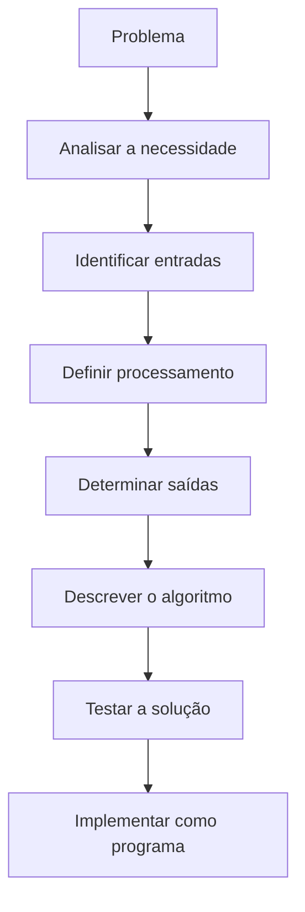
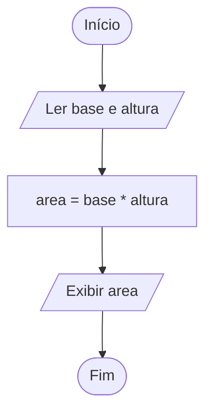
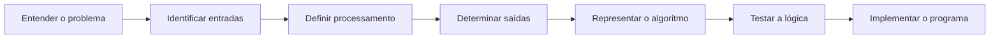

# Capítulo 1 — Introdução à computação e à resolução de problemas

> **Função do capítulo:** estabelecer a base conceitual para os capítulos seguintes. O foco é entender o que é um algoritmo, como analisar um problema e como representar uma solução antes de programar.

## Mapa do capítulo



## Objetivos de aprendizagem

Ao final deste capítulo, o estudante deverá ser capaz de:

- explicar o papel dos algoritmos na resolução de problemas computacionais;
- diferenciar problema, algoritmo e programa;
- identificar características de um algoritmo bem definido;
- decompor problemas simples em entrada, processamento e saída;
- representar uma solução por linguagem natural, pseudocódigo ou fluxograma;
- acompanhar a execução de um algoritmo com dados de teste;
- reconhecer que uma mesma lógica pode ser implementada em linguagens diferentes;
- explicar por que testar e revisar uma solução faz parte do desenvolvimento.

## 1.1 Por que estudar algoritmos?

Aplicativos de transporte, sistemas bancários, lojas virtuais, jogos e sistemas acadêmicos executam instruções para transformar dados em resultados. Antes de escrever essas instruções em uma linguagem de programação, é necessário compreender a necessidade e planejar uma solução.

**Programar não é apenas memorizar comandos.** É analisar um problema, identificar informações relevantes, organizar passos, prever resultados e verificar se a solução funciona.

!!! tip "Dica da professora"
    Antes de perguntar “qual comando devo usar?”, pergunte: **“qual é o problema e quais passos podem resolvê-lo?”**. Os comandos vêm depois da compreensão da solução.

### Pense e responda

Uma máquina de venda automática precisa entregar um produto após receber pagamento. Quais informações ela precisa receber? Que verificações deve fazer? O que deve acontecer se o valor for insuficiente?

Essa situação ajuda a perceber que um programa depende de regras explícitas, entradas e resultados esperados.

## 1.2 O que é um algoritmo?

Um **algoritmo** é uma sequência finita, organizada e suficientemente precisa de instruções para resolver um problema ou realizar uma tarefa.

Uma receita culinária é uma analogia útil: apresenta ingredientes e etapas que precisam ser executadas. Se as instruções forem vagas ou estiverem fora de ordem, o resultado pode ser diferente do esperado. Em um algoritmo, as ações também precisam ser claras e adequadas ao objetivo.

### Exemplo cotidiano: preparar um sanduíche

1. Separar os ingredientes e os utensílios.
2. Colocar o pão em uma superfície limpa.
3. Adicionar o recheio.
4. Fechar o sanduíche.
5. Servir.

A sequência tem um objetivo e uma ordem. Entretanto, uma instrução como “prepare algo gostoso” seria vaga: não especifica ações suficientes para orientar a execução.

!!! warning "Atenção"
    Um algoritmo não precisa ser escrito em uma linguagem de programação. Ele pode ser descrito por texto, pseudocódigo ou fluxograma. O importante, nesta etapa, é que os passos estejam claros e organizados.

## 1.3 Características de um bom algoritmo

| Característica | Significado | Exemplo |
|---|---|---|
| Clareza | Cada instrução deve ser compreensível. | “Leia a idade” é mais claro que “obtenha a informação”. |
| Ordem | As etapas devem seguir uma sequência coerente. | Obter as notas antes de calcular a média. |
| Finitude | A execução deve terminar quando a tarefa exigir uma quantidade finita de passos. | Ler duas notas, calcular e exibir a média. |
| Precisão | As ações devem indicar o que precisa ser feito. | “Some nota1 e nota2” em vez de “faça a conta”. |
| Resultado verificável | Deve ser possível conferir se a solução atende ao objetivo. | Comparar o valor calculado com o resultado esperado. |

Essas características tornam a solução mais fácil de compreender, testar e transformar em programa. Em problemas reais, também é importante avaliar se o algoritmo atende aos requisitos e trata adequadamente as situações previstas.

### Atividade visual: algoritmo claro ou vago?

Classifique cada instrução como **clara** ou **vaga** e justifique.

- “Leia dois números inteiros.”
- “Faça alguma operação interessante.”
- “Calcule a soma dos números lidos.”
- “Mostre um resultado bom.”

**Discussão esperada:** as instruções claras indicam ações verificáveis. As vagas não especificam suficientemente o que deve ser executado ou qual resultado se espera.

## 1.4 Problema, algoritmo e programa

| Termo | O que significa? | Exemplo |
|---|---|---|
| Problema | Necessidade que se deseja resolver. | Calcular a média de duas notas. |
| Algoritmo | Plano organizado dos passos para resolver o problema. | Ler as notas, somá-las, dividir por dois e exibir a média. |
| Programa | Implementação do algoritmo em uma linguagem de programação. | Código em Portugol/VisualG ou em C. |

O algoritmo descreve a lógica da solução. O programa expressa essa lógica usando as regras de uma linguagem específica.

### Exemplo resolvido: média de duas notas

**Problema:** receber duas notas e apresentar a média aritmética.

**Planejamento:**

1. Entrada: primeira nota e segunda nota.
2. Processamento: calcular `(nota1 + nota2) / 2`.
3. Saída: mostrar a média.

```text
Início
    Ler nota1
    Ler nota2
    média ← (nota1 + nota2) / 2
    Exibir média
Fim
```

A seta `←` representa atribuição: o resultado da expressão à direita é armazenado na variável à esquerda. A notação será formalizada nos capítulos seguintes.

## 1.5 Entrada, processamento e saída (EPS)

Uma forma inicial de analisar um problema é dividi-lo em três elementos:

- **Entrada:** dados necessários para resolver o problema.
- **Processamento:** cálculos ou operações realizados com os dados.
- **Saída:** resultado que será apresentado ou encaminhado.

### Exemplo resolvido: área de um retângulo

O programa recebe a base e a altura de um retângulo e calcula sua área.

| Elemento | Identificação |
|---|---|
| Entrada | Base e altura |
| Processamento | `área = base × altura` |
| Saída | Valor da área calculada |



**Teste rápido:** se a base for `5` e a altura for `3`, então `área = 5 × 3 = 15`. A saída esperada é `15`.

### Quadro EPS para preencher

| Entrada | Processamento | Saída |
|---|---|---|
| Preço de um produto e quantidade | ? | ? |

Complete a tabela antes de consultar o gabarito. Considere que o programa deve calcular o custo total da compra.

## 1.6 Formas de representar um algoritmo

| Representação | Como funciona | Vantagem | Limitação |
|---|---|---|---|
| Linguagem natural | Descreve os passos com frases comuns. | Fácil de começar. | Pode ficar ambígua. |
| Fluxograma | Usa símbolos e setas para representar o fluxo. | Ajuda a visualizar sequência e decisões. | Diagramas grandes podem ficar difíceis de ler. |
| Pseudocódigo | Usa instruções estruturadas próximas da lógica de programação. | Organiza o raciocínio sem exigir a sintaxe completa de uma linguagem. | É necessário combinar uma convenção de escrita. |

Nesta disciplina, o **Portugol no VisualG** será utilizado para praticar a lógica e, posteriormente, a **linguagem C no Dev-C++** será utilizada para implementar programas.

## 1.7 O mesmo raciocínio em Portugol e em C

Considere o problema de ler dois números e exibir a soma.

### Portugol / VisualG

```portugol
algoritmo "SomaDoisNumeros"
var
   numero1, numero2, soma: inteiro
inicio
   escreva("Digite o primeiro numero: ")
   leia(numero1)

   escreva("Digite o segundo numero: ")
   leia(numero2)

   soma <- numero1 + numero2
   escreval("Soma: ", soma)
fimalgoritmo
```

### Linguagem C

```c
#include <stdio.h>

int main(void) {
    int numero1, numero2, soma;

    printf("Digite o primeiro numero: ");
    scanf("%d", &numero1);

    printf("Digite o segundo numero: ");
    scanf("%d", &numero2);

    soma = numero1 + numero2;
    printf("Soma: %d\n", soma);

    return 0;
}
```

### Comparação

| Aspecto | Portugol / VisualG | Linguagem C |
|---|---|---|
| Declaração de variáveis | `var` e tipo após os nomes | Tipo antes dos nomes |
| Leitura | `leia()` | `scanf()` |
| Exibição | `escreva()` / `escreval()` | `printf()` |
| Atribuição | `<-` | `=` |
| Delimitação do programa | `inicio` e `fimalgoritmo` | Função `main()` e chaves |
| Biblioteca de entrada e saída | Não é declarada como em C | `#include <stdio.h>` |

**Observe:** os comandos são diferentes, mas a lógica é a mesma: ler dois valores, somá-los e apresentar o resultado.

## 1.8 Rastreamento manual: teste de mesa

O **teste de mesa** consiste em acompanhar manualmente a execução de um algoritmo, registrando os valores das variáveis após cada operação relevante.

Para a soma de dois números, considere as entradas `7` e `4`.

| Etapa | `numero1` | `numero2` | `soma` | Ação |
|---|---:|---:|---:|---|
| 1 | 7 | — | — | Ler o primeiro número |
| 2 | 7 | 4 | — | Ler o segundo número |
| 3 | 7 | 4 | 11 | Calcular `7 + 4` |
| 4 | 7 | 4 | 11 | Exibir `11` |

O teste de mesa permite verificar a lógica antes de executar o programa. Ele não substitui a compilação e os testes no ambiente de desenvolvimento, mas ajuda a localizar erros de raciocínio.

## 1.9 Erros frequentes de iniciantes

!!! warning "Confundir algoritmo com código"
    O algoritmo é o plano lógico; o código é uma implementação desse plano em uma linguagem.

!!! warning "Começar a programar sem identificar os dados"
    Antes de escrever comandos, registre quais informações entram, quais operações serão feitas e qual resultado deve sair.

!!! warning "Não verificar o resultado esperado"
    Use exemplos de teste simples e calcule previamente o resultado correto.

!!! tip "Estratégia de trabalho"
    Para cada exercício, escreva primeiro: **Problema → Entrada → Processamento → Saída → Teste**. Só depois escolha a representação ou a linguagem.

---

# Prática guiada

## Problema: calcular o custo de uma compra

Uma papelaria precisa calcular o valor total de uma compra a partir do preço unitário de um produto e da quantidade adquirida. Por enquanto, considere que não há descontos nem impostos adicionais.

### Etapa 1 — Identificar os dados

- Entrada: preço unitário e quantidade.
- Processamento: multiplicar o preço unitário pela quantidade.
- Saída: custo total.

### Etapa 2 — Representar a solução

```text
Início
    Ler preço_unitário
    Ler quantidade
    total ← preço_unitário × quantidade
    Exibir total
Fim
```

### Etapa 3 — Testar a solução

Se o preço unitário for `12,50` e a quantidade for `4`, o custo total será `50,00`.

### Etapa 4 — Refletir

- O que mudaria se a papelaria oferecesse um desconto?
- Que dado adicional seria necessário?
- Em qual etapa do modelo EPS o desconto seria calculado?

---

# Lista de exercícios

Os exercícios estão organizados por nível. Resolva primeiro sem consultar o gabarito. Quando a questão pedir justificativa, registre o raciocínio com suas próprias palavras.

## Nível 1 — Compreender

**1.** Explique, com suas palavras, o que é um algoritmo. Dê um exemplo de uma atividade cotidiana que possa ser descrita por uma sequência de passos.

**2.** Diferencie problema, algoritmo e programa. Use um único exemplo para demonstrar a relação entre os três.

**3.** Identifique qual característica de um bom algoritmo está sendo comprometida em cada situação:
- a) uma instrução pode ser interpretada de duas maneiras;
- b) o cálculo é realizado antes da leitura dos dados;
- c) o algoritmo exige que o usuário “faça algo adequado”, sem explicar o quê;
- d) não há uma condição de encerramento para uma tarefa que deveria terminar.

**4.** Explique a diferença entre entrada, processamento e saída usando um sistema de cálculo de média.

**5.** Compare linguagem natural, fluxograma e pseudocódigo. Em que situação cada representação pode ser útil?

## Nível 2 — Aplicar

**6.** Escreva em linguagem natural um algoritmo para calcular o dobro de um número informado pelo usuário. Identifique entrada, processamento e saída.

**7.** Um sistema recebe o comprimento e a largura de um terreno retangular. Monte uma tabela EPS para calcular a área do terreno.

**8.** Descreva os passos de um algoritmo que converte uma quantidade de horas em minutos. Use a relação `minutos = horas × 60`.

**9.** Um estudante deseja calcular a média aritmética de três notas. Escreva o algoritmo em pseudocódigo e indique as entradas, o processamento e a saída.

**10.** Uma loja vende cadernos por um preço unitário informado pelo usuário. Escreva um algoritmo que receba o preço e a quantidade e apresente o valor total, sem descontos.

**11.** Para o problema de calcular a área de um retângulo, escreva uma versão em linguagem natural e desenhe ou descreva o fluxograma correspondente.

**12.** Analise o algoritmo abaixo e indique a entrada, o processamento e a saída:

```text
Ler distancia
Ler tempo
velocidade_media ← distancia / tempo
Exibir velocidade_media
```

Que condição sobre o valor de `tempo` deve ser considerada para evitar uma divisão por zero?

## Nível 3 — Analisar e depurar

**13.** Um algoritmo para calcular a média de duas notas foi escrito assim:

```text
Ler nota1
media ← (nota1 + nota2) / 2
Ler nota2
Exibir media
```

Identifique o erro de ordem e reescreva a sequência correta.

**14.** Faça um teste de mesa para o algoritmo abaixo, usando `numero = 9`:

```text
Ler numero
dobro ← numero * 2
triplo ← numero * 3
Exibir dobro
Exibir triplo
```

Monte uma tabela com as variáveis e os resultados exibidos.

**15.** Um colega afirma: “Se o código compila, então o algoritmo está correto”. Você concorda? Justifique com um exemplo de erro lógico que poderia passar pela compilação.

**16.** Observe a descrição: “Leia dois números, faça uma conta e mostre o resultado”. Explique por que ela é insuficiente e reescreva-a para calcular a diferença entre o primeiro e o segundo número.

**17.** Um programa de compra recebe preço e quantidade, mas apresenta apenas o preço unitário. Identifique qual parte da solução provavelmente está faltando e proponha uma forma de verificar o comportamento esperado.

## Nível 4 — Desafios de aplicação

**18.** Elabore um algoritmo para converter uma temperatura em graus Celsius para Fahrenheit usando a fórmula `F = (C × 9/5) + 32`. Identifique EPS, escreva o pseudocódigo e teste com `C = 0`.

**19.** Uma biblioteca precisa calcular a quantidade total de páginas lidas por uma pessoa em três dias. Crie um algoritmo que leia a quantidade de páginas de cada dia e exiba o total. Inclua um teste de mesa com valores escolhidos por você.

**20.** Escolha um processo do cotidiano (por exemplo, emitir um comprovante, realizar uma compra ou acessar um sistema acadêmico). Descreva o problema, identifique entradas, processamento e saídas e represente o algoritmo em linguagem natural ou fluxograma.

**21.** Implemente o exercício 6 em Portugol/VisualG e em C. Teste as duas versões com a mesma entrada e compare as saídas. Explique o que permanece igual e o que muda.

**22.** Crie um algoritmo para calcular o valor total de uma compra de dois produtos diferentes. O programa deve receber o preço e a quantidade de cada produto, calcular os subtotais e exibir o total geral. Apresente um teste de mesa.

---

# Gabarito comentado

> Consulte esta seção depois de tentar resolver os exercícios. As respostas são referências de solução; em questões abertas, outras respostas podem ser válidas se forem coerentes e justificadas.

## Respostas — Nível 1

**1.** Algoritmo é uma sequência finita e organizada de instruções para realizar uma tarefa ou resolver um problema. Exemplo: separar ingredientes, montar um sanduíche e servi-lo. A resposta deve apresentar passos claros e ordenados.

**2.** Problema é a necessidade; algoritmo é o plano; programa é a implementação em uma linguagem. Exemplo: necessidade de calcular uma média; passos para ler duas notas e dividir a soma por dois; código em C ou Portugol que executa esses passos.

**3.**
- a) Clareza;
- b) Ordem;
- c) Precisão;
- d) Finitude ou definição de uma condição de encerramento.

**4.** Entrada: notas; processamento: soma das notas e divisão pela quantidade; saída: média calculada.

**5.** Linguagem natural é simples para iniciar, mas pode ser ambígua; fluxograma destaca visualmente o fluxo; pseudocódigo organiza as instruções de forma estruturada, aproximando-se da programação.

## Respostas — Nível 2

**6.**
```text
Início
    Ler numero
    dobro ← numero * 2
    Exibir dobro
Fim
```
Entrada: `numero`; processamento: multiplicar por dois; saída: `dobro`.

**7.** Entrada: comprimento e largura; processamento: `área = comprimento × largura`; saída: área do terreno.

**8.**
```text
Início
    Ler horas
    minutos ← horas * 60
    Exibir minutos
Fim
```

**9.**
```text
Início
    Ler nota1
    Ler nota2
    Ler nota3
    media ← (nota1 + nota2 + nota3) / 3
    Exibir media
Fim
```

**10.**
```text
Início
    Ler preco
    Ler quantidade
    total ← preco * quantidade
    Exibir total
Fim
```

**11.** A descrição deve ler base e altura, calcular `área = base × altura` e exibir a área. O fluxograma pode seguir: início → ler base e altura → calcular área → exibir área → fim.

**12.** Entrada: distância e tempo; processamento: distância dividida pelo tempo; saída: velocidade média. É necessário que `tempo` seja diferente de zero.

## Respostas — Nível 3

**13.** `nota2` é utilizada antes de ser lida. Ordem correta: ler `nota1`, ler `nota2`, calcular a média e exibir o resultado.

**14.**

| Etapa | `numero` | `dobro` | `triplo` |
|---|---:|---:|---:|
| Ler número | 9 | — | — |
| Calcular dobro | 9 | 18 | — |
| Calcular triplo | 9 | 18 | 27 |

Saídas: `18` e `27`.

**15.** Não. A compilação verifica regras sintáticas e outros aspectos, mas não garante que a lógica corresponda ao problema. Por exemplo, um programa pode compilar e calcular a soma quando deveria calcular a média.

**16.** “Faça uma conta” não define a operação. Uma versão mais precisa: ler `numero1`, ler `numero2`, calcular `diferenca ← numero1 - numero2` e exibir `diferenca`.

**17.** Provavelmente falta calcular `total ← preco × quantidade` e exibir `total`. Verificar com um caso conhecido, como preço `10` e quantidade `3`, cuja saída esperada é `30`.

## Respostas — Nível 4

**18.**
```text
Início
    Ler C
    F ← (C * 9 / 5) + 32
    Exibir F
Fim
```
Para `C = 0`, o resultado esperado é `32 °F`.

**19.** Uma solução possível:
```text
Ler dia1
Ler dia2
Ler dia3
total ← dia1 + dia2 + dia3
Exibir total
```
O teste de mesa deve somar os três valores informados. A correção depende de a saída ser igual à soma das entradas.

**20.** Resposta pessoal. Avaliar se o problema está claro, se as entradas são suficientes, se o processamento está ordenado e se a saída atende à necessidade.

**21.** A lógica deve ler um número, multiplicá-lo por dois e exibir o resultado. A sintaxe e os comandos de entrada e saída diferem entre Portugol/VisualG e C.

**22.** Uma solução possível:
```text
Ler preco1
Ler quantidade1
Ler preco2
Ler quantidade2
subtotal1 ← preco1 * quantidade1
subtotal2 ← preco2 * quantidade2
total ← subtotal1 + subtotal2
Exibir total
```
O teste de mesa deve conferir cada subtotal e depois a soma dos subtotais.

---

# Síntese do capítulo

Antes de programar, siga esta sequência:



## Checklist de autoavaliação

- [ ] Consigo explicar o que é um algoritmo.
- [ ] Consigo diferenciar problema, algoritmo e programa.
- [ ] Consigo identificar entrada, processamento e saída.
- [ ] Consigo representar uma solução com passos claros.
- [ ] Consigo realizar um teste de mesa simples.
- [ ] Entendo que Portugol e C têm sintaxes diferentes, mas podem implementar a mesma lógica.

## Glossário

| Termo | Definição |
|---|---|
| Algoritmo | Sequência finita e organizada de instruções para resolver um problema ou realizar uma tarefa. |
| Entrada | Dados necessários para a execução da solução. |
| Processamento | Operações realizadas sobre os dados de entrada. |
| Saída | Resultado produzido pela solução. |
| Pseudocódigo | Forma estruturada de representar um algoritmo sem adotar necessariamente a sintaxe completa de uma linguagem. |
| Fluxograma | Representação gráfica das etapas e do fluxo de execução de um algoritmo. |
| Programa | Implementação de uma solução em uma linguagem de programação. |
| Teste de mesa | Acompanhamento manual da execução, registrando os valores das variáveis. |
| Depuração | Processo de investigar e corrigir problemas em um programa. |

## Referências e materiais complementares

Inserir aqui as referências completas dos materiais didáticos e do plano de ensino efetivamente utilizados na elaboração do capítulo. Os dados bibliográficos devem ser conferidos nos documentos originais antes da publicação, sem completar informações por suposição.
