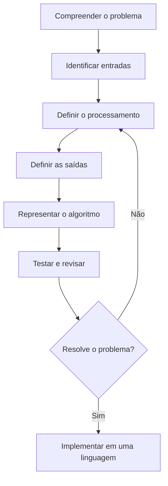
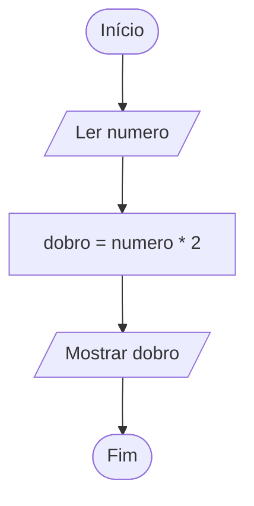
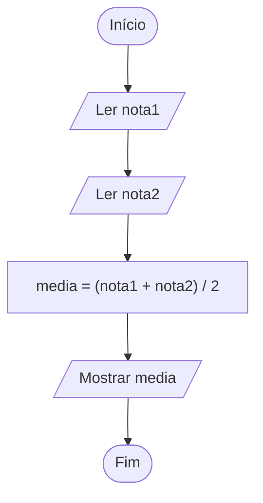
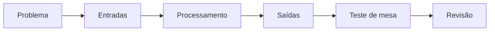

# Capítulo 2 — Algoritmos: pseudocódigo e fluxogramas

!!! abstract "Neste capítulo"
    Vamos aprender a transformar problemas em instruções claras e organizadas. Para isso, estudaremos diferentes formas de representar algoritmos: descrição narrativa, pseudocódigo e fluxogramas. Ao final, você será capaz de planejar uma solução antes de implementá-la em uma linguagem de programação.

## 1. Uma solução começa antes do código

Imagine que você precisa desenvolver um programa que calcule a média de um estudante e informe se ele foi aprovado. Antes de abrir o VisualG ou o editor de C, é necessário compreender o problema:

- Quais informações precisam ser fornecidas?
- Qual cálculo deve ser realizado?
- Qual regra determina a aprovação?
- O que o programa deverá apresentar ao final?

Essas perguntas ajudam a organizar o raciocínio. Programar não é apenas escrever comandos: é construir uma solução que possa ser executada de maneira consistente.

!!! note "Conceito-chave"
    **Algoritmo** é uma sequência finita e organizada de passos que, quando executados na ordem prevista, permite resolver um problema ou realizar uma tarefa.

Um algoritmo pode ser encontrado em atividades cotidianas. Uma receita, por exemplo, apresenta ingredientes e etapas que precisam ser seguidas. Um procedimento para sacar dinheiro em um caixa eletrônico também organiza ações e decisões. Na computação, os passos são descritos com precisão para que possam ser executados por uma pessoa ou por um sistema.

### 1.1 Do problema à solução

Uma estratégia útil é dividir o desenvolvimento em etapas:



**Figura 1 —** Etapas gerais para planejar e validar uma solução.

- **Entradas:** dados que o algoritmo recebe.
- **Processamento:** operações e regras aplicadas aos dados.
- **Saídas:** resultados ou informações produzidos.

Essa organização é conhecida como modelo **entrada–processamento–saída (E-P-S)**.

### Exemplo inicial: calcular o dobro de um número

Problema: receber um número e mostrar o seu dobro.

| Etapa | Definição |
|---|---|
| Entrada | Um número |
| Processamento | Multiplicar o número por 2 |
| Saída | O dobro calculado |

A lógica pode ser resumida assim:

```text
Ler um número
Calcular o dobro
Mostrar o resultado
```

Observe que ainda não escolhemos uma linguagem de programação. Primeiro descrevemos a solução; depois podemos representá-la de diferentes maneiras.

## 2. Características de um bom algoritmo

Nem toda lista de instruções é um bom algoritmo. Para ser útil, a solução deve apresentar características importantes.

### 2.1 Clareza

Cada instrução deve ser compreensível. Uma orientação como “faça o cálculo necessário” é vaga: não informa qual cálculo deve ser realizado.

**Instrução pouco clara:** “Calcule o resultado.”

**Instrução mais clara:** “Some a primeira nota à segunda nota e divida a soma por 2.”

### 2.2 Precisão e ausência de ambiguidade

Uma instrução não deve permitir interpretações incompatíveis. Se o algoritmo precisa calcular uma média aritmética simples, deve especificar a soma das notas e a divisão pela quantidade de notas.

### 2.3 Sequência lógica

As etapas precisam estar em uma ordem coerente. Para calcular uma média, primeiro é necessário obter as notas; depois, calcular a média; por fim, apresentar o resultado.

### 2.4 Finitude

O algoritmo deve terminar após uma quantidade finita de passos. Um procedimento que repete indefinidamente sem uma condição de parada não conclui a tarefa.

### 2.5 Efetividade

As instruções devem ser executáveis, considerando as operações disponíveis. “Descubra magicamente a resposta” não descreve uma operação realizável.

!!! warning "Atenção"
    Um algoritmo pode estar escrito de forma organizada e ainda conter um erro lógico. Clareza e organização ajudam, mas é necessário verificar se os passos realmente resolvem o problema proposto.

## 3. Formas de representar algoritmos

Há várias maneiras de comunicar a lógica de uma solução. Neste capítulo, trabalharemos com três formas principais.

| Representação | Como funciona | Vantagens | Limitações |
|---|---|---|---|
| Descrição narrativa | Explica os passos usando linguagem natural | É acessível e rápida de escrever | Pode ser longa ou ambígua |
| Pseudocódigo | Usa uma estrutura semelhante à de um programa, sem exigir a sintaxe exata de uma linguagem | Destaca a lógica e facilita a transição para o código | Pode variar conforme a convenção adotada |
| Fluxograma | Usa símbolos gráficos conectados por setas | Ajuda a visualizar sequência e decisões | Pode ficar grande em algoritmos complexos |

As representações não são concorrentes: cada uma pode ser útil em uma etapa do planejamento. É possível descrever um problema em texto, organizar os passos em pseudocódigo e construir um fluxograma para visualizar o fluxo de execução.

## 4. Descrição narrativa

A descrição narrativa apresenta as instruções com frases da linguagem natural. É especialmente útil para registrar uma ideia inicial.

### Exemplo 1 — Calcular a área de um retângulo

**Problema:** receber a largura e a altura de um retângulo e apresentar sua área.

**Descrição narrativa:**

1. Solicitar a largura do retângulo.
2. Solicitar a altura do retângulo.
3. Multiplicar a largura pela altura.
4. Guardar o resultado como área.
5. Apresentar a área calculada.

A fórmula utilizada é:

\[
\text{área} = \text{largura} \times \text{altura}
\]

Se a largura for 5 e a altura for 3, a área será \(5 \times 3 = 15\) unidades quadradas.

### Quando a descrição narrativa pode falhar?

Considere a instrução “calcule a média das notas”. Ela não esclarece quantas notas existem nem qual tipo de média deve ser usado. Para melhorar a descrição, precisamos definir as entradas e a regra de cálculo.

**Dica da professora:** sempre que uma frase puder gerar dúvida, transforme-a em uma instrução específica ou registre a regra que está sendo considerada.

## 5. Pseudocódigo e Portugol

O **pseudocódigo** descreve a lógica de um algoritmo com palavras e estruturas organizadas, sem precisar seguir integralmente a sintaxe de uma linguagem de programação real.

Em atividades introdutórias, é comum utilizar o **Portugol**, uma forma de escrever algoritmos com palavras em português e estruturas semelhantes às encontradas em linguagens de programação. Ferramentas como VisualG implementam uma convenção específica de Portugol.

!!! note "Importante"
    Não existe uma única sintaxe universal de pseudocódigo. Neste material, os exemplos em Portugol/VisualG seguirão uma convenção didática consistente. Pequenas diferenças podem existir entre ferramentas e versões.

### 5.1 Elementos comuns

Um algoritmo introdutório pode incluir:

- **identificação:** nome do algoritmo;
- **declaração de variáveis:** nomes que representam dados;
- **entrada:** leitura de valores;
- **processamento:** cálculos e atribuições;
- **saída:** apresentação de informações;
- **início e fim:** delimitam a execução.

### Exemplo 2 — Dobro de um número em Portugol/VisualG

```portugol
algoritmo "calcular_dobro"
var
   numero, dobro: real
inicio
   escreva("Digite um numero: ")
   leia(numero)

   dobro <- numero * 2

   escreval("O dobro e: ", dobro)
fimalgoritmo
```

**Entendendo as instruções:**

1. `algoritmo "calcular_dobro"` identifica o algoritmo.
2. `var` inicia a declaração de variáveis.
3. `numero` armazena o valor informado; `dobro` recebe o cálculo.
4. `escreva` apresenta uma mensagem.
5. `leia(numero)` recebe um valor digitado.
6. `dobro <- numero * 2` calcula e atribui o resultado.
7. `escreval` apresenta o resultado e encerra a linha.
8. `fimalgoritmo` encerra o algoritmo.

O símbolo `<-` representa **atribuição**: o valor calculado à direita é armazenado na variável à esquerda. Ele não deve ser confundido com o sinal de igualdade usado para comparar valores em outros contextos.

### 5.2 Entrada, processamento e saída

Observe como as instruções do exemplo se relacionam com o modelo E-P-S:

| Etapa | Instrução | Função |
|---|---|---|
| Entrada | `leia(numero)` | Obtém o número |
| Processamento | `dobro <- numero * 2` | Calcula o dobro |
| Saída | `escreval(...)` | Exibe o resultado |

### 5.3 Outro exemplo — Soma de dois números

```portugol
algoritmo "somar_dois_numeros"
var
   n1, n2, soma: real
inicio
   escreva("Digite o primeiro numero: ")
   leia(n1)

   escreva("Digite o segundo numero: ")
   leia(n2)

   soma <- n1 + n2

   escreval("A soma e: ", soma)
fimalgoritmo
```

Se o usuário digitar `8` e `4`, a variável `soma` receberá `12`.

!!! tip "Boa prática"
    Use nomes que indiquem o significado dos dados. `nota1` e `nota2` são mais informativos do que `a` e `b`, principalmente quando o algoritmo cresce.

## 6. Fluxogramas

Um **fluxograma** representa graficamente as etapas de um algoritmo. Os símbolos são conectados por setas que indicam a direção do fluxo.

### 6.1 Símbolos mais utilizados

| Símbolo | Nome | Finalidade |
|---|---|---|
| Oval ou terminador | Início/Fim | Indicar o início ou o término |
| Retângulo | Processo | Representar cálculo, atribuição ou ação |
| Paralelogramo | Entrada/Saída | Ler dados ou apresentar resultados |
| Losango | Decisão | Avaliar uma condição e escolher um caminho |
| Seta | Linha de fluxo | Indicar a direção da execução |
| Círculo pequeno, em algumas notações | Conector | Ligar partes de um fluxograma |

Os símbolos podem variar em algumas notações e ferramentas. Para esta apostila, utilizaremos as convenções mais comuns em fluxogramas introdutórios.

### 6.2 Fluxograma para calcular o dobro



**Figura 2 —** Fluxograma do cálculo do dobro.

A leitura é feita seguindo as setas, do início até o fim. O paralelogramo representa a leitura e a apresentação; o retângulo representa o cálculo.

### 6.3 Como construir um fluxograma

1. Identifique o início e o fim da solução.
2. Liste as entradas necessárias.
3. Defina o processamento.
4. Identifique as saídas.
5. Escolha o símbolo apropriado para cada etapa.
6. Conecte os símbolos com setas.
7. Confira se o fluxo está completo e se não há etapas sem ligação.

!!! warning "Erro comum"
    Escrever uma pergunta dentro de um retângulo de processo pode esconder a natureza da operação. Quando o algoritmo precisa escolher entre caminhos, represente a condição com um losango e indique as saídas, como “Sim” e “Não”.

## 7. Exemplo resolvido: média de duas notas

**Problema:** ler duas notas, calcular a média aritmética simples e apresentar o resultado.

### 7.1 Planejamento

- **Entradas:** `nota1` e `nota2`.
- **Processamento:** `media = (nota1 + nota2) / 2`.
- **Saída:** valor da média.

A divisão deve ser aplicada à soma das duas notas. Os parênteses deixam explícita a ordem do cálculo.

### 7.2 Descrição narrativa

1. Solicitar a primeira nota.
2. Ler a primeira nota.
3. Solicitar a segunda nota.
4. Ler a segunda nota.
5. Somar as notas e dividir o resultado por 2.
6. Apresentar a média.

### 7.3 Pseudocódigo em Portugol/VisualG

```portugol
algoritmo "media_duas_notas"
var
   nota1, nota2, media: real
inicio
   escreva("Digite a primeira nota: ")
   leia(nota1)

   escreva("Digite a segunda nota: ")
   leia(nota2)

   media <- (nota1 + nota2) / 2

   escreval("Media: ", media)
fimalgoritmo
```

### 7.4 Fluxograma



### 7.5 Teste de mesa

Suponha que o usuário informe `8` e `6`.

| Passo | Operação | Valor após a operação |
|---|---|---|
| 1 | Ler `nota1` | `nota1 = 8` |
| 2 | Ler `nota2` | `nota2 = 6` |
| 3 | Calcular `(8 + 6) / 2` | `media = 7` |
| 4 | Mostrar a média | `7` |

O **teste de mesa** consiste em acompanhar manualmente a execução de um algoritmo, usando valores de entrada e registrando os resultados de cada etapa. Ele ajuda a identificar erros antes ou durante a implementação.

## 8. Comparando Portugol e linguagem C

A lógica de um algoritmo não depende de uma única linguagem. A sintaxe muda, mas a sequência de entrada, processamento e saída pode permanecer a mesma.

### O cálculo da média em C

```c
#include <stdio.h>

int main(void) {
    float nota1, nota2, media;

    printf("Digite a primeira nota: ");
    scanf("%f", &nota1);

    printf("Digite a segunda nota: ");
    scanf("%f", &nota2);

    media = (nota1 + nota2) / 2.0f;

    printf("Media: %.2f\n", media);

    return 0;
}
```

| Ação | Portugol/VisualG | C |
|---|---|---|
| Declarar número real | `nota1: real` | `float nota1;` |
| Apresentar mensagem | `escreva(...)` | `printf(...)` |
| Ler valor | `leia(nota1)` | `scanf("%f", &nota1)` |
| Atribuir resultado | `media <- ...` | `media = ...;` |
| Encerrar algoritmo/função | `fimalgoritmo` | `return 0;` |

!!! note "Não confunda lógica com sintaxe"
    Em Portugol, usamos `<-` para atribuir um valor; em C, usamos `=`. Essa diferença de escrita não muda a ideia: calcular um resultado e armazená-lo em uma variável.

## 9. Erros frequentes e depuração

| Erro | Por que é um problema? | Como corrigir |
|---|---|---|
| Pular a leitura de uma entrada | O algoritmo pode usar um dado que não foi informado | Verifique todas as entradas necessárias |
| Calcular antes de ler os dados | O processamento ocorre sem valores válidos | Organize entrada, processamento e saída |
| Esquecer parênteses na média | A expressão pode calcular outra coisa | Escreva a fórmula de forma explícita |
| Usar nomes pouco claros | Dificulta entender e revisar o algoritmo | Prefira nomes significativos |
| Deixar o fluxograma sem seta de saída | O fluxo pode ficar incompleto | Confira todas as conexões |
| Não testar com valores conhecidos | Erros lógicos podem passar despercebidos | Faça um teste de mesa |

### Um exemplo de erro lógico

Considere:

```text
media <- nota1 + nota2 / 2
```

Se `nota1 = 8` e `nota2 = 6`, a expressão resulta em `8 + 3 = 11`, pois a divisão tem prioridade sobre a adição.

A forma correta para a média aritmética simples é:

```text
media <- (nota1 + nota2) / 2
```

Agora o resultado é `(8 + 6) / 2 = 7`.

## 10. Prática guiada

**Desafio:** criar um algoritmo que receba o preço de um produto e a quantidade comprada, calcule o valor total e apresente o resultado.

### Etapa 1 — Identifique os dados

- Entrada: preço unitário e quantidade.
- Processamento: preço unitário multiplicado pela quantidade.
- Saída: valor total.

### Etapa 2 — Escreva a lógica

```text
Ler preco
Ler quantidade
total <- preco * quantidade
Mostrar total
```

### Etapa 3 — Implemente em Portugol/VisualG

```portugol
algoritmo "valor_compra"
var
   preco, total: real
   quantidade: inteiro
inicio
   escreva("Preco unitario: ")
   leia(preco)

   escreva("Quantidade: ")
   leia(quantidade)

   total <- preco * quantidade

   escreval("Valor total: R$ ", total)
fimalgoritmo
```

### Etapa 4 — Teste a solução

Se o preço unitário for R$ 12,50 e a quantidade for 3, o total esperado é R$ 37,50.

Antes de considerar o algoritmo concluído, pergunte:

- Todas as entradas foram lidas?
- A fórmula está correta?
- A saída apresenta o resultado esperado?
- O algoritmo termina?
- O teste de mesa confirma o cálculo?

## 11. Lista de exercícios

Resolva os exercícios antes de consultar o gabarito. Quando solicitado, apresente a descrição narrativa, o pseudocódigo e/ou o fluxograma. Utilize nomes de variáveis claros e teste seus algoritmos com pelo menos um conjunto de dados.

### Nível 1 — Compreensão dos conceitos

**1.** Explique, com suas palavras, o que é um algoritmo. Dê um exemplo de algoritmo do cotidiano e identifique pelo menos quatro etapas.

**2.** Diferencie entrada, processamento e saída. Apresente um exemplo de cada elemento em um programa que calcula o valor de uma compra.

**3.** Cite quatro características desejáveis de um algoritmo e explique por que cada uma é importante.

**4.** Compare descrição narrativa, pseudocódigo e fluxograma. Indique uma vantagem e uma limitação de cada representação.

**5.** Relacione os símbolos do fluxograma às suas finalidades: terminador, processo, entrada/saída, decisão e seta de fluxo.

**6.** Explique por que um algoritmo precisa ter uma condição de término ou uma forma de concluir a tarefa.

### Nível 2 — Representação e interpretação

**7.** Escreva uma descrição narrativa para um algoritmo que leia o nome de uma pessoa e apresente uma mensagem de boas-vindas.

**8.** Represente em Portugol/VisualG um algoritmo que leia dois números e apresente a soma.

**9.** Construa um fluxograma para calcular o perímetro de um retângulo a partir da largura e da altura. Utilize a fórmula `perimetro = 2 * (largura + altura)`.

**10.** Escreva um algoritmo que leia o preço de um produto e apresente o preço com um acréscimo fixo de R$ 10,00. Identifique as entradas, o processamento e a saída.

**11.** Elabore um algoritmo que leia a idade de uma pessoa e apresente a idade informada. Escreva a solução em descrição narrativa e pseudocódigo.

**12.** Considere o pseudocódigo:

```text
Ler a
Ler b
resultado <- a * b
Mostrar resultado
```

a) Qual operação matemática é realizada?  
b) Quais são as entradas?  
c) Qual é a saída?  
d) Qual resultado será apresentado se `a = 7` e `b = 4`?

**13.** Um estudante escreveu os passos para calcular a média: mostrar a média, ler as notas, calcular a média. Identifique o problema na ordem das instruções e reescreva a sequência corretamente.

**14.** Construa um fluxograma para ler três números, calcular a soma e apresentar o resultado.

### Nível 3 — Aplicação

**15.** Desenvolva um algoritmo que leia a base e a altura de um triângulo e calcule sua área. Use `area = (base * altura) / 2`. Apresente descrição narrativa, Portugol e um teste de mesa.

**16.** Um estacionamento cobra uma tarifa fixa de R$ 8,00 mais R$ 5,00 por hora utilizada. Crie um algoritmo que leia a quantidade de horas e calcule o valor a pagar. Para este exercício, considere que a quantidade de horas será um número inteiro não negativo.

**17.** Crie um algoritmo que leia o salário mensal de uma pessoa e calcule o valor correspondente a 12 meses, sem considerar descontos, bônus ou reajustes. Explique as entradas e saídas.

**18.** Um estudante precisa calcular a média de quatro avaliações. Crie um algoritmo que leia as quatro notas, calcule a média aritmética e apresente o resultado. Teste com as notas 6, 7, 8 e 9.

**19.** Elabore um algoritmo para converter uma temperatura em graus Celsius para Fahrenheit, utilizando `F = (C * 9 / 5) + 32`. Represente a solução em pseudocódigo e fluxograma.

**20.** Um sistema recebe a quantidade de itens comprados e o preço unitário de cada item. Escreva um algoritmo que calcule o subtotal. Depois, descreva como você ampliaria a solução para incluir um desconto percentual.

### Nível 4 — Análise, depuração e desafio

**21.** Analise o algoritmo abaixo:

```text
Ler largura
Ler altura
area <- largura + altura
Mostrar area
```

O objetivo é calcular a área de um retângulo. Identifique o erro lógico, corrija a expressão e informe o resultado esperado para largura 5 e altura 3.

**22.** Uma pessoa escreveu `media <- nota1 + nota2 / 2` para calcular a média de duas notas. Explique por que essa expressão pode produzir um resultado incorreto e escreva a versão corrigida.

**23.** Observe o fluxograma do cálculo do dobro apresentado neste capítulo. Descreva o que aconteceria se a etapa “Ler número” fosse removida. Explique a relação entre entradas e processamento.

**24.** Crie um algoritmo para calcular o custo de uma viagem de carro, considerando a distância percorrida, o consumo médio do veículo em quilômetros por litro e o preço por litro do combustível. Defina as entradas, a fórmula, a saída e faça um teste de mesa com valores escolhidos por você.

**25. Desafio integrador.** Escolha um problema simples da rotina acadêmica, como calcular a média de notas, estimar o tempo de estudo ou calcular o custo de impressão. Documente:
- o problema e o objetivo;
- as entradas, o processamento e as saídas;
- a descrição narrativa;
- o pseudocódigo;
- o fluxograma;
- pelo menos dois testes de mesa;
- uma breve justificativa de como os testes ajudam a validar a solução.

## 12. Gabarito comentado

!!! tip "Como usar o gabarito"
    Tente resolver cada exercício antes de abrir as respostas. Para questões de criação de algoritmos, outras soluções podem estar corretas desde que sejam claras, coerentes e resolvam o problema proposto.

??? success "Respostas dos exercícios 1 a 6"
    **1.** Algoritmo é uma sequência finita e organizada de instruções para resolver um problema. Exemplo: preparar uma bebida — separar os ingredientes, colocar água para aquecer, preparar a bebida e servi-la. As etapas devem ser claras e estar em ordem.

    **2.** Entrada é o dado recebido (por exemplo, preço e quantidade); processamento é a operação (preço × quantidade); saída é o resultado (valor total).

    **3.** Exemplos: clareza (facilita a compreensão), precisão (evita interpretações diferentes), sequência lógica (garante a ordem correta), finitude (permite concluir a tarefa) e efetividade (as operações podem ser executadas).

    **4.** A descrição narrativa é fácil de ler, mas pode ser ambígua; o pseudocódigo organiza a lógica, mas depende de uma convenção; o fluxograma evidencia o fluxo, mas pode ficar extenso em soluções grandes.

    **5.** Terminador: início/fim; processo: cálculo ou atribuição; entrada/saída: leitura ou apresentação; decisão: avaliação de condição; seta: direção do fluxo.

    **6.** Sem término, a tarefa pode não ser concluída. Em algoritmos iterativos, por exemplo, uma condição de parada impede que a repetição continue indefinidamente.

??? success "Respostas dos exercícios 7 a 14"
    **7. Descrição narrativa:** solicitar o nome; ler o nome; montar a mensagem de boas-vindas; apresentar a mensagem.

    **8.**
    ```portugol
    algoritmo "soma"
    var
       a, b, soma: real
    inicio
       leia(a)
       leia(b)
       soma <- a + b
       escreval("Soma: ", soma)
    fimalgoritmo
    ```

    **9.** Início → ler largura e altura → calcular `perimetro <- 2 * (largura + altura)` → mostrar perímetro → fim. Entrada/saída em paralelogramos e cálculo em retângulo.

    **10.** Entrada: preço. Processamento: `precoFinal <- preco + 10`. Saída: preço final. O algoritmo deve ler o preço, calcular o acréscimo e apresentar o resultado.

    **11.** Narrativa: solicitar idade, ler idade e apresentá-la. Em Portugol, declarar `idade: inteiro`, executar `leia(idade)` e `escreval("Idade: ", idade)`.

    **12.** a) Multiplicação. b) `a` e `b`. c) `resultado`. d) `28`.

    **13.** O algoritmo tenta apresentar o resultado antes de obter e processar as notas. Ordem correta: ler as notas, calcular a média, mostrar a média.

    **14.** Início → ler `n1`, `n2`, `n3` → calcular `soma <- n1 + n2 + n3` → mostrar soma → fim.

??? success "Respostas dos exercícios 15 a 20"
    **15.**
    ```portugol
    algoritmo "area_triangulo"
    var
       base, altura, area: real
    inicio
       leia(base)
       leia(altura)
       area <- (base * altura) / 2
       escreval("Area: ", area)
    fimalgoritmo
    ```
    Teste: base = 10 e altura = 4 → área = 20.

    **16.**
    ```text
    Ler horas
    valor <- 8 + 5 * horas
    Mostrar valor
    ```
    Para 3 horas, o valor é `8 + 5 × 3 = R$ 23,00`.

    **17.** `totalAnual <- salarioMensal * 12`. Entrada: salário mensal. Saída: total correspondente a 12 meses. O cálculo não representa salário líquido anual, pois desconsidera descontos e adicionais.

    **18.** `media <- (n1 + n2 + n3 + n4) / 4`. Para 6, 7, 8 e 9, a soma é 30 e a média é 7,5.

    **19.**
    ```text
    Ler celsius
    fahrenheit <- (celsius * 9 / 5) + 32
    Mostrar fahrenheit
    ```
    Fluxo: início → ler Celsius → calcular Fahrenheit → mostrar resultado → fim. Para 0 °C, o resultado é 32 °F.

    **20.** `subtotal <- quantidade * precoUnitario`. Para acrescentar desconto percentual, leia também a taxa de desconto e calcule `desconto <- subtotal * taxa / 100`; então `total <- subtotal - desconto`.

??? success "Respostas dos exercícios 21 a 25"
    **21.** O algoritmo soma largura e altura, mas a área do retângulo é o produto. Correção: `area <- largura * altura`. Para 5 e 3, área = 15.

    **22.** A divisão tem prioridade sobre a adição; por isso, `nota1 + nota2 / 2` equivale a `nota1 + (nota2 / 2)`. Correção: `media <- (nota1 + nota2) / 2`.

    **23.** Sem a leitura, o algoritmo não recebe o valor que será usado no cálculo. O processamento depende de uma entrada válida. A implementação pode utilizar uma variável sem valor definido, gerando comportamento incorreto.

    **24.** Uma solução possível é `litros <- distancia / consumoMedio` e `custo <- litros * precoLitro`. Exemplo: distância = 300 km, consumo = 10 km/L e preço = R$ 6,00/L. Litros = 30; custo = R$ 180,00. O consumo médio deve ser maior que zero.

    **25.** A resposta depende do problema escolhido. Avalie se o estudante descreveu claramente o objetivo, identificou entradas e saídas, organizou corretamente o processamento, apresentou representações coerentes entre si e testou a solução com dados verificáveis.

## 13. Resumo visual



**Checklist de aprendizagem**

- [ ] Consigo explicar o que é um algoritmo.
- [ ] Consigo identificar entradas, processamento e saídas.
- [ ] Sei diferenciar descrição narrativa, pseudocódigo e fluxograma.
- [ ] Reconheço os símbolos básicos de um fluxograma.
- [ ] Consigo escrever um algoritmo simples em Portugol/VisualG.
- [ ] Sei acompanhar uma execução com teste de mesa.
- [ ] Consigo identificar e corrigir erros lógicos simples.

## 14. Glossário

- **Algoritmo:** sequência finita e organizada de passos para resolver um problema.
- **Entrada:** dado fornecido ao algoritmo.
- **Processamento:** operações realizadas sobre os dados.
- **Saída:** resultado produzido pelo algoritmo.
- **Pseudocódigo:** representação textual estruturada da lógica de uma solução.
- **Portugol:** notação didática que utiliza palavras em português e estruturas semelhantes às de linguagens de programação.
- **Fluxograma:** representação gráfica do fluxo de um algoritmo.
- **Teste de mesa:** simulação manual da execução de um algoritmo com valores de teste.
- **Atribuição:** operação que armazena um valor em uma variável.
- **Erro lógico:** falha na lógica que pode fazer o algoritmo produzir um resultado incorreto.

## 15. Referências e materiais complementares

Este capítulo foi elaborado como material didático autoral para a disciplina de Algoritmos e Lógica de Programação. Para aprofundamento, recomenda-se consultar:

- documentação e materiais de apoio da ferramenta VisualG adotada nas aulas;
- materiais introdutórios de algoritmos e lógica de programação indicados pela docente;
- documentação oficial da linguagem C, especialmente sobre tipos, expressões, entrada e saída.

Antes da publicação institucional, acrescente à bibliografia da disciplina as referências específicas adotadas no plano de ensino e confirme as versões dos softwares utilizadas nas aulas.
