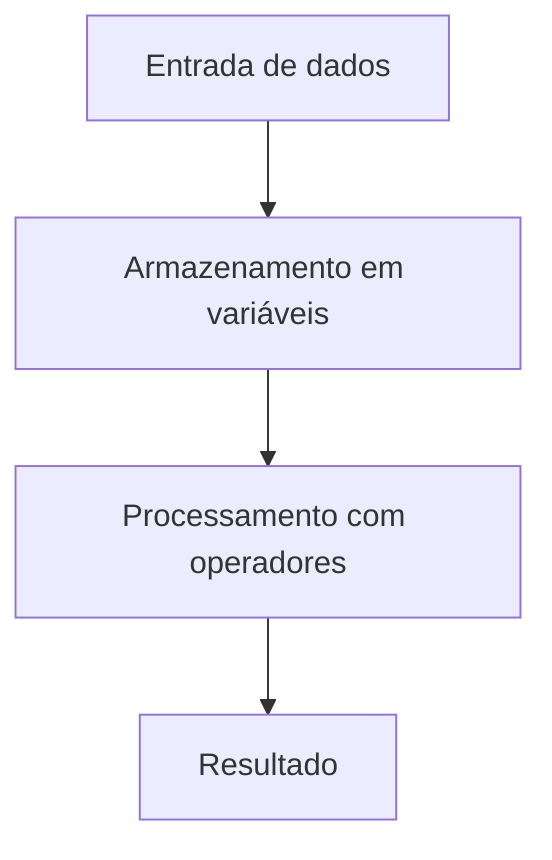
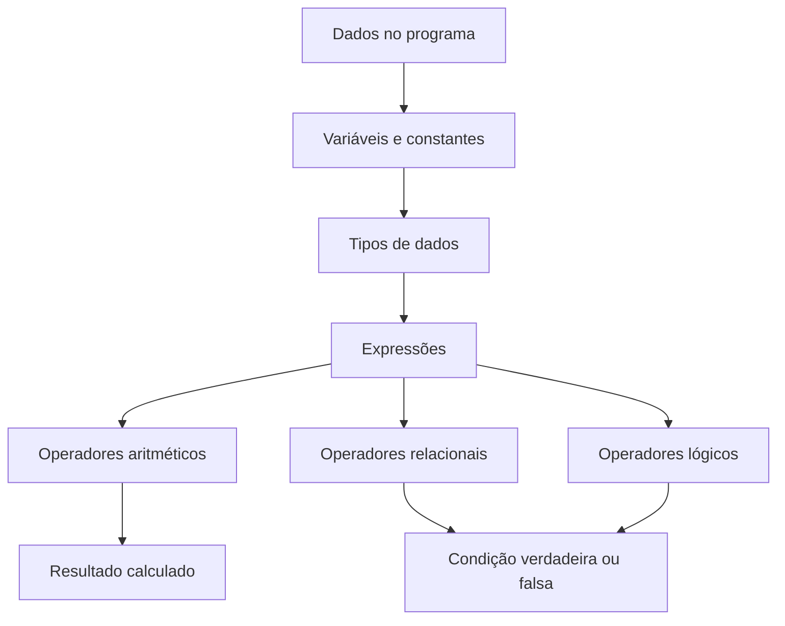

# Capítulo 3 — Variáveis, Tipos de Dados e Operadores

> **Unidade curricular:** Algoritmos e Lógica de Programação  
> **Curso:** Desenvolvimento de Software Multiplataforma (DSM)  
> **Objetivo do capítulo:** compreender como os programas representam informações, armazenam valores e realizam operações para produzir resultados.

---

## 3.1 Por que precisamos de variáveis?

Imagine um programa que calcula a média de um estudante. Para realizar esse cálculo, ele precisa guardar as notas informadas, somá-las e dividir o resultado pela quantidade de avaliações. Também pode precisar armazenar o nome do estudante e a média calculada.

Essas informações precisam permanecer disponíveis durante a execução do programa. Para isso, utilizamos **variáveis**.

Uma variável é um espaço lógico de armazenamento identificado por um nome, associado a um tipo de dado e a um valor que pode ser utilizado ou alterado durante a execução.



### Objetivos de aprendizagem

Ao final deste capítulo, você deverá ser capaz de:

- explicar a função das variáveis e das constantes;
- distinguir declaração, inicialização e atribuição;
- escolher tipos de dados adequados;
- utilizar operadores aritméticos, relacionais e lógicos;
- interpretar expressões e sua precedência;
- acompanhar a alteração de valores por meio de uma tabela de teste;
- implementar expressões equivalentes em Portugol/VisualG e em C.

## 3.2 Variáveis: nome, tipo e valor

Considere a variável `idade`, que armazena o valor `20`.

| Elemento | Exemplo | Significado |
|---|---|---|
| Nome | `idade` | Identificador usado no programa |
| Tipo | inteiro | Categoria de valor que pode ser armazenado |
| Valor | `20` | Conteúdo atual da variável |

O valor de uma variável pode mudar ao longo do programa. Por exemplo, depois de executar uma atribuição, `idade` pode passar de `20` para `21`.

### 3.2.1 Identificadores

Os identificadores são os nomes utilizados para representar variáveis, constantes, funções e outros elementos do código.

Boas práticas para nomear variáveis:

- escolha nomes que indiquem o significado dos dados, como `quantidadeProdutos`;
- evite nomes vagos, como `x`, `a` ou `valor1`, quando um nome mais claro for possível;
- não utilize espaços nos identificadores;
- comece com uma letra ou sublinhado, respeitando as regras da linguagem;
- não use palavras reservadas da linguagem;
- mantenha um padrão de escrita consistente.

Exemplos de nomes descritivos:

```c
int idade;
int quantidadeAlunos;
float mediaFinal;
```

As regras exatas de nomes variam entre linguagens. Em C, por exemplo, `mediaFinal` e `MediaFinal` são identificadores diferentes, pois a linguagem diferencia letras maiúsculas e minúsculas.

## 3.3 Declaração, inicialização e atribuição

Esses termos estão relacionados, mas não significam a mesma coisa.

- **Declaração:** informa ao compilador que uma variável existe e qual é seu tipo.
- **Inicialização:** fornece o primeiro valor à variável.
- **Atribuição:** coloca um valor em uma variável, substituindo o valor anterior, quando houver.

Exemplo em C:

```c
int idade;       // declaração
idade = 18;      // atribuição de um valor
idade = 19;      // nova atribuição: o valor anterior é substituído
```

Declaração e inicialização podem ocorrer juntas:

```c
int idade = 18;
```

Em C, uma variável local automática que não foi inicializada não deve ser lida como se tivesse um valor conhecido. Inicialize as variáveis antes de utilizá-las.

### 3.3.1 O símbolo de atribuição

Em C, o operador `=` representa **atribuição**, e não igualdade matemática.

```c
idade = 20;
idade = idade + 1;
```

Na segunda linha, o programa calcula o valor atual de `idade` mais `1` e armazena o resultado novamente em `idade`. Se antes a variável valia `20`, depois da instrução valerá `21`.

Esse comportamento é diferente de uma equação algébrica. Em matemática, `x = x + 1` não descreve uma igualdade verdadeira para um número comum; em programação, descreve uma atualização do conteúdo da variável.

## 3.4 Constantes

Uma constante representa um valor que não deve ser alterado durante o trecho do programa em que é utilizado. Ela ajuda a evitar números repetidos e torna o código mais legível.

Em C, a palavra-chave `const` permite declarar um objeto cujo valor não pode ser modificado por meio desse identificador após a inicialização:

```c
const float PI = 3.14159f;
```

Se o programa tentar atribuir outro valor a `PI`, o compilador deverá apontar uma violação de constância.

Uma constante nomeada também documenta o propósito do valor:

```c
const int DIAS_DA_SEMANA = 7;
```

Use constantes para valores conceituais que não devem ser alterados, como limites definidos pelo problema, taxas fixas ou quantidades de referência.

## 3.5 Tipos de dados

O tipo de dado define a categoria de valores que uma variável pode representar e influencia as operações que podem ser realizadas com ela.

| Categoria | Uso comum | Exemplo em C | Exemplos de valores |
|---|---|---|---|
| Inteiro | Contagens e quantidades sem parte fracionária | `int` | `0`, `18`, `-7` |
| Real aproximado | Medidas e valores com parte fracionária | `float`, `double` | `7.5`, `-2.25` |
| Caractere | Um caractere | `char` | `'A'`, `'z'`, `'7'` |
| Texto | Sequência de caracteres | vetor de `char` | `"Maria"` |
| Lógico | Condição verdadeira ou falsa | `bool` com `<stdbool.h>` em C padrão até C17 | `true`, `false` |

### 3.5.1 Inteiros

O tipo `int` é utilizado para números inteiros dentro do intervalo permitido pela implementação.

```c
int quantidade = 12;
int saldoDePontos = -3;
```

Não use um tipo inteiro quando o problema exigir preservar uma parte fracionária. Se uma divisão resultar em `2.5`, armazená-la em uma variável inteira não preservará essa fração.

### 3.5.2 Números reais

Em C, `float` e `double` representam números de ponto flutuante. `double` geralmente oferece maior precisão do que `float`.

```c
float altura = 1.68f;
double distancia = 1234.56789;
```

Números de ponto flutuante são representações aproximadas. Por isso, em cálculos que exigem precisão rigorosa, como certas aplicações financeiras ou científicas, é necessário avaliar cuidadosamente a representação numérica e os métodos de cálculo.

### 3.5.3 Caracteres e textos

Em C, `char` é usado para armazenar um caractere, como `'A'`. Literais de caractere são escritos entre aspas simples.

```c
char turma = 'B';
```

Textos são sequências de caracteres. Em C, uma forma introdutória de armazená-los é utilizar um vetor de `char`:

```c
char nome[] = "Ana";
```

Literais de texto são escritos entre aspas duplas. Observe a diferença:

```c
char letra = 'A';   // um caractere
char nome[] = "Ana"; // uma sequência de caracteres
```

### 3.5.4 Valores lógicos

Uma expressão lógica representa uma condição que pode ser verdadeira ou falsa.

Em C, pode-se utilizar `bool`, `true` e `false` incluindo a biblioteca padrão:

```c
#include <stdbool.h>

bool aprovado = true;
```

Em versões anteriores a C23, `bool`, `true` e `false` são disponibilizados por `<stdbool.h>`. O tipo lógico é especialmente útil em condições e estruturas de decisão, estudadas em capítulos posteriores.

## 3.6 Operadores aritméticos

Os operadores aritméticos permitem realizar cálculos.

| Operador | Operação | Exemplo | Resultado |
|---|---|---|---:|
| `+` | Adição | `8 + 3` | 11 |
| `-` | Subtração | `8 - 3` | 5 |
| `*` | Multiplicação | `8 * 3` | 24 |
| `/` | Divisão | `8 / 3` com operandos inteiros em C | 2 |
| `%` | Resto da divisão inteira | `8 % 3` | 2 |

### 3.6.1 Divisão inteira e divisão real

Em C, quando os dois operandos de `/` são inteiros, o resultado também é inteiro, com a parte fracionária descartada em uma divisão comum entre valores positivos.

```c
int resultado1 = 7 / 2;       // resultado1 vale 3
double resultado2 = 7.0 / 2;  // resultado2 vale 3.5
```

Atenção: atribuir o resultado de uma divisão inteira a uma variável `double` não recupera a parte fracionária que já foi descartada.

```c
double resultado = 7 / 2; // resultado vale 3.0, não 3.5
```

Para obter a fração, pelo menos um dos operandos deve participar da operação como valor de ponto flutuante, por exemplo `7.0 / 2`.

### 3.6.2 Operador de resto `%`

O operador `%` calcula o resto de uma divisão inteira. Ele é útil para verificar divisibilidade, identificar números pares e ímpares e separar componentes de valores.

```c
int resto = 17 % 5; // resto vale 2
```

Para verificar se um inteiro é par, uma condição comum é:

```c
numero % 2 == 0
```

Se o resto da divisão por `2` for zero, o número é divisível por `2`.

### 3.6.3 Incremento e decremento

Em C, `++` incrementa uma variável em uma unidade e `--` a decrementa em uma unidade.

```c
int contador = 4;
contador++; // agora vale 5
contador--; // agora vale 4
```

As formas pré-incremento (`++contador`) e pós-incremento (`contador++`) diferem quando a expressão resultante é utilizada em uma expressão maior. No início, prefira usá-las em instruções isoladas para tornar a leitura mais simples.

## 3.7 Operadores relacionais

Operadores relacionais comparam valores e produzem um resultado lógico.

| Operador em C | Significado | Exemplo |
|---|---|---|
| `==` | Igual a | `idade == 18` |
| `!=` | Diferente de | `idade != 18` |
| `>` | Maior que | `nota > 7` |
| `<` | Menor que | `temperatura < 15` |
| `>=` | Maior ou igual a | `frequencia >= 75` |
| `<=` | Menor ou igual a | `saldo <= 100` |

**Não confunda `=` com `==`.**

- `idade = 18` atribui o valor `18` à variável.
- `idade == 18` compara o valor atual de `idade` com `18`.

Exemplo:

```c
int idade = 20;
bool maiorDeIdade = idade >= 18;
```

Com `<stdbool.h>` incluído, `maiorDeIdade` recebe `true`.

## 3.8 Operadores lógicos

Os operadores lógicos combinam ou invertem condições.

| Operador em C | Nome | Interpretação |
|---|---|---|
| `&&` | E lógico | Verdadeiro quando as duas condições são verdadeiras |
| `||` | OU lógico | Verdadeiro quando pelo menos uma condição é verdadeira |
| `!` | NÃO lógico | Inverte o valor lógico |

### 3.8.1 Tabela-verdade do E (`&&`)

| A | B | A `&&` B |
|---|---|---|
| Falso | Falso | Falso |
| Falso | Verdadeiro | Falso |
| Verdadeiro | Falso | Falso |
| Verdadeiro | Verdadeiro | Verdadeiro |

O resultado de `A && B` só é verdadeiro quando ambas as condições são verdadeiras.

### 3.8.2 Tabela-verdade do OU (`||`)

| A | B | A `||` B |
|---|---|---|
| Falso | Falso | Falso |
| Falso | Verdadeiro | Verdadeiro |
| Verdadeiro | Falso | Verdadeiro |
| Verdadeiro | Verdadeiro | Verdadeiro |

O resultado de `A || B` é verdadeiro quando ao menos uma das condições é verdadeira.

### 3.8.3 Tabela-verdade do NÃO (`!`)

| A | `!A` |
|---|---|
| Falso | Verdadeiro |
| Verdadeiro | Falso |

Exemplo de uso combinado:

```c
bool temIngresso = true;
bool documentoValido = false;

bool podeEntrar = temIngresso && documentoValido;
```

Nesse caso, `podeEntrar` recebe `false`, pois as duas condições não são verdadeiras.

### 3.8.4 Curto-circuito

Em C, `&&` e `||` usam avaliação de curto-circuito. No operador `&&`, se a primeira condição for falsa, a segunda não precisa ser avaliada. No operador `||`, se a primeira condição for verdadeira, a segunda não precisa ser avaliada.

Esse comportamento pode evitar operações desnecessárias, mas expressões devem ser escritas com cuidado para não depender de efeitos colaterais confusos.

## 3.9 Precedência e uso de parênteses

Quando uma expressão contém vários operadores, a linguagem segue regras de precedência e associatividade para determinar a ordem de avaliação.

Considere:

```c
int resultado = 2 + 3 * 4;
```

A multiplicação é realizada antes da adição, então `resultado` vale `14`.

Com parênteses:

```c
int resultado = (2 + 3) * 4;
```

A expressão entre parênteses é avaliada primeiro, então `resultado` vale `20`.

| Prioridade geral | Operadores comuns | Exemplo |
|---|---|---|
| Maior, neste conjunto | Parênteses na expressão | `(2 + 3) * 4` |
| Multiplicação/divisão/resto | `*`, `/`, `%` | `12 / 3 * 2` |
| Adição/subtração | `+`, `-` | `10 - 4 + 1` |
| Comparação relacional | `<`, `<=`, `>`, `>=` | `idade >= 18` |
| Igualdade | `==`, `!=` | `nota != 0` |
| E lógico | `&&` | `a > 0 && b > 0` |
| OU lógico | `||` | `a > 0 || b > 0` |
| Atribuição | `=` | `media = soma / 2.0` |

A tabela apresenta uma visão introdutória, não a lista completa da precedência em C. Ao escrever expressões longas, use parênteses para deixar a intenção explícita e reduzir ambiguidades de leitura.

## 3.10 Expressões e atribuições: exemplo completo

Uma expressão combina valores, variáveis e operadores para calcular um resultado.

### Exemplo 1 — Média de duas avaliações

**Problema:** receber duas notas, calcular a média aritmética e exibir o resultado.

#### Passo 1 — Identificar os dados

- Entradas: `nota1` e `nota2`.
- Processamento: somar as notas e dividir por `2`.
- Saída: `media`.

#### Passo 2 — Pseudocódigo

```text
INÍCIO
    LEIA nota1
    LEIA nota2
    media ← (nota1 + nota2) / 2
    ESCREVA media
FIM
```

#### Passo 3 — Implementação em C

```c
#include <stdio.h>

int main(void) {
    double nota1, nota2, media;

    printf("Digite a primeira nota: ");
    scanf("%lf", &nota1);

    printf("Digite a segunda nota: ");
    scanf("%lf", &nota2);

    media = (nota1 + nota2) / 2.0;

    printf("Media: %.2f\n", media);
    return 0;
}
```

O especificador `%lf` é usado com `scanf` para ler um valor do tipo `double`. Em `printf`, `%f` é utilizado para imprimir um valor de ponto flutuante do tipo promovido; `%.2f` mostra duas casas decimais.

#### Teste de mesa

| Etapa | `nota1` | `nota2` | Expressão/ação | `media` |
|---|---:|---:|---|---:|
| 1 | 7.0 | — | Leitura da primeira nota | — |
| 2 | 7.0 | 8.0 | Leitura da segunda nota | — |
| 3 | 7.0 | 8.0 | `(7.0 + 8.0) / 2.0` | 7.5 |
| 4 | 7.0 | 8.0 | Exibição com duas casas | 7.50 |

### Exemplo 2 — Conversão de minutos

**Problema:** dado um número inteiro de minutos, calcular quantas horas completas ele contém e quantos minutos sobram.

Se a entrada for `135`, o programa deve calcular `2` horas e `15` minutos.

```c
#include <stdio.h>

int main(void) {
    int totalMinutos;
    int horas;
    int minutosRestantes;

    printf("Digite o total de minutos: ");
    scanf("%d", &totalMinutos);

    horas = totalMinutos / 60;
    minutosRestantes = totalMinutos % 60;

    printf("Horas: %d\n", horas);
    printf("Minutos restantes: %d\n", minutosRestantes);

    return 0;
}
```

O operador `/` realiza a divisão inteira e `%` calcula o resto. Para a entrada `135`, `135 / 60` resulta em `2`, enquanto `135 % 60` resulta em `15`.

## 3.11 Variáveis e operadores em Portugol/VisualG e C

A notação pode mudar entre pseudocódigo e linguagem de programação. O raciocínio deve permanecer equivalente.

| Conceito | Pseudocódigo/VisualG (notação comum) | C |
|---|---|---|
| Atribuição | `idade <- 18` | `idade = 18;` |
| Igualdade em condição | `idade = 18` em notação VisualG | `idade == 18` |
| Diferente | `<>` em notação VisualG | `!=` |
| E lógico | `e` | `&&` |
| OU lógico | `ou` | `||` |
| NÃO lógico | `nao` | `!` |
| Resto | `mod` em notação comum de Portugol | `%` |
| Declaração de inteiro | `idade: inteiro` | `int idade;` |
| Declaração de real | `nota: real` | `double nota;` |

A sintaxe exata pode variar conforme a versão do VisualG ou o ambiente de Portugol adotado. Verifique os exemplos da ferramenta utilizada na disciplina.

## 3.12 Erros comuns e como evitá-los

### Erro 1 — Confundir atribuição com comparação

```c
if (idade = 18) {
    /* ... */
}
```

Essa expressão atribui `18` a `idade`; não testa se a idade é igual a `18`. Para comparar, use `idade == 18`.

### Erro 2 — Esquecer a inicialização

```c
int total;
total = total + 10;
```

O valor inicial de `total` não foi definido. Uma forma correta é:

```c
int total = 0;
total = total + 10;
```

### Erro 3 — Esperar uma divisão real com dois inteiros

```c
double media = (7 + 8) / 2;
```

Como todos os operandos da divisão são inteiros, a operação é feita como divisão inteira. Nesse exemplo o resultado é `7.0`, que por coincidência também é a média exata; para um caso como `(7 + 8) / 2`, o valor seria 7.5 matematicamente, mas a divisão inteira produz 7. Use `2.0` para garantir uma divisão em ponto flutuante.

Forma recomendada:

```c
double media = (7 + 8) / 2.0;
```

### Erro 4 — Usar aspas incorretas para texto

```c
char inicial = "A"; // incorreto para um único char
```

Para um único caractere, use aspas simples:

```c
char inicial = 'A';
```

Para um texto, utilize aspas duplas:

```c
char nome[] = "Ana";
```

### Erro 5 — Escrever uma condição lógica sem pensar no objetivo

Antes de usar `&&` ou `||`, pergunte: **todas** as condições precisam ser verdadeiras ou basta **uma** delas?

- “Pode entrar se tiver ingresso **e** documento válido”: `temIngresso && documentoValido`.
- “Recebe alerta se a temperatura for baixa **ou** a pressão for alta”: `temperaturaBaixa || pressaoAlta`.

## 3.13 Prática guiada

### Desafio — Cálculo de compra

Uma loja precisa calcular o total de uma compra. O programa deve receber a quantidade de unidades e o preço unitário, calcular o subtotal e aplicar um desconto de 10% quando o subtotal for igual ou superior a R$ 200,00.

**Entradas:** quantidade e preço unitário.  
**Processamento:** subtotal = quantidade × preço unitário; se subtotal for pelo menos 200, desconto = subtotal × 0,10; total = subtotal − desconto.  
**Saída:** subtotal, desconto e total.

Uma primeira versão, usando os conceitos deste capítulo:

```c
#include <stdio.h>

int main(void) {
    int quantidade;
    double precoUnitario;
    double subtotal;
    double desconto = 0.0;
    double total;

    printf("Quantidade de unidades: ");
    scanf("%d", &quantidade);

    printf("Preco unitario: ");
    scanf("%lf", &precoUnitario);

    subtotal = quantidade * precoUnitario;

    if (subtotal >= 200.0) {
        desconto = subtotal * 0.10;
    }

    total = subtotal - desconto;

    printf("Subtotal: R$ %.2f\n", subtotal);
    printf("Desconto: R$ %.2f\n", desconto);
    printf("Total: R$ %.2f\n", total);

    return 0;
}
```

Esse exemplo antecipa a estrutura condicional `if`, que será estudada com mais profundidade no capítulo dedicado às decisões. Para esta atividade, concentre-se nas variáveis, nos tipos, nas expressões aritméticas e na comparação `subtotal >= 200.0`.

### Teste de mesa do desafio

Considere `quantidade = 4` e `precoUnitario = 60.00`.

| Etapa | Quantidade | Preço unitário | Subtotal | Desconto | Total |
|---|---:|---:|---:|---:|---:|
| 1 | 4 | 60,00 | — | 0,00 | — |
| 2 | 4 | 60,00 | 240,00 | 0,00 | — |
| 3 | 4 | 60,00 | 240,00 | 24,00 | — |
| 4 | 4 | 60,00 | 240,00 | 24,00 | 216,00 |

## 3.14 Exercícios

Resolva os exercícios primeiro sem executar o código. Depois, utilize papel, tabela de teste e compilador para conferir o raciocínio.

### Nível 1 — Compreensão

1. Explique, com suas palavras, o que é uma variável e apresente três exemplos de informações que poderiam ser armazenadas em um programa acadêmico.
2. Diferencie declaração, inicialização e atribuição. Escreva um pequeno exemplo em C para cada conceito.
3. Classifique os dados a seguir como mais adequados a `int`, `double`, `char` ou vetor de `char`: quantidade de livros, altura de uma pessoa, inicial do sobrenome e nome completo.
4. Explique a diferença entre `=` e `==` em C.
5. Qual é a finalidade de uma constante? Apresente uma situação em que o uso de `const` torna o programa mais claro.
6. Indique o resultado das expressões: `9 + 4`, `9 - 4`, `9 * 4`, `9 / 4` e `9 % 4`, considerando operandos inteiros em C.
7. Explique a diferença entre `'M'` e `"M"` em C.

### Nível 2 — Aplicação

8. Declare em C variáveis adequadas para armazenar matrícula numérica, média final, letra da turma e nome de um estudante.
9. Escreva um programa em C que leia dois números reais e exiba a soma, a subtração, a multiplicação e a divisão. Antes de dividir, explique como evitar a divisão por zero.
10. Leia o preço de um produto e a quantidade comprada. Calcule e exiba o valor total.
11. Leia uma quantidade de segundos e converta-a em minutos completos e segundos restantes.
12. Leia um número inteiro e calcule o resto de sua divisão por `2`. Explique como esse resultado ajuda a identificar um número par.
13. Determine o resultado das expressões abaixo e justifique a precedência utilizada:
    - `4 + 5 * 2`
    - `(4 + 5) * 2`
    - `20 / 5 + 3`
    - `20 / (5 + 3)`
14. Considere `a = 8` e `b = 3`. Determine os resultados de `a > b`, `a == b`, `a != b`, `a <= b` e `a % b == 2`.
15. Monte a tabela-verdade de `A && B` e `A || B`, explicando em quais situações cada expressão é verdadeira.
16. Escreva uma expressão lógica para verificar se uma nota está entre `0` e `10`, inclusive.
17. Escreva uma expressão lógica para verificar se uma pessoa pode participar de uma atividade que exige idade mínima de 16 anos e autorização assinada.

### Nível 3 — Análise e programação

18. Faça o teste de mesa para o trecho abaixo e informe os valores finais de `x` e `y`:

    ```c
    int x = 5;
    int y = 2;
    x = x + y;
    y = x * 2;
    x = x - 1;
    ```

19. Um programa declara `int a = 5; int b = 2; double resultado = a / b;`. Qual valor será armazenado em `resultado`? Corrija a expressão para obter `2.5`.
20. Desenvolva um programa que leia três notas reais e calcule a média aritmética com duas casas decimais.
21. Desenvolva um programa que leia um valor em reais e calcule o valor com acréscimo de 8%.
22. Desenvolva um programa que receba o total de minutos de uma duração e exiba horas completas e minutos restantes.
23. Um sistema permite desconto de 15% se o total da compra for superior a R$ 300,00 **e** o cliente possuir cadastro ativo. Escreva a expressão lógica que representa a regra e explique seus operadores.
24. Escreva um programa que leia dois números inteiros e informe o quociente inteiro e o resto da divisão. Considere como o programa deve lidar com divisor igual a zero.
25. Analise a expressão `nota >= 7 && frequencia >= 75`. Explique seu significado em linguagem natural e dê um exemplo de valores que tornam a expressão verdadeira e outro que a tornam falsa.

## 3.15 Gabarito comentado

O gabarito apresenta respostas de referência. Em questões discursivas, respostas equivalentes e tecnicamente corretas também podem ser aceitas.

1. Variável é um identificador associado a um tipo e a um valor usado pelo programa. Exemplos: nome, nota e quantidade de faltas.
2. Declaração: `int idade;`. Inicialização: `int idade = 18;`. Atribuição posterior: `idade = 19;`.
3. Quantidade de livros: `int`; altura: `double`; inicial: `char`; nome completo: vetor de `char`, por exemplo `char nome[] = "Ana Silva";`.
4. `=` atribui um valor; `==` compara dois valores.
5. Constantes nomeadas representam valores que não devem ser alterados. Exemplo: `const int DIAS_DA_SEMANA = 7;`.
6. `9 + 4 = 13`; `9 - 4 = 5`; `9 * 4 = 36`; `9 / 4 = 2`; `9 % 4 = 1`.
7. `'M'` é um literal de caractere; `"M"` é um literal de texto (uma sequência que inclui o caractere e o terminador nulo em C).
8. Uma resposta possível: `int matricula; double mediaFinal; char turma; char nome[100];`. Em aplicações reais, o tipo e o tamanho devem considerar as regras de identificação e o tamanho máximo dos dados.
9. Use `double a, b;`, leia ambos com `%lf`, exiba as operações e teste `b != 0.0` antes da divisão.
10. Leia `double preco; int quantidade;` e calcule `total = preco * quantidade;`.
11. `minutos = segundos / 60;` e `restantes = segundos % 60;`, supondo entrada não negativa.
12. Se `numero % 2 == 0`, o número é divisível por 2 e é par.
13. `4 + 5 * 2 = 14`; `(4 + 5) * 2 = 18`; `20 / 5 + 3 = 7`; `20 / (5 + 3) = 2` em divisão inteira.
14. `a > b`: verdadeiro; `a == b`: falso; `a != b`: verdadeiro; `a <= b`: falso; `a % b == 2`: verdadeiro.
15. `&&` só é verdadeiro se A e B forem verdadeiros; `||` é verdadeiro se ao menos um deles for verdadeiro. As tabelas completas estão na seção 3.8.
16. `nota >= 0 && nota <= 10`.
17. `idade >= 16 && possuiAutorizacao`, considerando `possuiAutorizacao` como valor lógico.
18. Inicialmente `x=5`, `y=2`; após `x=x+y`, `x=7`; após `y=x*2`, `y=14`; após `x=x-1`, `x=6`. Valores finais: `x=6`, `y=14`.
19. `a / b` é divisão inteira e resulta em `2`, armazenado como `2.0`. Para obter `2.5`, use `double resultado = (double)a / b;` ou `double resultado = a / 2.0;`.
20. Leia três `double` e calcule `media = (nota1 + nota2 + nota3) / 3.0;`, exibindo com `%.2f`.
21. `valorFinal = valor * 1.08;`.
22. `horas = totalMinutos / 60;` e `minutosRestantes = totalMinutos % 60;`.
23. `total > 300.0 && cadastroAtivo`. A conjunção exige que ambas as condições sejam verdadeiras.
24. Antes de calcular `a / b` e `a % b`, verifique se `b != 0`. Se for zero, informe que a divisão não pode ser realizada.
25. A expressão significa “a nota é pelo menos 7 e a frequência é pelo menos 75”. Verdadeira, por exemplo, com `nota=8` e `frequencia=80`; falsa com `nota=8` e `frequencia=60`.

## 3.16 Resumo visual



- **Variáveis** armazenam valores que podem mudar durante a execução.
- **Constantes** representam valores que não devem ser alterados.
- **Tipos** ajudam a definir quais valores podem ser representados e quais operações fazem sentido.
- **Operadores aritméticos** realizam cálculos.
- **Operadores relacionais** comparam valores.
- **Operadores lógicos** combinam condições.
- **Parênteses** tornam a intenção das expressões mais clara.
- **Teste de mesa** ajuda a acompanhar as mudanças de estado das variáveis.

## 3.17 Glossário

| Termo | Definição |
|---|---|
| Atribuição | Operação que associa um valor a uma variável |
| Constante | Identificador usado para representar um valor que não deve ser alterado |
| Expressão | Combinação de valores, variáveis e operadores que produz um resultado |
| Identificador | Nome usado para referenciar um elemento do programa |
| Inicialização | Definição do primeiro valor de uma variável |
| Operador | Símbolo ou palavra que representa uma operação |
| Precedência | Regra que determina quais operadores são avaliados primeiro |
| Tipo de dado | Categoria que determina a natureza dos valores representados |
| Variável | Identificador associado a um valor que pode mudar durante a execução |

## Referências para consulta

- KERNIGHAN, Brian W.; RITCHIE, Dennis M. **The C Programming Language**. 2. ed. Englewood Cliffs: Prentice Hall, 1988.
- ISO/IEC. **ISO/IEC 9899: Programming Languages — C**. Norma da linguagem C.
- Documentação de referência da linguagem C: [cppreference.com — C language](https://en.cppreference.com/w/c).
- Documentação e material de apoio do VisualG utilizado na disciplina.

---

**Sugestão de integração ao MkDocs:** salve este arquivo como `docs/ALP/apostila/03-variaveis-tipos-operadores.md` e acrescente ao grupo `Apostila de ALP` no `nav` do `mkdocs.yml`:

```yaml
- Apostila de ALP:
    - Apresentação: ALP/apostila/index.md
    - Capítulo 3 — Variáveis, Tipos de Dados e Operadores: ALP/apostila/03-variaveis-tipos-operadores.md
```

Se o Capítulo 2 já estiver no `nav`, mantenha-o e insira o Capítulo 3 na sequência correta.
