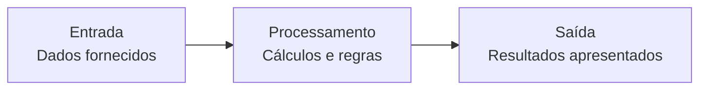
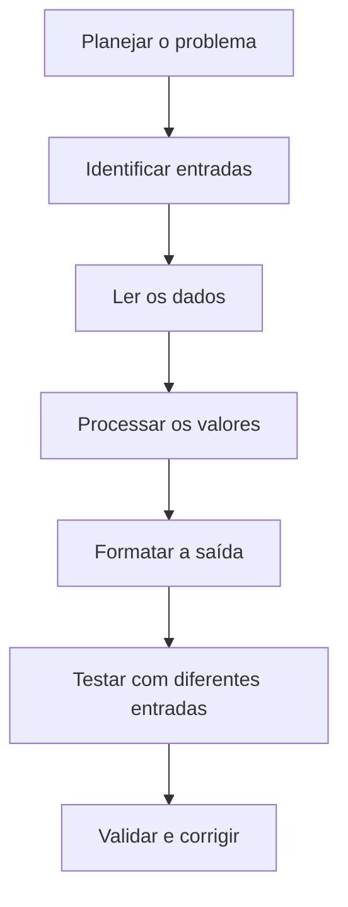

# Capítulo 4 — Entrada, Processamento e Saída de Dados

> **Unidade curricular:** Algoritmos e Lógica de Programação  
> **Curso:** Desenvolvimento de Software Multiplataforma (DSM)  
> **Objetivo do capítulo:** construir algoritmos que recebam dados, processem informações e apresentem resultados compreensíveis ao usuário.

---

## 4.1 Como um programa interage com o usuário?

Um programa não serve apenas para executar cálculos internos. Em muitas situações, ele precisa receber informações, realizar operações e apresentar os resultados. Esse ciclo é conhecido como **Entrada, Processamento e Saída (EPS)**.

- **Entrada:** dados fornecidos ao programa, como notas, nomes, quantidades ou medidas.
- **Processamento:** operações executadas sobre os dados, como cálculos, conversões e comparações.
- **Saída:** informações apresentadas ao usuário, como uma média, um total ou uma mensagem.



### Objetivos de aprendizagem

Ao final deste capítulo, você deverá ser capaz de:

- identificar as entradas, o processamento e as saídas de um problema;
- planejar a interação entre o programa e o usuário;
- ler dados com `scanf()` e exibir resultados com `printf()` em C;
- utilizar especificadores de formato adequados;
- compreender o papel de `&` na leitura de variáveis com `scanf()`;
- organizar mensagens e resultados para facilitar a interpretação;
- realizar testes com diferentes valores de entrada.

## 4.2 Planejamento com Entrada, Processamento e Saída

Antes de escrever o código, identifique quais dados são necessários, quais operações serão realizadas e quais resultados devem ser apresentados.

### Exemplo — Área de um retângulo

**Problema:** criar um programa que receba a largura e a altura de um retângulo e calcule sua área.

| Etapa | Descrição |
|---|---|
| Entrada | Largura e altura |
| Processamento | `area = largura * altura` |
| Saída | Área calculada |

O planejamento evita que o programa seja escrito sem considerar dados essenciais ou resultados esperados.

### Exemplo — Média de duas notas

| Etapa | Descrição |
|---|---|
| Entrada | Duas notas |
| Processamento | Somar as notas e dividir por `2.0` |
| Saída | Média calculada |

O resultado deve ser armazenado em um tipo adequado para preservar a parte fracionária.

## 4.3 Saída de dados em C: `printf()`

A função `printf()` permite exibir textos e valores no terminal. Ela é declarada na biblioteca padrão `stdio.h`.

```c
#include <stdio.h>

int main(void) {
    printf("Ola, estudante!\n");
    printf("Bem-vindo a Algoritmos e Logica de Programacao.\n");
    return 0;
}
```

O caractere especial `\n` indica uma quebra de linha.

### 4.3.1 Exibir valores de variáveis

Para mostrar o conteúdo de uma variável, utiliza-se um especificador de formato compatível com seu tipo.

```c
#include <stdio.h>

int main(void) {
    int idade = 20;
    double media = 8.75;

    printf("Idade: %d anos\n", idade);
    printf("Media: %.2f\n", media);

    return 0;
}
```

Saída esperada:

```text
Idade: 20 anos
Media: 8.75
```

Observe que `%.2f` apresenta o número com duas casas decimais. A formatação da saída facilita a leitura, mas não altera necessariamente o valor armazenado na variável.

### 4.3.2 Especificadores de formato frequentes

| Especificador | Uso comum em `printf()` | Exemplo |
|---|---|---|
| `%d` | Inteiro (`int`) | `printf("%d", idade);` |
| `%f` | Valor de ponto flutuante | `printf("%f", altura);` |
| `%.2f` | Valor de ponto flutuante com duas casas decimais | `printf("%.2f", media);` |
| `%c` | Caractere | `printf("%c", turma);` |
| `%s` | Texto armazenado como sequência de caracteres | `printf("%s", nome);` |
| `%lf` | Em `printf`, `%f` é o especificador usual para `double`; `%lf` também é aceito em implementações conformes modernas, mas não é necessário | `printf("%f", valorDouble);` |

Para evitar confusão no início, lembre-se: em `printf()`, use `%f` para exibir um `double`; em `scanf()`, use `%lf` para ler um `double`.

### 4.3.3 Textos e valores na mesma mensagem

```c
int quantidade = 3;
double preco = 12.50;

printf("Quantidade: %d\n", quantidade);
printf("Preco unitario: R$ %.2f\n", preco);
printf("Total: R$ %.2f\n", quantidade * preco);
```

É possível incluir vários especificadores em uma única chamada. A ordem dos argumentos deve corresponder à ordem dos especificadores no texto.

## 4.4 Entrada de dados em C: `scanf()`

A função `scanf()` lê dados digitados pelo usuário e armazena os valores nas variáveis indicadas.

```c
#include <stdio.h>

int main(void) {
    int idade;

    printf("Digite sua idade: ");
    scanf("%d", &idade);

    printf("Voce informou %d anos.\n", idade);
    return 0;
}
```

Nesse exemplo:

1. `printf()` apresenta a solicitação;
2. `scanf()` aguarda a entrada;
3. `%d` informa que será lido um inteiro;
4. `&idade` fornece o endereço da variável onde o valor deve ser armazenado;
5. o programa apresenta o valor lido.

### 4.4.1 Por que usamos `&`?

Na leitura de variáveis escalares como `int`, `double` e `char`, `scanf()` precisa receber o endereço de memória onde o dado será guardado. O operador `&`, nesse contexto, obtém o endereço da variável.

```c
int idade;
scanf("%d", &idade);
```

Não confunda esse uso de `&` com o operador lógico `&&`, que combina condições.

Em alguns casos, como leitura de um vetor de caracteres com `%s`, o nome do vetor já é convertido para um ponteiro para seu primeiro elemento, por isso o uso de `&` é diferente:

```c
char nome[30];
scanf("%29s", nome);
```

O limite `%29s` evita que a leitura ultrapasse o espaço disponível no vetor de 30 caracteres, reservando espaço para o terminador `'\0'`. Esse formato lê apenas até o primeiro espaço; para nomes completos, veja a seção 4.6.

### 4.4.2 Especificadores frequentes em `scanf()`

| Especificador | Tipo esperado | Variável de exemplo |
|---|---|---|
| `%d` | `int` | `&idade` |
| `%f` | `float` | `&altura` |
| `%lf` | `double` | `&media` |
| `%c` | `char` | `&opcao` |
| `%s` | vetor de caracteres | `nome` |

O tipo esperado precisa corresponder ao especificador utilizado. Usar um especificador incompatível pode causar comportamento indefinido.

### 4.4.3 Ler mais de um valor

É possível ler vários valores na mesma chamada:

```c
int idade;
double altura;

printf("Digite idade e altura: ");
scanf("%d %lf", &idade, &altura);
```

O usuário pode digitar, por exemplo:

```text
20 1.68
```

Para exercícios introdutórios, uma leitura por solicitação costuma ser mais clara para quem está começando.

## 4.5 Programa completo: área de um retângulo

**Problema:** ler a largura e a altura de um retângulo, calcular a área e apresentar o resultado com duas casas decimais.

```c
#include <stdio.h>

int main(void) {
    double largura;
    double altura;
    double area;

    printf("Digite a largura do retangulo: ");
    scanf("%lf", &largura);

    printf("Digite a altura do retangulo: ");
    scanf("%lf", &altura);

    area = largura * altura;

    printf("Area do retangulo: %.2f\n", area);

    return 0;
}
```

### Simulação

Entrada:

```text
Digite a largura do retangulo: 5
Digite a altura do retangulo: 3
```

Saída:

```text
Area do retangulo: 15.00
```

A sequência segue o modelo EPS: leitura dos valores, cálculo da área e apresentação do resultado.

## 4.6 Leitura de textos

O especificador `%s` lê uma sequência de caracteres até encontrar um espaço em branco, como espaço, tabulação ou quebra de linha.

```c
char nome[40];

printf("Digite seu primeiro nome: ");
scanf("%39s", nome);

printf("Ola, %s!\n", nome);
```

O limite `39` deixa uma posição para o caractere nulo que encerra a string.

Para ler uma linha que pode conter espaços, pode-se utilizar `fgets()`:

```c
#include <stdio.h>
#include <string.h>

int main(void) {
    char nomeCompleto[100];

    printf("Digite seu nome completo: ");

    if (fgets(nomeCompleto, sizeof(nomeCompleto), stdin) != NULL) {
        nomeCompleto[strcspn(nomeCompleto, "\n")] = '\0';
        printf("Nome informado: %s\n", nomeCompleto);
    }

    return 0;
}
```

`fgets()` lê até o limite indicado ou até encontrar uma quebra de linha. O uso de `strcspn()` remove a quebra de linha final, quando ela estiver presente. A biblioteca `string.h` é necessária para essa função.

Se o programa misturar `scanf()` e `fgets()`, a quebra de linha deixada pela leitura anterior pode ser consumida imediatamente por `fgets()`. Em atividades iniciais, prefira manter uma estratégia de leitura consistente ou tratar explicitamente o restante da linha.

## 4.7 Conferir se a leitura ocorreu corretamente

`scanf()` retorna a quantidade de itens lidos com sucesso. Verificar esse retorno ajuda a identificar entradas que não correspondem ao tipo esperado.

```c
#include <stdio.h>

int main(void) {
    int idade;

    printf("Digite sua idade: ");

    if (scanf("%d", &idade) == 1) {
        printf("Idade informada: %d\n", idade);
    } else {
        printf("Entrada invalida. Digite um numero inteiro.\n");
    }

    return 0;
}
```

Se o usuário digitar uma palavra quando o programa espera um inteiro, a conversão pode falhar. O teste do retorno permite apresentar uma mensagem mais útil.

Para sistemas mais robustos, a leitura de linhas com `fgets()` seguida de conversão controlada pode facilitar a validação. Neste capítulo, o foco é compreender o fluxo básico de entrada e saída.

## 4.8 Organização e legibilidade da interação

Um programa deve orientar o usuário com mensagens claras.

Compare:

```c
printf("Digite um valor: ");
```

com:

```c
printf("Digite a quantidade de produtos comprados: ");
```

A segunda mensagem explica melhor o dado solicitado.

Boas práticas:

- informe claramente o que deve ser digitado;
- indique a unidade de medida quando necessário;
- apresente rótulos nos resultados;
- formate números de acordo com a necessidade do problema;
- evite exibir apenas valores sem explicar o que representam;
- teste entradas comuns e casos extremos;
- valide entradas quando o problema exigir.

### Atenção à separação decimal

Em muitos exemplos de C, números decimais são digitados com ponto, como `7.5`, porque essa é a convenção padrão do ambiente C para conversões numéricas. A configuração regional do terminal e a forma de entrada devem ser consideradas se o programa precisar aceitar vírgula decimal.

## 4.9 Exemplo completo: cálculo de média

**Problema:** receber três notas, calcular a média aritmética e apresentar o resultado com duas casas decimais.

### Planejamento EPS

| Etapa | Elementos |
|---|---|
| Entrada | `nota1`, `nota2`, `nota3` |
| Processamento | `media = (nota1 + nota2 + nota3) / 3.0` |
| Saída | Média formatada com duas casas |

### Código em C

```c
#include <stdio.h>

int main(void) {
    double nota1;
    double nota2;
    double nota3;
    double media;

    printf("Digite a primeira nota: ");
    scanf("%lf", &nota1);

    printf("Digite a segunda nota: ");
    scanf("%lf", &nota2);

    printf("Digite a terceira nota: ");
    scanf("%lf", &nota3);

    media = (nota1 + nota2 + nota3) / 3.0;

    printf("Media final: %.2f\n", media);

    return 0;
}
```

### Teste de mesa

Considere as entradas `6.5`, `8.0` e `9.0`.

| Etapa | `nota1` | `nota2` | `nota3` | `media` |
|---|---:|---:|---:|---:|
| Leitura 1 | 6.5 | — | — | — |
| Leitura 2 | 6.5 | 8.0 | — | — |
| Leitura 3 | 6.5 | 8.0 | 9.0 | — |
| Cálculo | 6.5 | 8.0 | 9.0 | 7.83 |

A média exata é aproximadamente `7.8333...`; a exibição com `%.2f` mostra `7.83`.

## 4.10 Erros comuns e depuração

### Erro 1 — Esquecer o `&` em `scanf()`

Incorreto para uma variável inteira:

```c
int idade;
scanf("%d", idade);
```

Correto:

```c
scanf("%d", &idade);
```

### Erro 2 — Usar `%f` para ler um `double`

Incorreto:

```c
double altura;
scanf("%f", &altura);
```

Correto:

```c
scanf("%lf", &altura);
```

### Erro 3 — Usar `%d` para imprimir um `double`

Incorreto:

```c
double media = 8.5;
printf("%d\n", media);
```

Correto:

```c
printf("%.2f\n", media);
```

### Erro 4 — Não limitar a leitura com `%s`

Evite ler texto sem limite em um vetor de tamanho fixo:

```c
char nome[20];
scanf("%s", nome); // pode ultrapassar o vetor
```

Use um limite compatível, como `%19s`, ou escolha `fgets()` quando precisar ler uma linha completa.

### Erro 5 — Apresentar o resultado sem identificação

Em vez de:

```c
printf("%.2f\n", total);
```

prefira:

```c
printf("Total da compra: R$ %.2f\n", total);
```

A segunda forma deixa explícito o significado do número.

## 4.11 Prática guiada — Calculadora de consumo

Uma pessoa deseja calcular o consumo médio de combustível de uma viagem. O programa deverá receber a distância percorrida em quilômetros e a quantidade de combustível consumida em litros. Em seguida, calculará a distância por litro e exibirá o resultado com duas casas decimais.

### Planejamento

- **Entrada:** distância em quilômetros e combustível em litros.
- **Processamento:** `consumoMedio = distancia / litros`.
- **Saída:** consumo médio em km/L.

Antes de dividir, o programa deve verificar se a quantidade de litros é maior que zero.

```c
#include <stdio.h>

int main(void) {
    double distancia;
    double litros;
    double consumoMedio;

    printf("Distancia percorrida (km): ");
    if (scanf("%lf", &distancia) != 1) {
        printf("Entrada invalida para distancia.\n");
        return 1;
    }

    printf("Combustivel consumido (L): ");
    if (scanf("%lf", &litros) != 1) {
        printf("Entrada invalida para combustivel.\n");
        return 1;
    }

    if (distancia >= 0.0 && litros > 0.0) {
        consumoMedio = distancia / litros;
        printf("Consumo medio: %.2f km/L\n", consumoMedio);
    } else {
        printf("Informe distancia nao negativa e litros maiores que zero.\n");
    }

    return 0;
}
```

O exemplo usa `if` e operadores lógicos como revisão e contextualização. O foco principal continua sendo a leitura, o cálculo e a apresentação dos dados.

### Teste de mesa

Para `distancia = 300` e `litros = 25`, temos:

| Etapa | Distância | Litros | Operação | Resultado |
|---|---:|---:|---|---:|
| Entrada | 300 | 25 | Leitura dos dados | — |
| Validação | 300 | 25 | `distancia >= 0 && litros > 0` | Verdadeiro |
| Processamento | 300 | 25 | `300 / 25` | 12 |
| Saída | 300 | 25 | Exibição com duas casas | 12.00 km/L |

## 4.12 Exercícios

Resolva os exercícios e teste seus programas com mais de um conjunto de dados. Quando houver entradas inválidas ou limites relevantes, descreva como o programa deve reagir.

### Nível 1 — Compreensão

1. Explique as três etapas do modelo Entrada, Processamento e Saída (EPS).
2. Qual é a finalidade de `printf()`? Dê um exemplo de mensagem com quebra de linha.
3. Qual é a finalidade de `scanf()`? Por que normalmente utilizamos `&` ao ler uma variável `int`?
4. Associe os especificadores aos tipos: `%d`, `%lf` em `scanf()`, `%c` e `%s`.
5. Qual é a diferença entre `%s` e `fgets()` ao ler texto?
6. Explique o que significa `%.2f` em uma chamada a `printf()`.
7. Por que é importante exibir rótulos como “Média final” ou “Total da compra” junto aos resultados?

### Nível 2 — Aplicação

8. Escreva um programa que leia o nome de uma pessoa e sua idade e apresente uma frase com essas informações. Considere como lidar com nomes que contêm espaços.
9. Escreva um programa que leia dois números inteiros e exiba a soma, a diferença e o produto.
10. Escreva um programa que leia a largura e a altura de um retângulo e apresente a área com duas casas decimais.
11. Escreva um programa que leia o preço de um produto e a quantidade comprada e apresente o total.
12. Escreva um programa que leia três notas e exiba a média aritmética com duas casas decimais.
13. Escreva um programa que leia uma distância em quilômetros e apresente seu equivalente em metros.
14. Escreva um programa que leia um tempo em minutos e apresente horas completas e minutos restantes.
15. Escreva um programa que leia um valor em reais e apresente o valor com acréscimo de 5%.
16. Leia um número real e exiba-o com uma, duas e três casas decimais. Explique a diferença entre o valor armazenado e sua formatação de saída.
17. Escreva um programa que leia um caractere e o exiba entre colchetes, por exemplo `[A]`.

### Nível 3 — Análise e programação

18. Analise o código abaixo. Identifique o problema e corrija-o:

    ```c
    double nota;
    printf("Digite a nota: ");
    scanf("%f", &nota);
    printf("Nota: %d\n", nota);
    ```

19. Desenvolva um programa que leia distância percorrida e litros consumidos e calcule o consumo médio em km/L. Evite divisão por zero.
20. Desenvolva um programa que leia o salário atual e uma porcentagem de reajuste e apresente o novo salário.
21. Desenvolva um programa que leia a quantidade de itens, o preço unitário e calcule o subtotal. Exiba quantidade, preço e subtotal com rótulos claros.
22. Desenvolva um programa que leia um valor inteiro em centavos e o apresente como quantidade de reais inteiros e centavos restantes.
23. Faça o teste de mesa de um programa que lê `a = 12` e `b = 5`, calcula `soma = a + b`, `produto = a * b` e `quociente = a / b` usando variáveis inteiras. Informe os valores finais.
24. Desenvolva um programa que leia dois valores reais e calcule a média. Verifique se as leituras foram realizadas com sucesso.
25. Projete um programa de cadastro simples que receba nome completo, idade e média de um estudante e apresente um resumo organizado. Explique por que escolheu cada tipo de dado e como tratou a leitura do nome.

## 4.13 Gabarito comentado

As soluções são referências possíveis. Outras implementações corretas também podem ser aceitas.

1. Entrada recebe os dados; processamento realiza as operações; saída apresenta os resultados.
2. `printf()` exibe textos e valores. Exemplo: `printf("Ola!\n");`.
3. `scanf()` lê e converte dados conforme os especificadores. Para `int`, recebe normalmente `&variavel`, o endereço onde armazenará o valor.
4. `%d`: inteiro; `%lf` em `scanf()`: `double`; `%c`: caractere; `%s`: sequência de caracteres.
5. `%s` lê até o primeiro espaço em branco; `fgets()` pode ler uma linha com espaços, respeitando o limite informado.
6. Exibe o valor de ponto flutuante com duas casas decimais.
7. Os rótulos dão contexto e evitam que o usuário precise deduzir o significado de cada número.
8. Uma solução pode usar `fgets()` para o nome e uma leitura controlada para a idade. Se misturar `fgets()` e `scanf()`, trate a quebra de linha pendente.
9. Leia dois `int` com `%d` e calcule `a+b`, `a-b` e `a*b`.
10. `area = largura * altura;`, usando `double` e exibindo com `%.2f`.
11. `total = preco * quantidade;`, usando um tipo adequado para o preço.
12. `media = (n1+n2+n3)/3.0;`.
13. `metros = quilometros * 1000.0;`.
14. `horas = minutos / 60;` e `restantes = minutos % 60;`, para entrada não negativa.
15. `novoValor = valor * 1.05;`.
16. `printf("%.1f", valor)`, `printf("%.2f", valor)` e `printf("%.3f", valor)`. A formatação controla a representação exibida, não necessariamente o conteúdo armazenado.
17. `printf("[%c]\n", caractere);`.
18. Use `scanf("%lf", &nota);` para ler um `double` e `printf("%.2f\n", nota);` para exibir com duas casas.
19. Leia os dois valores, valide a leitura e verifique `litros > 0` antes de calcular `distancia / litros`.
20. `novoSalario = salario * (1.0 + percentual / 100.0);`.
21. `subtotal = quantidade * precoUnitario;`, apresentando cada informação com um rótulo.
22. Para centavos não negativos: `reais = centavos / 100;` e `restantes = centavos % 100;`.
23. `soma = 17`, `produto = 60`, `quociente = 2`, pois `12 / 5` é divisão inteira.
24. Verifique se cada `scanf("%lf", &variavel)` retorna `1`; depois calcule `(a+b)/2.0`.
25. Uma solução possível utiliza `char nome[100]`, `int idade` e `double media`. Para aceitar nome completo, use `fgets()` e remova a quebra de linha quando necessário.

## 4.14 Resumo visual



- **EPS** organiza o fluxo de um algoritmo: entrada, processamento e saída.
- **`scanf()`** permite ler dados formatados; verifique o tipo e o retorno da função.
- **`printf()`** apresenta mensagens e valores com especificadores adequados.
- **`&`** fornece o endereço de uma variável em leituras como `scanf("%d", &idade)`.
- **`fgets()`** é útil para ler linhas de texto que contêm espaços.
- **Formatação** torna a saída mais clara e adequada ao usuário.
- **Testes** ajudam a identificar problemas de leitura, cálculo e apresentação.

## 4.15 Glossário

| Termo | Definição |
|---|---|
| Entrada | Dados fornecidos ao programa |
| EPS | Modelo de organização: Entrada, Processamento e Saída |
| Especificador de formato | Código como `%d` ou `%lf` que indica como um valor será lido ou exibido |
| `fgets()` | Função da biblioteca padrão para ler uma linha de texto com limite |
| `printf()` | Função da biblioteca padrão para formatar e exibir dados |
| Processamento | Operações realizadas sobre os dados de entrada |
| `scanf()` | Função da biblioteca padrão para ler dados formatados |
| Saída | Resultado ou mensagem apresentada pelo programa |
| Validação | Verificação de que os dados recebidos atendem às condições esperadas |

## Referências para consulta

- KERNIGHAN, Brian W.; RITCHIE, Dennis M. **The C Programming Language**. 2. ed. Englewood Cliffs: Prentice Hall, 1988.
- ISO/IEC. **ISO/IEC 9899: Programming Languages — C**. Norma da linguagem C.
- Documentação de referência da linguagem C: [cppreference.com — C input/output](https://en.cppreference.com/w/c/io).
- Documentação de apoio do compilador e do ambiente utilizado nas aulas.

---

**Sugestão de integração ao MkDocs:** salve este arquivo como `docs/ALP/apostila/04-entrada-processamento-saida.md` e acrescente ao grupo `Apostila de ALP` no `nav` do `mkdocs.yml`:

```yaml
- Capítulo 4 — Entrada, Processamento e Saída de Dados: ALP/apostila/04-entrada-processamento-saida.md
```

Mantenha os capítulos anteriores no `nav`, em ordem numérica.
