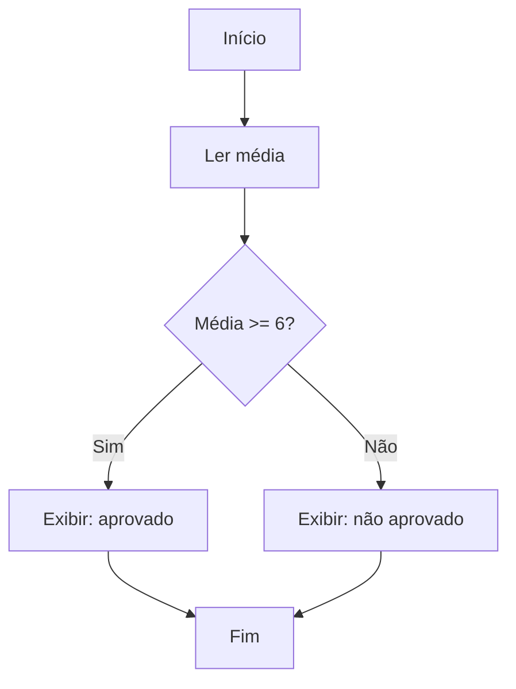
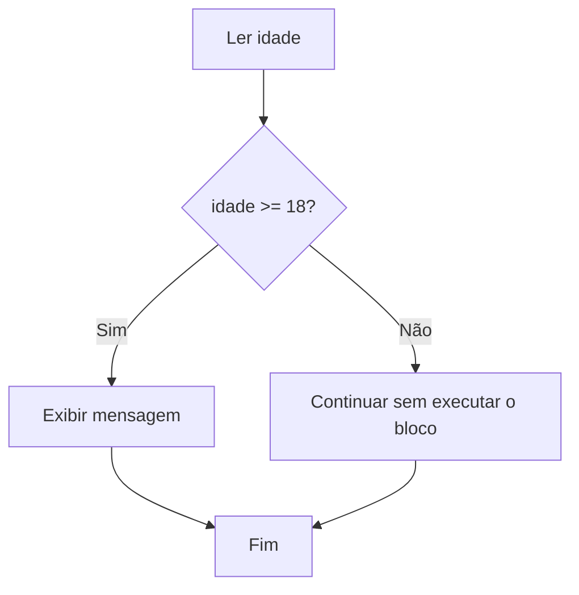
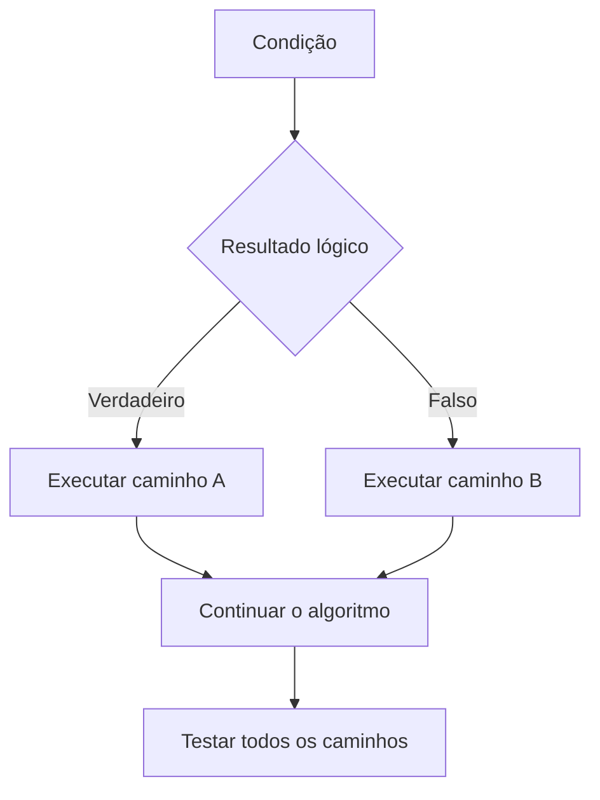

# Capítulo 5 — Estruturas Condicionais

> **Unidade curricular:** Algoritmos e Lógica de Programação  
> **Curso:** Desenvolvimento de Software Multiplataforma (DSM)  
> **Objetivo do capítulo:** desenvolver algoritmos capazes de escolher diferentes caminhos de execução conforme as condições de um problema.

---

## 5.1 Por que um programa precisa tomar decisões?

Até aqui, trabalhamos principalmente com algoritmos que recebem dados, realizam cálculos e apresentam resultados seguindo uma sequência de instruções. Porém, muitos problemas exigem comportamentos diferentes dependendo dos valores recebidos.

Considere um sistema acadêmico que calcula a média de um estudante. Depois de calcular a média, o programa precisa decidir se o estudante foi aprovado ou reprovado conforme os critérios definidos pela instituição.

Uma **estrutura condicional** permite executar instruções diferentes de acordo com o resultado de uma condição lógica.



> **Importante:** o valor `6` é apenas um exemplo didático. Em situações reais, os critérios de aprovação devem seguir as regras oficiais da instituição ou da atividade.

### Objetivos de aprendizagem

Ao final deste capítulo, você deverá ser capaz de:

- explicar o papel das estruturas condicionais;
- escrever condições com operadores relacionais e lógicos;
- utilizar `if`, `else` e decisões encadeadas em C;
- utilizar `switch` em situações com alternativas discretas;
- representar decisões em pseudocódigo e fluxogramas;
- testar caminhos diferentes com tabelas de teste;
- identificar erros comuns em expressões condicionais.

## 5.2 Condições lógicas

Uma condição é uma expressão que, quando avaliada, produz um resultado lógico: verdadeira ou falsa.

Exemplos em C:

```c
idade >= 18
nota < 6.0
quantidade == 0
temperatura > 30.0 && umidade > 70.0
```

As três primeiras expressões comparam um valor com outro. A última combina duas condições usando o operador lógico `&&`.

| Operador | Significado | Exemplo |
|---|---|---|
| `==` | Igual a | `opcao == 1` |
| `!=` | Diferente de | `idade != 18` |
| `>` | Maior que | `nota > 7.0` |
| `<` | Menor que | `temperatura < 10.0` |
| `>=` | Maior ou igual a | `frequencia >= 75` |
| `<=` | Menor ou igual a | `saldo <= 0` |
| `&&` | E lógico | `idade >= 18 && temDocumento` |
| `||` | OU lógico | `opcao == 1 || opcao == 2` |
| `!` | NÃO lógico | `!temCadastro` |

Não confunda atribuição com comparação: `nota = 7.0` atribui um valor; `nota == 7.0` compara valores.

## 5.3 Condicional simples: `if`

A estrutura `if` executa um bloco de instruções quando a condição é verdadeira.

```c
if (condicao) {
    /* instruções executadas quando a condição é verdadeira */
}
```

### Exemplo 1 — Verificar maioridade

```c
#include <stdio.h>

int main(void) {
    int idade;

    printf("Digite sua idade: ");
    if (scanf("%d", &idade) != 1) {
        printf("Entrada invalida.\n");
        return 1;
    }

    if (idade >= 18) {
        printf("Voce tem 18 anos ou mais.\n");
    }

    return 0;
}
```

Se a idade for `20`, a mensagem será exibida. Se for `15`, o programa não executará o bloco do `if` e seguirá para a próxima instrução.

### Fluxograma



## 5.4 Condicional composta: `if` e `else`

Quando há duas alternativas — uma para condição verdadeira e outra para condição falsa — utilizamos `if` e `else`.

```c
if (condicao) {
    /* caminho verdadeiro */
} else {
    /* caminho falso */
}
```

### Exemplo 2 — Número par ou ímpar

```c
#include <stdio.h>

int main(void) {
    int numero;

    printf("Digite um numero inteiro: ");
    if (scanf("%d", &numero) != 1) {
        printf("Entrada invalida.\n");
        return 1;
    }

    if (numero % 2 == 0) {
        printf("O numero e par.\n");
    } else {
        printf("O numero e impar.\n");
    }

    return 0;
}
```

O operador `%` calcula o resto da divisão inteira. Quando o resto da divisão por `2` é zero, o número é par; caso contrário, é ímpar.

### Teste de mesa

| Entrada | Cálculo | Condição `numero % 2 == 0` | Saída |
|---:|---|---|---|
| 8 | `8 % 2 = 0` | Verdadeira | Par |
| 11 | `11 % 2 = 1` | Falsa | Ímpar |
| 0 | `0 % 2 = 0` | Verdadeira | Par |

O zero é um número par, pois é divisível por `2` e o resto é zero.

## 5.5 Decisões encadeadas com `else if`

Alguns problemas apresentam mais de duas possibilidades. Para esses casos, podemos encadear condições com `else if`.

### Exemplo — Classificação de uma nota

Considere o seguinte critério didático:

- média maior ou igual a `7.0`: resultado “Atingiu o critério”;
- média maior ou igual a `5.0` e menor que `7.0`: resultado “Em recuperação”;
- média menor que `5.0`: resultado “Não atingiu o critério”.

```c
#include <stdio.h>

int main(void) {
    double media;

    printf("Digite a media: ");
    if (scanf("%lf", &media) != 1) {
        printf("Entrada invalida.\n");
        return 1;
    }

    if (media >= 7.0) {
        printf("Atingiu o criterio.\n");
    } else if (media >= 5.0) {
        printf("Em recuperacao.\n");
    } else {
        printf("Nao atingiu o criterio.\n");
    }

    return 0;
}
```

A ordem das condições importa. Quando a primeira condição verdadeira é encontrada, seu bloco é executado e as alternativas seguintes são ignoradas.

O exemplo pressupõe que a média recebida esteja dentro do intervalo esperado. Em um programa completo, pode ser necessário validar se a nota está entre `0` e `10`.

### Tabela de decisão

| Média | Primeira condição `media >= 7.0` | Segunda condição `media >= 5.0` | Resultado |
|---:|---|---|---|
| 8.5 | Verdadeira | Não avaliada | Atingiu o critério |
| 6.0 | Falsa | Verdadeira | Em recuperação |
| 3.5 | Falsa | Falsa | Não atingiu o critério |

## 5.6 Condições compostas

Uma condição composta utiliza operadores lógicos para combinar duas ou mais expressões.

### Exemplo — Faixa válida

Para verificar se uma nota está entre `0` e `10`, inclusive:

```c
nota >= 0.0 && nota <= 10.0
```

As duas condições precisam ser verdadeiras. Se `nota` for `8.5`, a expressão será verdadeira; se for `12.0`, será falsa.

### Exemplo — Acesso permitido

Imagine que um sistema permita acesso quando a pessoa possui cadastro ativo **e** confirmou sua identidade:

```c
cadastroAtivo && identidadeConfirmada
```

Para permitir acesso quando uma opção é `1` **ou** `2`:

```c
opcao == 1 || opcao == 2
```

### Atenção à interpretação

A escolha entre `&&` e `||` depende da regra do problema:

- **E (`&&`)**: todas as condições precisam ser verdadeiras.
- **OU (`||`)**: basta que pelo menos uma condição seja verdadeira.
- **NÃO (`!`)**: inverte o valor lógico de uma expressão.

Use parênteses quando eles ajudarem a deixar a regra mais explícita:

```c
(idade >= 18 && temDocumento) || estaAcompanhado
```

Essa expressão significa que o acesso é permitido se a pessoa tiver pelo menos 18 anos e documento, ou se estiver acompanhada. Em um sistema real, a regra deve ser definida com precisão antes de ser programada.

## 5.7 Condicionais aninhadas

Uma condicional é aninhada quando há um `if` dentro do bloco de outro `if` ou `else`.

```c
if (temCadastro) {
    if (senhaCorreta) {
        printf("Acesso permitido.\n");
    } else {
        printf("Senha incorreta.\n");
    }
} else {
    printf("Cadastro nao encontrado.\n");
}
```

A estrutura permite tratar primeiro a existência do cadastro e, somente depois, verificar a senha.

Condicionais aninhadas são úteis quando uma decisão depende de outra. Porém, muitos níveis de aninhamento podem dificultar a leitura. Sempre que possível, escolha uma organização clara e use indentação consistente.

## 5.8 Seleção múltipla com `switch`

Quando uma variável pode assumir uma entre várias opções discretas, `switch` pode deixar o código mais organizado do que uma sequência extensa de comparações de igualdade.

### Exemplo — Menu de operações

```c
#include <stdio.h>

int main(void) {
    int opcao;

    printf("MENU\n");
    printf("1 - Consultar saldo\n");
    printf("2 - Realizar deposito\n");
    printf("3 - Sair\n");
    printf("Escolha uma opcao: ");

    if (scanf("%d", &opcao) != 1) {
        printf("Entrada invalida.\n");
        return 1;
    }

    switch (opcao) {
        case 1:
            printf("Opcao: consultar saldo.\n");
            break;
        case 2:
            printf("Opcao: realizar deposito.\n");
            break;
        case 3:
            printf("Encerrando o programa.\n");
            break;
        default:
            printf("Opcao inexistente.\n");
    }

    return 0;
}
```

### Elementos de `switch`

- `switch (opcao)`: avalia o valor da expressão de seleção.
- `case`: identifica um valor possível.
- `break`: encerra o bloco do `switch`, evitando a execução dos próximos casos.
- `default`: executa quando nenhum caso corresponde ao valor.

Em C, os rótulos `case` devem usar expressões constantes inteiras compatíveis com as regras da linguagem. `switch` não substitui todas as condições: ele é especialmente apropriado para alternativas discretas, como opções de menu.

### O que acontece sem `break`?

Se o `break` for omitido, a execução pode continuar no próximo `case`, comportamento conhecido como *fall-through*. Isso pode ser intencional em algumas situações, mas, em exercícios iniciais, inclua `break` em cada caso para evitar resultados inesperados.

## 5.9 Comparando `if/else` e `switch`

| Situação | Estrutura geralmente adequada | Motivo |
|---|---|---|
| Verificar se a idade é maior ou igual a 18 | `if` | Envolve uma comparação relacional |
| Verificar se a nota está em uma faixa | `if/else if` | Envolve intervalos |
| Escolher uma opção numérica de menu | `switch` | Alternativas discretas |
| Verificar duas condições ao mesmo tempo | `if` com `&&` ou `||` | Combina expressões lógicas |
| Classificar valores por intervalos | `if/else if` | Cada caminho depende de uma condição |

Não existe uma única estrutura correta para todos os problemas. A escolha depende da regra que se deseja representar e da clareza do código.

## 5.10 Validação de entrada e limites

Uma condição também pode verificar se o valor digitado pertence a um intervalo válido.

```c
if (nota < 0.0 || nota > 10.0) {
    printf("Nota fora do intervalo permitido.\n");
} else {
    printf("Nota dentro do intervalo permitido.\n");
}
```

A expressão usa `||` porque uma nota inválida pode ser menor que zero **ou** maior que dez.

Também é possível verificar a leitura antes de avaliar o valor:

```c
double nota;

printf("Digite uma nota de 0 a 10: ");
if (scanf("%lf", &nota) != 1) {
    printf("Entrada invalida.\n");
    return 1;
}

if (nota < 0.0 || nota > 10.0) {
    printf("Nota fora do intervalo permitido.\n");
} else {
    printf("Nota aceita.\n");
}
```

A validação da leitura e a validação do domínio são verificações diferentes:

1. **Validação da leitura:** o dado pôde ser convertido para o tipo esperado?
2. **Validação do domínio:** o valor convertido está dentro dos limites aceitos pelo problema?

## 5.11 Erros comuns e depuração

### Erro 1 — Usar `=` em vez de `==`

Incorreto:

```c
if (opcao = 2) {
    printf("Opcao dois.\n");
}
```

A instrução atribui `2` a `opcao`; ela não compara a opção digitada com `2`.

Correto:

```c
if (opcao == 2) {
    printf("Opcao dois.\n");
}
```

### Erro 2 — Esquecer as chaves

Em C, sem chaves, o `if` controla apenas a próxima instrução. Isso pode gerar resultados inesperados quando a indentação sugere que várias linhas fazem parte do bloco.

Prefira usar chaves mesmo quando houver apenas uma instrução:

```c
if (idade >= 18) {
    printf("Maior de idade.\n");
}
```

### Erro 3 — Criar intervalos incorretos

Considere a condição:

```c
nota >= 5.0 || nota <= 10.0
```

Para números comuns, essa expressão é verdadeira para praticamente qualquer nota: uma nota abaixo de `5` satisfaz a segunda parte, e uma nota acima de `10` satisfaz a primeira.

Para verificar se a nota está entre `5` e `10`, inclusive, use:

```c
nota >= 5.0 && nota <= 10.0
```

### Erro 4 — Não usar `break` em `switch`

Sem `break`, o programa pode executar instruções dos casos seguintes. Revise cada `case` e confirme se a continuação é intencional.

### Erro 5 — Não considerar valores fora do esperado

Um menu que só trata as opções `1`, `2` e `3` deve informar o que ocorre se o usuário digitar `0` ou `9`. O caso `default` ajuda a tratar opções não previstas.

### Erro 6 — Não testar todos os caminhos

Para uma condição `idade >= 18`, teste pelo menos:
- um valor abaixo de `18`;
- o valor exatamente igual a `18`;
- um valor acima de `18`.

Valores de fronteira são especialmente úteis para encontrar erros nas condições.

## 5.12 Prática guiada — Classificação de temperatura

Crie um programa que leia uma temperatura em graus Celsius e apresente uma classificação didática:

- abaixo de `15`: “Frio”;
- de `15` até menos de `25`: “Ameno”;
- `25` ou mais: “Quente”.

### Planejamento

| Elemento | Definição |
|---|---|
| Entrada | Temperatura em Celsius |
| Processamento | Comparar a temperatura com os limites `15` e `25` |
| Saída | Uma classificação em texto |

### Código em C

```c
#include <stdio.h>

int main(void) {
    double temperatura;

    printf("Digite a temperatura em Celsius: ");
    if (scanf("%lf", &temperatura) != 1) {
        printf("Entrada invalida.\n");
        return 1;
    }

    if (temperatura < 15.0) {
        printf("Classificacao: Frio.\n");
    } else if (temperatura < 25.0) {
        printf("Classificacao: Ameno.\n");
    } else {
        printf("Classificacao: Quente.\n");
    }

    return 0;
}
```

Observe que, no `else if`, não é necessário escrever `temperatura >= 15.0`: se a execução chegou a esse ponto, a primeira condição `temperatura < 15.0` já foi falsa. Ainda assim, a segunda condição é testada explicitamente.

### Teste de mesa

| Temperatura | `temperatura < 15.0` | `temperatura < 25.0` quando necessário | Saída |
|---:|---|---|---|
| 10.0 | Verdadeira | Não avaliada | Frio |
| 15.0 | Falsa | Verdadeira | Ameno |
| 24.9 | Falsa | Verdadeira | Ameno |
| 25.0 | Falsa | Falsa | Quente |
| 32.0 | Falsa | Falsa | Quente |

## 5.13 Exercícios

Implemente e teste os programas em C. Quando o exercício pedir uma condição, escreva primeiro a regra em linguagem natural e só depois converta para código.

### Nível 1 — Compreensão

1. Explique para que servem as estruturas condicionais e apresente uma situação cotidiana em que uma decisão depende de uma condição.
2. Qual é a diferença entre `if` e `if/else`?
3. O que acontece em uma estrutura `if/else if/else` quando uma condição é verdadeira?
4. Explique a diferença entre os operadores lógicos `&&` e `||`.
5. Qual é a finalidade do `default` em um `switch`?
6. Por que o uso de `break` é comum nos casos de um `switch`?
7. Explique por que a expressão `nota >= 5 && nota <= 10` representa um intervalo, mas `nota >= 5 || nota <= 10` não representa o mesmo critério.

### Nível 2 — Aplicação

8. Escreva um programa que leia um inteiro e informe se ele é positivo, negativo ou zero.
9. Escreva um programa que leia um inteiro e informe se ele é par ou ímpar.
10. Escreva um programa que leia dois números reais e apresente qual é o maior, ou informe que são iguais.
11. Escreva um programa que leia uma idade e informe se a pessoa tem 18 anos ou mais.
12. Escreva um programa que leia uma nota e informe se ela está no intervalo de `0` a `10`, inclusive.
13. Escreva um programa que leia uma média e classifique-a usando os critérios didáticos: média maior ou igual a `7`: “Atingiu o critério”; média maior ou igual a `5` e menor que `7`: “Em recuperação”; média menor que `5`: “Não atingiu o critério”. Valide também se a média está entre `0` e `10`.
14. Escreva um programa que leia um número de `1` a `7` e apresente o dia da semana correspondente usando `switch`. Defina qual número representa cada dia.
15. Crie um menu com `switch` para escolher entre três operações: somar, subtrair ou multiplicar dois inteiros.
16. Escreva uma condição que permita acesso quando o usuário tem cadastro ativo e confirmou sua identidade.
17. Escreva uma condição que aceite um número quando ele estiver entre `10` e `20`, inclusive, ou for exatamente `50`.
18. Leia o preço de um produto. Se for maior que R$ 100,00, apresente a mensagem “Produto acima de R$ 100,00”; caso contrário, apresente “Produto de até R$ 100,00”.

### Nível 3 — Análise e programação

19. Analise o trecho abaixo para `nota = 8.0`. Qual mensagem é exibida? Explique o erro lógico.

    ```c
    if (nota >= 5.0 || nota <= 10.0) {
        printf("Nota valida.\n");
    } else {
        printf("Nota invalida.\n");
    }
    ```

20. Desenvolva um programa que leia três números inteiros e apresente o maior deles. Considere também a possibilidade de valores iguais.
21. Desenvolva um programa que leia um ano e informe se ele é bissexto. Considere a regra: é bissexto se for divisível por `400`, ou se for divisível por `4` e não por `100`.
22. Desenvolva um programa de calculadora que leia dois números reais e uma opção de operação (`+`, `-`, `*` ou `/`). Trate a divisão por zero.
23. Um sistema oferece entrega gratuita se a compra for de pelo menos R$ 150,00 ou se o cliente possuir uma categoria especial. Escreva a condição lógica e implemente a decisão.
24. Faça uma tabela de teste para o programa de classificação de temperatura da seção 5.12 usando os valores `14.9`, `15`, `24.9` e `25`.
25. Projete um menu para um sistema acadêmico com as opções: `1` cadastrar estudante, `2` consultar estudantes, `3` encerrar. Use `switch`, inclua `default` e explique o papel do `break`.

## 5.14 Gabarito comentado

As respostas são referências. Em questões de programação, outras soluções corretas também podem ser aceitas.

1. Condicionais permitem selecionar caminhos de execução conforme condições. Exemplo: conceder desconto se a compra atingir determinado valor.
2. `if` executa um bloco apenas quando a condição é verdadeira; `if/else` define também o caminho alternativo.
3. As condições são testadas em sequência; executa-se o primeiro bloco cuja condição seja verdadeira e as alternativas seguintes são ignoradas.
4. `&&` exige que todas as condições sejam verdadeiras; `||` exige que pelo menos uma seja verdadeira.
5. `default` trata valores que não correspondem a nenhum `case`.
6. `break` encerra a execução do `switch` após o caso escolhido, evitando a continuação nos casos seguintes.
7. `&&` exige que o valor seja ao mesmo tempo maior ou igual a `5` e menor ou igual a `10`. Com `||`, basta uma parte ser verdadeira, então valores fora do intervalo também podem passar.
8. Use `if (n > 0)`, `else if (n < 0)` e `else`.
9. Use `if (n % 2 == 0)` para par; caso contrário, ímpar.
10. Compare `a > b`, `b > a` e, no `else`, informe que são iguais.
11. Use `if (idade >= 18)`.
12. Use `nota >= 0.0 && nota <= 10.0`.
13. Primeiro valide `media < 0.0 || media > 10.0`; caso contrário, use a sequência de condições para classificar.
14. Associe `1` a um dia, `2` ao seguinte e assim por diante até `7`; cada `case` apresenta o dia correspondente e termina com `break`.
15. Leia a opção e os dois números; use `switch` com casos para somar, subtrair e multiplicar e um `default` para opção inválida.
16. `cadastroAtivo && identidadeConfirmada`.
17. `(numero >= 10 && numero <= 20) || numero == 50`.
18. Use `if (preco > 100.0)` e `else`.
19. Para `nota = 8.0`, a mensagem “Nota valida.” é exibida. A condição está incorreta porque o operador `||` permite que uma das comparações seja verdadeira; o correto para validar o intervalo é `nota >= 5.0 && nota <= 10.0`.
20. Uma solução pode inicializar `maior` com o primeiro número e comparar os outros dois, atualizando `maior` quando encontrar valor superior. Isso também funciona quando há valores iguais.
21. Condição: `(ano % 400 == 0) || (ano % 4 == 0 && ano % 100 != 0)`.
22. Use `switch` sobre a operação escolhida e verifique se o segundo número é diferente de zero antes da divisão. Em C, a leitura de caracteres e a gestão de espaços devem ser consideradas.
23. `total >= 150.0 || categoriaEspecial`. Se a condição for verdadeira, exiba que a entrega é gratuita; caso contrário, informe que há cobrança.
24. `14.9` → Frio; `15` → Ameno; `24.9` → Ameno; `25` → Quente.
25. Crie três `case` com mensagens e `break`; use `default` para uma opção inválida. `break` impede que a execução continue nos casos seguintes.

## 5.15 Resumo visual



- **`if`** executa instruções quando uma condição é verdadeira.
- **`if/else`** oferece dois caminhos alternativos.
- **`else if`** permite avaliar várias condições em sequência.
- **`switch`** organiza alternativas discretas.
- **`&&`** combina condições que precisam ser todas verdadeiras.
- **`||`** combina condições em que basta uma ser verdadeira.
- **`break`** encerra o caso atual de um `switch`.
- **Testes de fronteira** ajudam a verificar condições nos limites dos intervalos.

## 5.16 Glossário

| Termo | Definição |
|---|---|
| Condição | Expressão avaliada como verdadeira ou falsa |
| Condicional aninhada | Estrutura condicional dentro de outra |
| `else` | Bloco alternativo executado quando a condição do `if` é falsa |
| `else if` | Alternativa que avalia outra condição após uma condição anterior ser falsa |
| `if` | Estrutura que executa instruções conforme uma condição |
| `switch` | Estrutura de seleção entre alternativas discretas |
| `case` | Rótulo que representa um valor possível em `switch` |
| `break` | Instrução que interrompe a execução do `switch` ou de outras estruturas aplicáveis |
| `default` | Alternativa de `switch` executada quando nenhum caso corresponde ao valor |

## Referências para consulta

- KERNIGHAN, Brian W.; RITCHIE, Dennis M. **The C Programming Language**. 2. ed. Englewood Cliffs: Prentice Hall, 1988.
- ISO/IEC. **ISO/IEC 9899: Programming Languages — C**. Norma da linguagem C.
- Documentação de referência da linguagem C: [cppreference.com — statements](https://en.cppreference.com/w/c/language/statements).
- Material e ambiente de pseudocódigo/VisualG utilizados na disciplina.

---

**Sugestão de integração ao MkDocs:** salve este arquivo como `docs/ALP/apostila/05-estruturas-condicionais.md` e acrescente ao grupo `Apostila de ALP` no `nav` do `mkdocs.yml`:

```yaml
- Capítulo 5 — Estruturas Condicionais: ALP/apostila/05-estruturas-condicionais.md
```

Mantenha os capítulos anteriores no `nav`, em ordem numérica.
