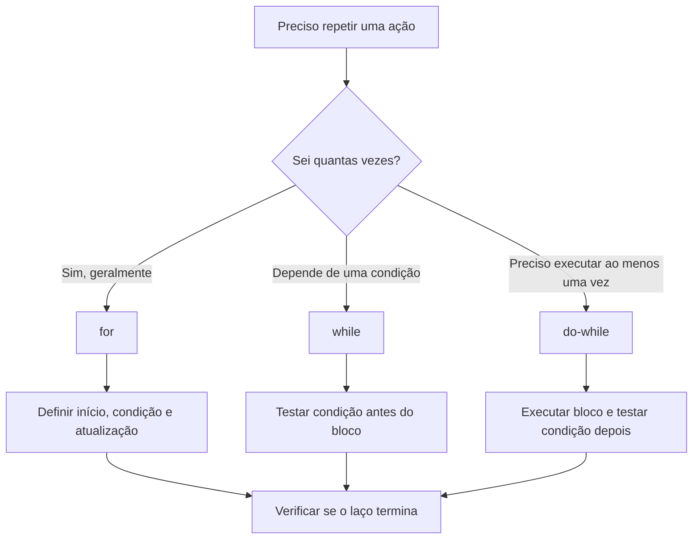
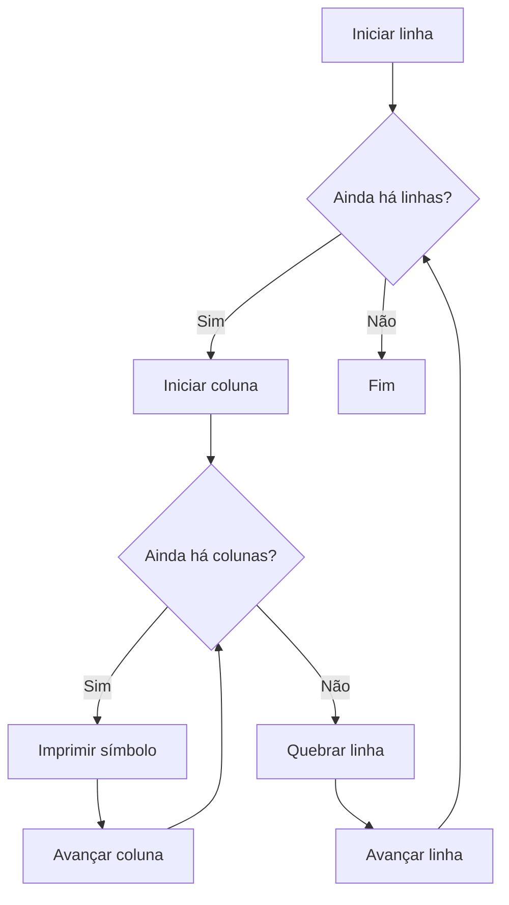

# Capítulo 6 — Estruturas de repetição

> **Ideia central:** quando um algoritmo precisa executar uma ação várias vezes, usamos uma estrutura de repetição. Em vez de escrever o mesmo comando repetidamente, descrevemos uma regra que controla quando repetir e quando parar.

## Objetivos de aprendizagem

Ao concluir este capítulo, você deverá ser capaz de:

- reconhecer problemas que exigem repetição;
- diferenciar repetição controlada por condição e repetição controlada por contador;
- utilizar `while`, `do-while` e `for` em linguagem C;
- representar repetições em pseudocódigo;
- acompanhar a execução de um laço usando uma tabela de teste de mesa;
- identificar e corrigir laços infinitos, erros de limite e atualizações incorretas de contadores e acumuladores.

## 1. Por que precisamos repetir comandos?

Imagine que você precisa mostrar os números de 1 a 100. Uma solução seria escrever cem comandos de saída. Isso funcionaria, mas seria longo, difícil de revisar e pouco flexível.

Uma estrutura de repetição permite descrever a regra uma única vez:

1. começar no número 1;
2. mostrar o número atual;
3. avançar para o próximo número;
4. repetir enquanto o número estiver dentro do limite.

Esse conjunto de passos forma um **laço de repetição**, também chamado de *loop*.

### Mapa visual do capítulo



> A escolha da estrutura depende do problema. As sugestões do mapa são orientações práticas, não regras absolutas.

## 2. Os elementos de um laço

Uma repetição bem construída costuma ter quatro elementos:

- **Inicialização:** define o estado inicial, como `contador = 1`.
- **Condição:** determina se uma nova execução deve acontecer.
- **Corpo:** contém os comandos repetidos.
- **Atualização:** altera o estado para que a condição possa, em algum momento, deixar de ser verdadeira.

Veja o exemplo conceitual:

```text
contador ← 1
ENQUANTO contador <= 5 FAÇA
    ESCREVA contador
    contador ← contador + 1
FIM ENQUANTO
```

O contador começa em 1, é exibido e aumenta de um em um. Quando chega a 6, a condição `contador <= 5` torna-se falsa e o laço termina.

### Teste de mesa

| Iteração | `contador` antes da saída | Condição `contador <= 5` | Saída | Atualização |
|---:|---:|---|---:|---|
| 1 | 1 | Verdadeira | 1 | contador = 2 |
| 2 | 2 | Verdadeira | 2 | contador = 3 |
| 3 | 3 | Verdadeira | 3 | contador = 4 |
| 4 | 4 | Verdadeira | 4 | contador = 5 |
| 5 | 5 | Verdadeira | 5 | contador = 6 |
| — | 6 | Falsa | — | Laço encerrado |

O teste de mesa ajuda a perceber a diferença entre **o valor usado na iteração** e **o valor que fica armazenado depois da atualização**.

## 3. Repetição com `while`

A estrutura `while` testa a condição **antes** de executar o corpo. Se a condição for falsa desde o início, o corpo não será executado nenhuma vez.

### Sintaxe em C

```c
while (condicao) {
    // comandos repetidos
}
```

A condição deve ser uma expressão que possa ser avaliada como verdadeira ou falsa. Dentro do corpo, normalmente existe alguma atualização que permite encerrar a repetição.

### Exemplo 1 — Contar de 1 a 5

```c
#include <stdio.h>

int main(void) {
    int contador = 1;

    while (contador <= 5) {
        printf("%d\n", contador);
        contador++;
    }

    return 0;
}
```

**Saída:**

```text
1
2
3
4
5
```

O operador `contador++` incrementa a variável em uma unidade. Neste exemplo, equivale a `contador = contador + 1`.

### Exemplo 2 — Somar números até digitar zero

Neste problema, não sabemos previamente quantos números serão digitados. O valor zero será o sinal para encerrar a entrada.

```c
#include <stdio.h>

int main(void) {
    int numero;
    int soma = 0;

    printf("Digite um numero (0 encerra): ");
    scanf("%d", &numero);

    while (numero != 0) {
        soma += numero;

        printf("Digite outro numero (0 encerra): ");
        scanf("%d", &numero);
    }

    printf("Soma: %d\n", soma);

    return 0;
}
```

**Como funciona?**

1. O programa lê o primeiro número antes de entrar no laço.
2. Se o número for diferente de zero, ele é acrescentado à soma.
3. O programa solicita outro número.
4. Quando o usuário digita zero, a condição fica falsa e a repetição termina.
5. O zero funciona como **sentinela**: um valor especial usado para sinalizar o fim da entrada.

Nesse exemplo, o valor zero não é somado. A soma começa em zero porque ainda não foi acumulado nenhum valor.

### Pseudocódigo equivalente

```text
soma ← 0
ESCREVA "Digite um número (0 encerra): "
LEIA numero

ENQUANTO numero != 0 FAÇA
    soma ← soma + numero
    ESCREVA "Digite outro número (0 encerra): "
    LEIA numero
FIM ENQUANTO

ESCREVA "Soma: ", soma
```

## 4. Repetição com `do-while`

A estrutura `do-while` executa o corpo primeiro e testa a condição depois. Por isso, o bloco é executado **pelo menos uma vez**.

### Sintaxe em C

```c
do {
    // comandos repetidos
} while (condicao);
```

Observe o ponto e vírgula após `while (condicao);`. Ele faz parte da sintaxe.

### Exemplo — Validar uma opção de menu

```c
#include <stdio.h>

int main(void) {
    int opcao;

    do {
        printf("\n=== MENU ===\n");
        printf("1 - Cadastrar\n");
        printf("2 - Consultar\n");
        printf("0 - Sair\n");
        printf("Escolha: ");
        scanf("%d", &opcao);

        if (opcao != 0 && opcao != 1 && opcao != 2) {
            printf("Opcao invalida!\n");
        }
    } while (opcao != 0 && opcao != 1 && opcao != 2);

    printf("Programa encerrado.\n");
    return 0;
}
```

O menu é apresentado ao menos uma vez. Enquanto a opção não for 0, 1 ou 2, ele é exibido novamente. Quando uma opção válida é informada, a condição fica falsa.

### Quando usar?

`do-while` é útil para menus, solicitações de entrada e situações em que o usuário precisa ver a pergunta antes de o programa avaliar a resposta.

## 5. Repetição com `for`

A estrutura `for` é muito usada quando existe um contador e uma quantidade conhecida ou delimitada de repetições.

### Sintaxe em C

```c
for (inicializacao; condicao; atualizacao) {
    // comandos repetidos
}
```

As três partes entre parênteses têm funções distintas:

- **Inicialização:** executada uma vez, antes da primeira verificação.
- **Condição:** verificada antes de cada iteração.
- **Atualização:** executada ao final de cada iteração, antes da próxima verificação.

### Exemplo 1 — Mostrar os números de 1 a 10

```c
#include <stdio.h>

int main(void) {
    int i;

    for (i = 1; i <= 10; i++) {
        printf("%d\n", i);
    }

    return 0;
}
```

É comum usar `i` como nome de um contador, embora nomes como `contador` também sejam válidos e possam ser mais claros para iniciantes.

### Exemplo 2 — Calcular a tabuada

```c
#include <stdio.h>

int main(void) {
    int numero;
    int i;

    printf("Digite um numero: ");
    scanf("%d", &numero);

    for (i = 1; i <= 10; i++) {
        printf("%d x %d = %d\n", numero, i, numero * i);
    }

    return 0;
}
```

O laço começa em 1 e termina em 10, inclusive. A cada iteração, o valor de `i` aumenta uma unidade.

### Pseudocódigo equivalente

```text
ESCREVA "Digite um número: "
LEIA numero

PARA i DE 1 ATÉ 10 FAÇA
    ESCREVA numero, " x ", i, " = ", numero * i
FIM PARA
```

## 6. Comparando as estruturas

| Característica | `while` | `do-while` | `for` |
|---|---|---|---|
| Quando testa a condição? | Antes do corpo | Depois do corpo | Antes do corpo |
| Pode executar zero vezes? | Sim | Não | Sim |
| Onde fica a atualização? | Geralmente no corpo | Geralmente no corpo | Na expressão de atualização ou no corpo |
| Uso comum | Repetição dependente de condição | Menu ou entrada executada ao menos uma vez | Contagem e repetição com limites |
| Ponto de atenção | Não esquecer de atualizar o estado | Não esquecer o `;` após a condição | Conferir início, limite e incremento |

As três estruturas conseguem resolver muitos dos mesmos problemas. Escolha a que deixe a lógica mais clara.

## 7. Contadores e acumuladores

Apesar dos nomes parecidos, contador e acumulador têm funções diferentes.

- **Contador:** registra quantas vezes algo aconteceu ou controla o número da iteração.
- **Acumulador:** guarda um total formado a partir de vários valores.

Exemplo de contador:

```c
int contador = 0;
contador++;
```

Exemplo de acumulador:

```c
int soma = 0;
soma += valor;
```

### Exemplo — Média de cinco notas

```c
#include <stdio.h>

int main(void) {
    float nota;
    float soma = 0.0f;
    float media;
    int i;

    for (i = 1; i <= 5; i++) {
        printf("Digite a nota %d: ", i);
        scanf("%f", &nota);
        soma += nota;
    }

    media = soma / 5.0f;
    printf("Media: %.2f\n", media);

    return 0;
}
```

Aqui, `i` controla as cinco leituras e `soma` acumula as notas. A média só é calculada depois que as cinco notas forem lidas.

> **Atenção:** em C, a divisão entre dois valores inteiros produz um resultado inteiro. Por isso, no cálculo de médias, use valores de ponto flutuante quando precisar preservar a parte decimal.

## 8. Laços aninhados

Um laço pode estar dentro de outro. Isso é chamado de **repetição aninhada**.

### Exemplo — Exibir uma matriz de símbolos

```c
#include <stdio.h>

int main(void) {
    int linha;
    int coluna;

    for (linha = 1; linha <= 3; linha++) {
        for (coluna = 1; coluna <= 4; coluna++) {
            printf("* ");
        }
        printf("\n");
    }

    return 0;
}
```

**Saída:**

```text
* * * *
* * * *
* * * *
```

O laço externo controla as três linhas. Para cada linha, o laço interno imprime quatro símbolos. Só depois de concluir as quatro colunas o programa avança para a próxima linha.

### Fluxo simplificado



## 9. Erros comuns e como depurar

### 9.1 Esquecer a atualização

```c
int i = 1;

while (i <= 5) {
    printf("%d\n", i);
}
```

**Problema:** `i` permanece igual a 1. A condição continua verdadeira e o laço não termina.

**Correção:**

```c
while (i <= 5) {
    printf("%d\n", i);
    i++;
}
```

### 9.2 Usar o limite errado

```c
for (i = 1; i < 10; i++) {
    printf("%d\n", i);
}
```

Esse código mostra de 1 a 9, não de 1 a 10. Se o limite 10 também deve ser incluído, use `i <= 10`.

### 9.3 Colocar ponto e vírgula após o `for`

```c
for (i = 1; i <= 5; i++); {
    printf("%d\n", i);
}
```

O ponto e vírgula encerra o `for`, deixando o bloco seguinte separado do laço. Isso altera a lógica e pode produzir resultado inesperado. Não coloque `;` após o cabeçalho do `for` quando a intenção for repetir o bloco.

### 9.4 Confundir `=` com `==`

- `=` atribui um valor: `i = 1`.
- `==` compara dois valores: `i == 1`.

Uma condição de repetição normalmente usa operadores de comparação, como `i <= 10` ou `resposta != 0`.

### 9.5 Alterar o contador no sentido errado

Se o contador começa em 1 e a condição é `i <= 5`, usar `i--` faz o contador diminuir e mantém a condição verdadeira. Sempre confira se a atualização aproxima a variável do fim desejado.

### Estratégia de depuração

Quando um laço não funciona, pergunte:

1. Qual é o valor inicial?
2. A condição é verdadeira antes da primeira iteração?
3. Quais comandos são executados em cada repetição?
4. Qual variável muda e como muda?
5. Em que momento a condição se torna falsa?
6. O limite deveria ser incluído ou excluído?

## 10. Atividade guiada — Estatísticas de temperaturas

Uma estação registra cinco temperaturas. O programa deve ler os cinco valores, calcular a soma e a média e informar quantas temperaturas são maiores ou iguais a 30 °C.

### Etapa 1 — Planejamento

- Entrada: cinco temperaturas.
- Processamento: somar valores, contar temperaturas `>= 30` e calcular a média.
- Saída: soma, média e quantidade de temperaturas a partir de 30 °C.

### Etapa 2 — Pseudocódigo

```text
soma ← 0
quantidadeQuentes ← 0

PARA i DE 1 ATÉ 5 FAÇA
    ESCREVA "Digite a temperatura: "
    LEIA temperatura
    soma ← soma + temperatura

    SE temperatura >= 30 ENTÃO
        quantidadeQuentes ← quantidadeQuentes + 1
    FIM SE
FIM PARA

media ← soma / 5
ESCREVA "Soma: ", soma
ESCREVA "Média: ", media
ESCREVA "Temperaturas >= 30: ", quantidadeQuentes
```

### Etapa 3 — Implementação em C

```c
#include <stdio.h>

int main(void) {
    float temperatura;
    float soma = 0.0f;
    float media;
    int quantidadeQuentes = 0;
    int i;

    for (i = 1; i <= 5; i++) {
        printf("Digite a temperatura %d: ", i);
        scanf("%f", &temperatura);

        soma += temperatura;

        if (temperatura >= 30.0f) {
            quantidadeQuentes++;
        }
    }

    media = soma / 5.0f;

    printf("Soma: %.2f\n", soma);
    printf("Media: %.2f\n", media);
    printf("Temperaturas >= 30: %d\n", quantidadeQuentes);

    return 0;
}
```

### Etapa 4 — Teste de mesa

Considere as temperaturas `25`, `30`, `32`, `28` e `35`.

| Leitura | Temperatura | Soma após leitura | Contagem de temperaturas ≥ 30 |
|---:|---:|---:|---:|
| 1 | 25 | 25 | 0 |
| 2 | 30 | 55 | 1 |
| 3 | 32 | 87 | 2 |
| 4 | 28 | 115 | 2 |
| 5 | 35 | 150 | 3 |

Resultado esperado: soma `150`, média `30` e quantidade `3`.

## 11. Exercícios propostos

Resolva primeiro no papel, identificando entrada, processamento, saída e a estrutura de repetição mais adequada. Depois, implemente os exercícios de programação em C.

### Nível 1 — Compreensão

1. Explique com suas palavras o que é um laço de repetição.
2. Diferencie contador e acumulador e apresente um exemplo de cada.
3. Qual é a diferença entre `while` e `do-while` quanto ao momento em que a condição é testada?
4. Quantas vezes o corpo será executado?

   ```c
   int i = 1;
   while (i <= 4) {
       printf("%d\n", i);
       i++;
   }
   ```

5. O que será exibido pelo código?

   ```c
   for (int i = 2; i <= 8; i += 2) {
       printf("%d ", i);
   }
   ```

6. Por que o código a seguir não termina normalmente?

   ```c
   int n = 0;
   while (n < 3) {
       printf("%d\n", n);
   }
   ```

7. Qual estrutura garante que o corpo seja executado ao menos uma vez?
8. O que é um valor sentinela? Dê um exemplo de uso.
9. Qual é a função da terceira expressão de um `for`, como `i++`?
10. Qual é a diferença entre `i < 5` e `i <= 5` em um laço que começa com `i = 1` e incrementa de um em um?

### Nível 2 — Aplicação

11. Escreva um programa em C que mostre os números de 1 a 20 usando `for`.
12. Escreva um programa que mostre os números pares de 2 a 30.
13. Leia um número inteiro e mostre sua tabuada de 1 a 10.
14. Leia dez números inteiros e calcule a soma deles.
15. Leia oito notas e calcule a média aritmética.
16. Leia números até que o usuário digite `-1`. Ao final, informe quantos números foram digitados, sem contar a sentinela, e a soma dos valores válidos.
17. Leia quinze números e conte quantos são positivos, negativos e iguais a zero.
18. Leia um número inteiro positivo `n` e calcule a soma de 1 até `n`.
19. Mostre uma contagem regressiva de 10 até 0 e, ao final, exiba `Fim!`.
20. Escreva um programa que solicite uma senha até que o usuário informe a senha correta. Para o exercício, considere a senha numérica `1234`.

### Nível 3 — Desafio

21. Leia números inteiros até receber zero e informe o maior valor digitado, sem considerar a sentinela. Considere que o usuário digitará pelo menos um valor diferente de zero.
22. Calcule o fatorial de um número inteiro não negativo. Lembre-se de que `0! = 1`.
23. Gere os primeiros `n` termos da sequência de Fibonacci, começando por `0, 1`.
24. Use laços aninhados para exibir um retângulo de `r` linhas por `c` colunas, formado pelo caractere `*`.
25. Leia as notas de uma turma. Primeiro, pergunte quantos estudantes há; depois, leia a nota de cada um e informe a média da turma e quantos estudantes obtiveram nota maior ou igual a 6. Considere quantidade maior que zero.

## 12. Gabarito comentado

O gabarito apresenta caminhos possíveis. Em programação, soluções diferentes podem estar corretas se respeitarem o enunciado e produzirem os resultados esperados.

### 1 a 10 — Conceitos

1. Um laço repete um bloco de comandos enquanto uma condição ou regra de repetição permitir.
2. Contador controla ou registra quantidade (`contador++`); acumulador agrega valores (`soma += numero`).
3. `while` testa antes do corpo; `do-while` testa depois e executa o corpo ao menos uma vez.
4. Quatro vezes, exibindo 1, 2, 3 e 4.
5. `2 4 6 8`.
6. Porque `n` nunca é atualizado; a condição `n < 3` permanece verdadeira.
7. `do-while`.
8. É um valor especial que sinaliza o fim da entrada, como `0` para encerrar a leitura de números.
9. Atualiza a variável após cada iteração, antes do próximo teste da condição.
10. `i < 5` exclui 5; `i <= 5` inclui 5.

### 11 — Números de 1 a 20

```c
for (int i = 1; i <= 20; i++) {
    printf("%d\n", i);
}
```

### 12 — Pares de 2 a 30

```c
for (int i = 2; i <= 30; i += 2) {
    printf("%d\n", i);
}
```

### 13 — Tabuada

```c
int n;
scanf("%d", &n);

for (int i = 1; i <= 10; i++) {
    printf("%d x %d = %d\n", n, i, n * i);
}
```

### 14 — Soma de dez inteiros

```c
int numero;
int soma = 0;

for (int i = 1; i <= 10; i++) {
    scanf("%d", &numero);
    soma += numero;
}

printf("Soma: %d\n", soma);
```

### 15 — Média de oito notas

```c
float nota, soma = 0.0f;

for (int i = 1; i <= 8; i++) {
    scanf("%f", &nota);
    soma += nota;
}

printf("Media: %.2f\n", soma / 8.0f);
```

### 16 — Leitura até -1

```c
int numero;
int quantidade = 0;
int soma = 0;

scanf("%d", &numero);
while (numero != -1) {
    quantidade++;
    soma += numero;
    scanf("%d", &numero);
}

printf("Quantidade: %d\nSoma: %d\n", quantidade, soma);
```

### 17 — Positivos, negativos e zeros

```c
int numero;
int positivos = 0, negativos = 0, zeros = 0;

for (int i = 1; i <= 15; i++) {
    scanf("%d", &numero);

    if (numero > 0) positivos++;
    else if (numero < 0) negativos++;
    else zeros++;
}

printf("Positivos: %d\nNegativos: %d\nZeros: %d\n",
       positivos, negativos, zeros);
```

### 18 — Soma de 1 até n

```c
int n;
int soma = 0;
scanf("%d", &n);

for (int i = 1; i <= n; i++) {
    soma += i;
}

printf("Soma: %d\n", soma);
```

Pressupõe-se que `n` seja positivo. Uma versão completa pode validar a entrada.

### 19 — Contagem regressiva

```c
for (int i = 10; i >= 0; i--) {
    printf("%d\n", i);
}
printf("Fim!\n");
```

### 20 — Validação de senha

```c
int senha;

do {
    printf("Digite a senha: ");
    scanf("%d", &senha);
} while (senha != 1234);

printf("Acesso permitido.\n");
```

### 21 — Maior valor até zero

```c
int numero;
int maior;
int primeiro = 1;

scanf("%d", &numero);

while (numero != 0) {
    if (primeiro || numero > maior) {
        maior = numero;
        primeiro = 0;
    }
    scanf("%d", &numero);
}

if (!primeiro) {
    printf("Maior: %d\n", maior);
} else {
    printf("Nenhum valor valido foi informado.\n");
}
```

O marcador `primeiro` permite inicializar `maior` com o primeiro valor válido, sem supor que todos os valores sejam positivos.

### 22 — Fatorial

```c
int n;
unsigned long long fatorial = 1;

scanf("%d", &n);

if (n < 0) {
    printf("O numero deve ser nao negativo.\n");
} else {
    for (int i = 1; i <= n; i++) {
        fatorial *= (unsigned long long)i;
    }
    printf("Fatorial: %llu\n", fatorial);
}
```

O tipo escolhido ainda possui limite; fatoriais crescem rapidamente e podem ultrapassar a capacidade numérica.

### 23 — Fibonacci

```c
int n;
unsigned long long a = 0, b = 1;

scanf("%d", &n);

for (int i = 1; i <= n; i++) {
    printf("%llu ", a);
    unsigned long long proximo = a + b;
    a = b;
    b = proximo;
}
printf("\n");
```

Para `n = 7`, a saída é `0 1 1 2 3 5 8`. O tipo numérico também limita quantos termos podem ser calculados corretamente.

### 24 — Retângulo de asteriscos

```c
int r, c;
scanf("%d %d", &r, &c);

for (int linha = 1; linha <= r; linha++) {
    for (int coluna = 1; coluna <= c; coluna++) {
        printf("* ");
    }
    printf("\n");
}
```

### 25 — Média da turma e aprovados

```c
int quantidade;
int aprovados = 0;
float nota;
float soma = 0.0f;

scanf("%d", &quantidade);

if (quantidade > 0) {
    for (int i = 1; i <= quantidade; i++) {
        scanf("%f", &nota);
        soma += nota;

        if (nota >= 6.0f) {
            aprovados++;
        }
    }

    printf("Media: %.2f\n", soma / quantidade);
    printf("Notas >= 6: %d\n", aprovados);
} else {
    printf("A quantidade deve ser maior que zero.\n");
}
```

## 13. Resumo visual

| Estrutura | Pense nela quando… | Atenção principal |
|---|---|---|
| `while` | a repetição depende de uma condição testada antes | atualizar o estado para que o laço possa terminar |
| `do-while` | o bloco precisa executar pelo menos uma vez | lembrar do ponto e vírgula final |
| `for` | há contador, início, limite e atualização bem definidos | conferir limite e incremento |
| Laço aninhado | uma repetição ocorre dentro de outra | entender quantas vezes o laço interno executa |

### Checklist de revisão

Antes de considerar seu algoritmo concluído, verifique:

- [ ] Inicializei as variáveis necessárias?
- [ ] Escolhi a condição correta?
- [ ] A atualização aproxima o laço do término?
- [ ] O limite está correto (inclui ou exclui o valor final)?
- [ ] Os contadores e acumuladores começam em valores adequados?
- [ ] Testei com poucos valores, com valores-limite e com uma entrada que encerra o laço?
- [ ] A saída corresponde ao que o enunciado solicita?

## 14. Glossário

- **Laço ou loop:** estrutura que repete comandos.
- **Iteração:** uma execução do corpo do laço.
- **Contador:** variável usada para contar ocorrências ou controlar repetições.
- **Acumulador:** variável que reúne valores, como uma soma.
- **Sentinela:** valor especial que sinaliza o fim da entrada.
- **Laço infinito:** repetição cuja condição não se torna falsa ou cuja saída nunca é alcançada.
- **Laços aninhados:** estruturas de repetição colocadas uma dentro da outra.
- **Teste de mesa:** simulação manual e organizada da execução de um algoritmo.

## 15. Referências para consulta

- KERNIGHAN, Brian W.; RITCHIE, Dennis M. *The C Programming Language*. 2. ed. Englewood Cliffs: Prentice Hall, 1988.
- SCHILDT, Herbert. *C: The Complete Reference*. 4. ed. Berkeley: Osborne/McGraw-Hill, 2000.
- ISO/IEC. *ISO/IEC 9899: Programming Languages — C*. International Organization for Standardization.
- cppreference.com. *C language*. Disponível em: https://en.cppreference.com/w/c/language. Acesso em: 24 out. 2026.

---

## Integração ao portal MkDocs

Salve este arquivo como `docs/ALP/apostila/06-estruturas-de-repeticao.md`.

No bloco `nav` do `mkdocs.yml`, adicione o item abaixo na sequência dos capítulos anteriores:

```yaml
- Capítulo 6 — Estruturas de repetição: ALP/apostila/06-estruturas-de-repeticao.md
```

Confira a indentação para manter o item dentro do grupo `Apostila de ALP`. Depois, execute seu comando `atualizar-portal` e verifique a página publicada, principalmente os diagramas Mermaid e os blocos de código.
