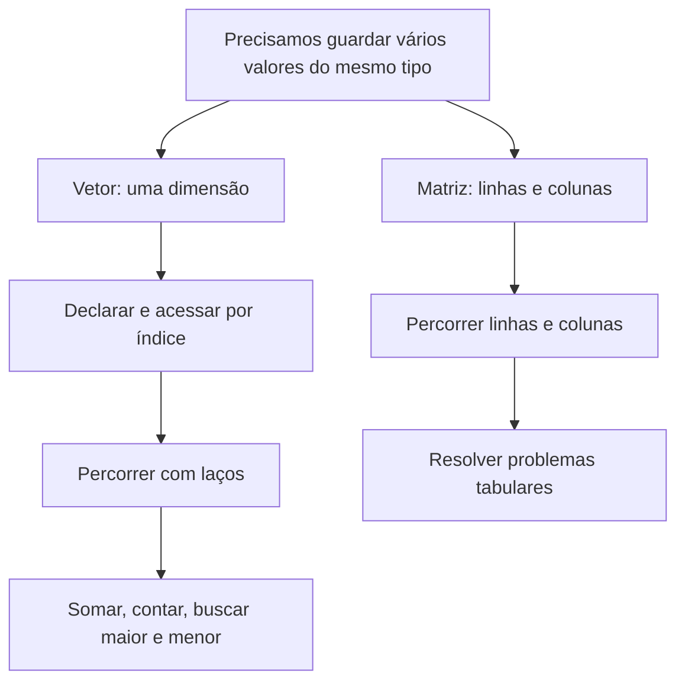
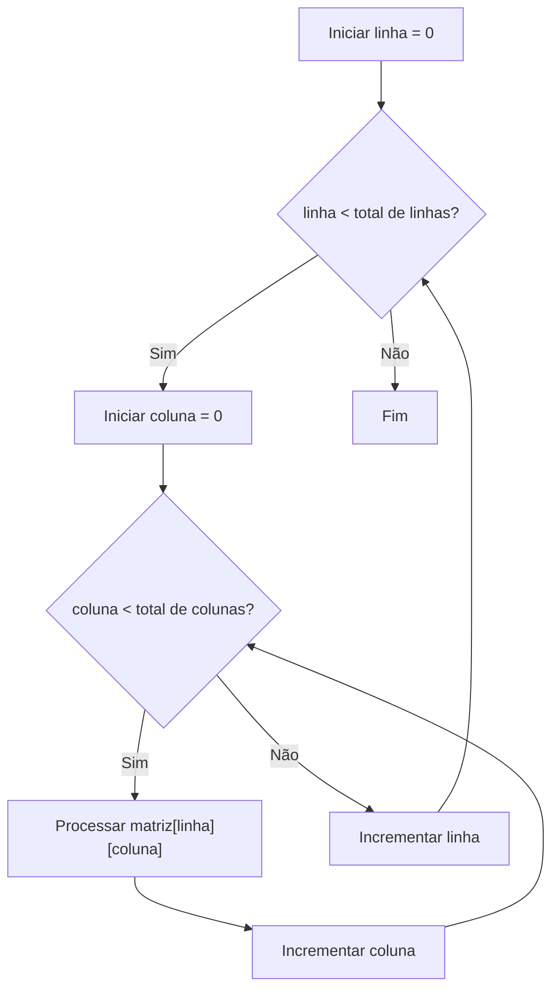

# Capítulo 7 — Vetores e matrizes

> **Ideia central:** até agora, trabalhamos principalmente com variáveis que armazenam um valor por vez. E quando precisamos guardar as notas de uma turma, as temperaturas de vários dias ou os elementos de uma tabela? Para isso, podemos usar coleções homogêneas, como vetores e matrizes.

## Objetivos de aprendizagem

Ao concluir este capítulo, você deverá ser capaz de:

- explicar o que são variáveis compostas homogêneas;
- declarar, inicializar e acessar elementos de um vetor em C;
- compreender que os índices de vetores em C começam em zero;
- percorrer vetores com estruturas de repetição;
- calcular soma, média, maior e menor elemento;
- declarar e percorrer matrizes bidimensionais;
- identificar erros de índice e relacionar vetores e matrizes a problemas reais.

## 1. Por que precisamos de vetores?

Imagine que um programa precise armazenar as notas de 30 estudantes. Uma possibilidade seria criar `nota1`, `nota2`, `nota3` e assim por diante. Essa estratégia ficaria difícil de manter: para calcular a média, por exemplo, seria necessário escrever uma expressão extensa ou repetir comandos para cada variável.

Um **vetor** permite armazenar vários valores do mesmo tipo sob um único nome, acessando cada valor por meio de um índice.

Em C, vetores e matrizes são exemplos de **arranjos (arrays)**. Neste capítulo, começaremos pelos vetores, que organizam elementos em uma dimensão, e depois estudaremos matrizes, que organizam elementos em linhas e colunas.

### Mapa visual do capítulo



## 2. Conceitos fundamentais

### 2.1 Coleção homogênea

Uma coleção homogênea reúne elementos de um mesmo tipo. Por exemplo, um vetor de inteiros armazena valores `int`; um vetor de números reais pode usar `float`.

Em um vetor declarado como `int idades[5];`, os cinco elementos são inteiros. Não é possível guardar diretamente um texto em um dos espaços desse vetor.

### 2.2 Índices e posições

Em C, o primeiro elemento de um vetor tem índice `0`, não índice `1`.

Considere:

```c
int numeros[5] = {10, 20, 30, 40, 50};
```

<box gap={2}>
  <grid columns={5} gap={1}>
    <grid-item>
      <box background="#EF5552" theme="dark" radius="md" padding={2} align="center" gap={1}>
        <text size="xs">índice 0</text>
        <title size="lg" color="#FFFFFF">10</title>
      </box>
    </grid-item>
    <grid-item>
      <box background="#EF5552" theme="dark" radius="md" padding={2} align="center" gap={1}>
        <text size="xs">índice 1</text>
        <title size="lg" color="#FFFFFF">20</title>
      </box>
    </grid-item>
    <grid-item>
      <box background="#EF5552" theme="dark" radius="md" padding={2} align="center" gap={1}>
        <text size="xs">índice 2</text>
        <title size="lg" color="#FFFFFF">30</title>
      </box>
    </grid-item>
    <grid-item>
      <box background="#EF5552" theme="dark" radius="md" padding={2} align="center" gap={1}>
        <text size="xs">índice 3</text>
        <title size="lg" color="#FFFFFF">40</title>
      </box>
    </grid-item>
    <grid-item>
      <box background="#EF5552" theme="dark" radius="md" padding={2} align="center" gap={1}>
        <text size="xs">índice 4</text>
        <title size="lg" color="#FFFFFF">50</title>
      </box>
    </grid-item>
  </grid>
  <text color="secondary" size="sm">Representação dos cinco elementos do vetor `numeros`.</text>
</box>

O último índice válido é sempre o tamanho do vetor menos um. Em um vetor com cinco elementos, os índices válidos são `0`, `1`, `2`, `3` e `4`.

### 2.3 Declaração

A forma geral de declarar um vetor em C é:

```c
tipo nome[tamanho];
```

Exemplos:

```c
int idades[30];
float notas[5];
char letras[10];
```

O tamanho usado na declaração determina quantos elementos cabem no vetor. Em exemplos introdutórios, trabalharemos com tamanhos conhecidos no momento da declaração.

## 3. Inicializando e acessando vetores

### 3.1 Inicialização com valores

```c
int numeros[5] = {10, 20, 30, 40, 50};
```

Os valores são associados aos índices em ordem. Também é possível deixar o compilador contar os elementos na inicialização:

```c
int numeros[] = {10, 20, 30, 40, 50};
```

### 3.2 Acessar um elemento

Use o nome do vetor e o índice entre colchetes:

```c
printf("%d\n", numeros[0]);  // mostra 10
printf("%d\n", numeros[3]);  // mostra 40
```

Acessar um elemento permite tanto consultar seu valor quanto alterá-lo:

```c
numeros[2] = 99;
```

Depois dessa atribuição, o elemento de índice `2` passa a valer `99`.

### 3.3 Erro de índice fora dos limites

Se o vetor tem cinco elementos, `numeros[5]` está fora dos limites. O último elemento é `numeros[4]`.

Em C, acessar posições fora do vetor causa **comportamento indefinido**: o programa pode exibir valores inesperados, corromper dados ou falhar. O compilador nem sempre detecta esse problema.

## 4. Percorrendo vetores com `for`

Como vimos no capítulo anterior, laços de repetição são ideais para processar coleções. Um `for` pode visitar cada posição do vetor.

### Exemplo 1 — Mostrar todos os elementos

```c
#include <stdio.h>

int main(void) {
    int numeros[5] = {10, 20, 30, 40, 50};

    for (int i = 0; i < 5; i++) {
        printf("Indice %d: %d\n", i, numeros[i]);
    }

    return 0;
}
```

Observe que a condição é `i < 5`, e não `i <= 5`. A última posição válida é 4.

### Exemplo 2 — Ler cinco notas e calcular a média

```c
#include <stdio.h>

int main(void) {
    float notas[5];
    float soma = 0.0f;
    float media;

    for (int i = 0; i < 5; i++) {
        printf("Digite a nota %d: ", i + 1);
        scanf("%f", &notas[i]);
        soma += notas[i];
    }

    media = soma / 5.0f;
    printf("Media: %.2f\n", media);

    return 0;
}
```

Usamos `i + 1` apenas para mostrar ao usuário as notas como 1, 2, 3, 4 e 5. O acesso ao vetor continua sendo feito com `notas[i]`, usando os índices de 0 a 4.

### Teste de mesa

Considere as notas `7`, `8`, `6`, `9` e `10`.

| Iteração | `i` | `notas[i]` | `soma` após a adição |
|---:|---:|---:|---:|
| 1 | 0 | 7 | 7 |
| 2 | 1 | 8 | 15 |
| 3 | 2 | 6 | 21 |
| 4 | 3 | 9 | 30 |
| 5 | 4 | 10 | 40 |

A média será \(40 / 5 = 8\).

## 5. Operações comuns com vetores

### 5.1 Somar os elementos

```c
int valores[5] = {4, 7, 2, 9, 3};
int soma = 0;

for (int i = 0; i < 5; i++) {
    soma += valores[i];
}
```

Inicialize o acumulador com zero. Se ele não for inicializado, seu valor pode ser indeterminado.

### 5.2 Encontrar o maior elemento

```c
int valores[5] = {4, 7, 2, 9, 3};
int maior = valores[0];

for (int i = 1; i < 5; i++) {
    if (valores[i] > maior) {
        maior = valores[i];
    }
}

printf("Maior: %d\n", maior);
```

Começamos com o primeiro elemento como referência. Isso é mais seguro do que iniciar `maior` com zero, pois todos os valores do vetor poderiam ser negativos.

### 5.3 Contar elementos que atendem a uma condição

```c
int valores[6] = {4, -2, 0, 7, -1, 8};
int positivos = 0;

for (int i = 0; i < 6; i++) {
    if (valores[i] > 0) {
        positivos++;
    }
}
```

O contador aumenta apenas quando a condição é verdadeira.

### 5.4 Buscar um valor

```c
int valores[5] = {12, 7, 25, 4, 18};
int procurado = 25;
int encontrado = 0;

for (int i = 0; i < 5; i++) {
    if (valores[i] == procurado) {
        encontrado = 1;
        break;
    }
}

if (encontrado) {
    printf("Valor encontrado.\n");
} else {
    printf("Valor nao encontrado.\n");
}
```

A variável `encontrado` funciona como uma indicação lógica. O `break` encerra o laço quando não é necessário continuar procurando.

## 6. Vetores e pseudocódigo

A ideia de vetor existe em várias linguagens, mas a sintaxe varia. Em pseudocódigo, podemos representar um vetor de forma didática, por exemplo:

```text
DECLARE notas[5] COMO REAL
soma ← 0

PARA i DE 0 ATÉ 4 FAÇA
    ESCREVA "Digite a nota ", i + 1
    LEIA notas[i]
    soma ← soma + notas[i]
FIM PARA

media ← soma / 5
ESCREVA "Média: ", media
```

Este pseudocódigo adota explicitamente índices de `0` a `4`, como em C. Se o ambiente de pseudocódigo usado em aula adotar outra convenção, mantenha a convenção consistente e deixe-a clara para a turma.

## 7. Matrizes: organizando dados em linhas e colunas

Uma **matriz bidimensional** organiza elementos em linhas e colunas. Ela pode representar, por exemplo, as notas de estudantes em diferentes avaliações, um tabuleiro ou uma tabela de temperaturas.

### 7.1 Declaração

```c
int matriz[3][4];
```

Essa matriz possui 3 linhas e 4 colunas, totalizando 12 elementos. Em C, os dois índices começam em zero: linhas de 0 a 2 e colunas de 0 a 3.

### 7.2 Visualização

Para a declaração `int matriz[3][4];`, as posições são:

|  | Coluna 0 | Coluna 1 | Coluna 2 | Coluna 3 |
|---|---|---|---|---|
| Linha 0 | `matriz[0][0]` | `matriz[0][1]` | `matriz[0][2]` | `matriz[0][3]` |
| Linha 1 | `matriz[1][0]` | `matriz[1][1]` | `matriz[1][2]` | `matriz[1][3]` |
| Linha 2 | `matriz[2][0]` | `matriz[2][1]` | `matriz[2][2]` | `matriz[2][3]` |

Cada elemento é acessado com dois índices: primeiro a linha, depois a coluna.

### 7.3 Inicialização

```c
int matriz[2][3] = {
    {1, 2, 3},
    {4, 5, 6}
};
```

A primeira linha contém `1, 2, 3`, e a segunda contém `4, 5, 6`.

## 8. Percorrendo matrizes com laços aninhados

Para visitar todos os elementos, normalmente usamos um laço para as linhas e outro para as colunas.

### Exemplo — Exibir uma matriz

```c
#include <stdio.h>

int main(void) {
    int matriz[2][3] = {
        {1, 2, 3},
        {4, 5, 6}
    };

    for (int linha = 0; linha < 2; linha++) {
        for (int coluna = 0; coluna < 3; coluna++) {
            printf("%d ", matriz[linha][coluna]);
        }
        printf("\n");
    }

    return 0;
}
```

**Saída:**

```text
1 2 3
4 5 6
```

O laço externo seleciona a linha atual. O interno percorre todas as colunas dessa linha. Ao terminar o laço interno, `printf("\n")` muda para a próxima linha.

### Fluxo de execução



### Exemplo — Ler e somar todos os elementos de uma matriz

```c
#include <stdio.h>

int main(void) {
    int matriz[2][3];
    int soma = 0;

    for (int linha = 0; linha < 2; linha++) {
        for (int coluna = 0; coluna < 3; coluna++) {
            printf("Elemento [%d][%d]: ", linha, coluna);
            scanf("%d", &matriz[linha][coluna]);
            soma += matriz[linha][coluna];
        }
    }

    printf("Soma dos elementos: %d\n", soma);
    return 0;
}
```

## 9. Erros comuns e depuração

### Erro 1 — Percorrer uma posição além do vetor

```c
int v[5];

for (int i = 0; i <= 5; i++) {
    scanf("%d", &v[i]);
}
```

**Problema:** a condição `i <= 5` permite que `i` chegue a 5, mas os índices válidos são de 0 a 4.

**Correção:**

```c
for (int i = 0; i < 5; i++) {
    scanf("%d", &v[i]);
}
```

### Erro 2 — Usar um índice sem inicializá-lo

```c
int i;
while (i < 5) {
    printf("%d\n", v[i]);
    i++;
}
```

**Problema:** `i` não recebeu um valor inicial. Inicialize-o antes do laço, por exemplo, `int i = 0;`.

### Erro 3 — Esquecer de inicializar a soma

```c
int soma;

for (int i = 0; i < 5; i++) {
    soma += v[i];
}
```

**Problema:** a soma começa com um valor indeterminado.

**Correção:** use `int soma = 0;` antes do laço.

### Erro 4 — Trocar linha e coluna

Em `matriz[linha][coluna]`, o primeiro índice representa a linha e o segundo, a coluna. Em uma matriz retangular, inverter os índices pode causar acesso fora dos limites.

### Checklist de depuração

- O tamanho declarado corresponde à quantidade de elementos?
- O primeiro índice é zero?
- A condição do laço evita ultrapassar o último índice?
- Todos os índices foram inicializados?
- Contadores e acumuladores receberam valores iniciais?
- Em matrizes, os limites de linha e coluna estão corretos?

## 10. Atividade guiada — Análise de notas de uma turma

Uma turma tem seis estudantes. O programa deverá armazenar as seis notas, calcular a média da turma, mostrar a maior nota e contar quantos estudantes obtiveram nota maior ou igual a 6.

### Etapa 1 — Planejamento

- **Entrada:** seis notas.
- **Processamento:** armazenar as notas, somá-las, identificar a maior e contar as notas `>= 6`.
- **Saída:** média, maior nota e quantidade de estudantes com nota `>= 6`.

### Etapa 2 — Pseudocódigo

```text
DECLARE notas[6] COMO REAL
soma ← 0
quantidadeAprovados ← 0

PARA i DE 0 ATÉ 5 FAÇA
    ESCREVA "Digite a nota ", i + 1
    LEIA notas[i]
    soma ← soma + notas[i]

    SE notas[i] >= 6 ENTÃO
        quantidadeAprovados ← quantidadeAprovados + 1
    FIM SE
FIM PARA

maior ← notas[0]
PARA i DE 1 ATÉ 5 FAÇA
    SE notas[i] > maior ENTÃO
        maior ← notas[i]
    FIM SE
FIM PARA

media ← soma / 6
ESCREVA "Média: ", media
ESCREVA "Maior nota: ", maior
ESCREVA "Notas >= 6: ", quantidadeAprovados
```

### Etapa 3 — Implementação em C

```c
#include <stdio.h>

int main(void) {
    float notas[6];
    float soma = 0.0f;
    float media;
    float maior;
    int aprovados = 0;

    for (int i = 0; i < 6; i++) {
        printf("Digite a nota %d: ", i + 1);
        scanf("%f", &notas[i]);

        soma += notas[i];

        if (notas[i] >= 6.0f) {
            aprovados++;
        }
    }

    maior = notas[0];

    for (int i = 1; i < 6; i++) {
        if (notas[i] > maior) {
            maior = notas[i];
        }
    }

    media = soma / 6.0f;

    printf("Media: %.2f\n", media);
    printf("Maior nota: %.2f\n", maior);
    printf("Quantidade com nota >= 6: %d\n", aprovados);

    return 0;
}
```

> Este exemplo pressupõe que as seis entradas são numéricas e válidas. Em um sistema real, também seria necessário validar o intervalo permitido para as notas e verificar se a leitura ocorreu corretamente.

### Etapa 4 — Teste de mesa

Considere as notas `5`, `7`, `8`, `6`, `4` e `10`.

| Índice | Nota | Soma acumulada | Aprovados até aqui |
|---:|---:|---:|---:|
| 0 | 5 | 5 | 0 |
| 1 | 7 | 12 | 1 |
| 2 | 8 | 20 | 2 |
| 3 | 6 | 26 | 3 |
| 4 | 4 | 30 | 3 |
| 5 | 10 | 40 | 4 |

Resultados esperados: média `6,67`, maior nota `10` e quatro notas maiores ou iguais a 6.

## 11. Exercícios propostos

Antes de programar, identifique quais dados precisam ser armazenados, o tamanho da coleção e quais operações devem ser realizadas. Em C, confira os índices em todas as estruturas de repetição.

### Nível 1 — Compreensão

1. Explique o que é uma variável composta homogênea.
2. Qual é a diferença entre um vetor e uma matriz bidimensional?
3. Considere `int v[8];`. Quais são o primeiro e o último índices válidos?
4. O que há de errado neste código?

   ```c
   int v[5] = {1, 2, 3, 4, 5};
   printf("%d\n", v[5]);
   ```

5. O que será exibido?

   ```c
   int v[4] = {3, 6, 9, 12};
   printf("%d\n", v[2]);
   ```

6. Por que usamos um laço para percorrer um vetor?
7. Qual é a função de `matriz[linha][coluna]`?
8. Por que é importante inicializar um acumulador com zero?
9. Por que iniciar a busca do maior elemento em `v[0]` pode ser mais seguro do que iniciar em zero?
10. Em uma matriz `int m[4][3];`, quantas linhas, colunas e elementos existem?

### Nível 2 — Aplicação

11. Declare um vetor de dez inteiros, leia os valores e depois exiba-os na mesma ordem.
12. Leia oito números reais em um vetor e calcule a soma e a média.
13. Leia dez inteiros e conte quantos são pares.
14. Leia doze números e informe o maior e o menor valor.
15. Leia dez notas e conte quantas são maiores ou iguais a 6.
16. Leia oito números inteiros e depois um valor de busca. Informe se o valor está no vetor.
17. Leia seis números inteiros e exiba-os em ordem inversa.
18. Declare e inicialize uma matriz 3 × 3. Mostre todos os seus elementos em formato de tabela.
19. Leia uma matriz 2 × 4 de inteiros e calcule a soma de todos os elementos.
20. Leia uma matriz 3 × 3 e calcule a soma dos elementos de cada linha.

### Nível 3 — Desafio

21. Leia dez inteiros e copie para um segundo vetor apenas os números positivos. Ao final, mostre os valores copiados e quantos foram encontrados.
22. Leia dez números e remova conceitualmente as repetições da saída: exiba cada valor distinto apenas uma vez. Não é necessário alterar o vetor original.
23. Leia as notas de oito estudantes. Exiba a média, a maior nota e a posição (índice) em que ela aparece pela primeira vez.
24. Leia uma matriz 4 × 4 e calcule a soma dos elementos da diagonal principal.
25. Crie uma matriz 5 × 5 preenchida com zeros e uns, colocando `1` na diagonal principal e `0` nas demais posições. Exiba a matriz.

## 12. Gabarito comentado

As soluções abaixo são exemplos de implementação. Os exercícios que envolvem entrada de dados podem ser ampliados com validação de entrada e mensagens mais amigáveis.

### 1 a 10 — Conceitos

1. Uma estrutura que agrupa valores do mesmo tipo sob um único nome e permite acessar cada elemento por índice.
2. O vetor usa um índice; a matriz bidimensional usa dois, para linha e coluna.
3. Primeiro índice `0`; último índice `7`.
4. `v[5]` está fora dos limites. Os índices válidos são de 0 a 4.
5. `9`, porque `v[2]` é o terceiro elemento.
6. Para aplicar os mesmos comandos a cada elemento sem duplicar código.
7. Identifica o elemento na linha e coluna especificadas.
8. Para que a soma comece em um valor conhecido e correto.
9. Porque todos os valores podem ser negativos; iniciar em zero poderia produzir um resultado que nem pertence ao vetor.
10. Quatro linhas, três colunas e 12 elementos.

### 11 — Ler e exibir dez inteiros

```c
int v[10];

for (int i = 0; i < 10; i++) {
    scanf("%d", &v[i]);
}

for (int i = 0; i < 10; i++) {
    printf("%d ", v[i]);
}
printf("\n");
```

### 12 — Soma e média de oito reais

```c
float v[8];
float soma = 0.0f;

for (int i = 0; i < 8; i++) {
    scanf("%f", &v[i]);
    soma += v[i];
}

printf("Soma: %.2f\nMedia: %.2f\n", soma, soma / 8.0f);
```

### 13 — Contar pares

```c
int v[10];
int pares = 0;

for (int i = 0; i < 10; i++) {
    scanf("%d", &v[i]);

    if (v[i] % 2 == 0) {
        pares++;
    }
}

printf("Pares: %d\n", pares);
```

### 14 — Maior e menor de doze valores

```c
int v[12];

for (int i = 0; i < 12; i++) {
    scanf("%d", &v[i]);
}

int maior = v[0];
int menor = v[0];

for (int i = 1; i < 12; i++) {
    if (v[i] > maior) maior = v[i];
    if (v[i] < menor) menor = v[i];
}

printf("Maior: %d\nMenor: %d\n", maior, menor);
```

### 15 — Contar notas maiores ou iguais a 6

```c
float notas[10];
int aprovados = 0;

for (int i = 0; i < 10; i++) {
    scanf("%f", &notas[i]);

    if (notas[i] >= 6.0f) {
        aprovados++;
    }
}

printf("Quantidade: %d\n", aprovados);
```

### 16 — Busca simples

```c
int v[8];
int procurado;
int encontrado = 0;

for (int i = 0; i < 8; i++) {
    scanf("%d", &v[i]);
}

scanf("%d", &procurado);

for (int i = 0; i < 8; i++) {
    if (v[i] == procurado) {
        encontrado = 1;
        break;
    }
}

if (encontrado) printf("Encontrado\n");
else printf("Nao encontrado\n");
```

### 17 — Exibir em ordem inversa

```c
int v[6];

for (int i = 0; i < 6; i++) {
    scanf("%d", &v[i]);
}

for (int i = 5; i >= 0; i--) {
    printf("%d ", v[i]);
}
printf("\n");
```

### 18 — Matriz 3 × 3 inicializada

```c
int m[3][3] = {
    {1, 2, 3},
    {4, 5, 6},
    {7, 8, 9}
};

for (int linha = 0; linha < 3; linha++) {
    for (int coluna = 0; coluna < 3; coluna++) {
        printf("%d ", m[linha][coluna]);
    }
    printf("\n");
}
```

### 19 — Soma de matriz 2 × 4

```c
int m[2][4];
int soma = 0;

for (int linha = 0; linha < 2; linha++) {
    for (int coluna = 0; coluna < 4; coluna++) {
        scanf("%d", &m[linha][coluna]);
        soma += m[linha][coluna];
    }
}

printf("Soma: %d\n", soma);
```

### 20 — Soma de cada linha de uma matriz 3 × 3

```c
int m[3][3];

for (int linha = 0; linha < 3; linha++) {
    for (int coluna = 0; coluna < 3; coluna++) {
        scanf("%d", &m[linha][coluna]);
    }
}

for (int linha = 0; linha < 3; linha++) {
    int somaLinha = 0;

    for (int coluna = 0; coluna < 3; coluna++) {
        somaLinha += m[linha][coluna];
    }

    printf("Soma da linha %d: %d\n", linha, somaLinha);
}
```

### 21 — Copiar valores positivos

```c
int original[10];
int positivos[10];
int quantidade = 0;

for (int i = 0; i < 10; i++) {
    scanf("%d", &original[i]);

    if (original[i] > 0) {
        positivos[quantidade] = original[i];
        quantidade++;
    }
}

printf("Valores positivos: ");
for (int i = 0; i < quantidade; i++) {
    printf("%d ", positivos[i]);
}
printf("\nQuantidade: %d\n", quantidade);
```

### 22 — Exibir cada valor distinto uma vez

```c
int v[10];

for (int i = 0; i < 10; i++) {
    scanf("%d", &v[i]);
}

for (int i = 0; i < 10; i++) {
    int jaApareceu = 0;

    for (int j = 0; j < i; j++) {
        if (v[j] == v[i]) {
            jaApareceu = 1;
            break;
        }
    }

    if (!jaApareceu) {
        printf("%d ", v[i]);
    }
}
printf("\n");
```

O laço interno verifica se o valor atual já apareceu em uma posição anterior.

### 23 — Média, maior nota e primeiro índice

```c
float notas[8];
float soma = 0.0f;

for (int i = 0; i < 8; i++) {
    scanf("%f", &notas[i]);
    soma += notas[i];
}

float maior = notas[0];
int indiceMaior = 0;

for (int i = 1; i < 8; i++) {
    if (notas[i] > maior) {
        maior = notas[i];
        indiceMaior = i;
    }
}

printf("Media: %.2f\n", soma / 8.0f);
printf("Maior nota: %.2f\n", maior);
printf("Indice da primeira maior nota: %d\n", indiceMaior);
```

Como a atualização ocorre apenas quando aparece uma nota estritamente maior, em caso de empate permanece o índice da primeira ocorrência.

### 24 — Soma da diagonal principal

```c
int m[4][4];
int soma = 0;

for (int linha = 0; linha < 4; linha++) {
    for (int coluna = 0; coluna < 4; coluna++) {
        scanf("%d", &m[linha][coluna]);
    }
}

for (int i = 0; i < 4; i++) {
    soma += m[i][i];
}

printf("Soma da diagonal principal: %d\n", soma);
```

Na diagonal principal, os índices de linha e coluna são iguais.

### 25 — Matriz identidade 5 × 5

```c
int m[5][5];

for (int linha = 0; linha < 5; linha++) {
    for (int coluna = 0; coluna < 5; coluna++) {
        if (linha == coluna) {
            m[linha][coluna] = 1;
        } else {
            m[linha][coluna] = 0;
        }
    }
}

for (int linha = 0; linha < 5; linha++) {
    for (int coluna = 0; coluna < 5; coluna++) {
        printf("%d ", m[linha][coluna]);
    }
    printf("\n");
}
```

## 13. Resumo visual

| Conceito | Lembrete |
|---|---|
| Vetor | Coleção homogênea acessada por um índice |
| Matriz bidimensional | Coleção homogênea acessada por linha e coluna |
| Índices em C | Começam em zero |
| Último índice | Tamanho menos um |
| Percorrer vetor | Geralmente um laço |
| Percorrer matriz | Geralmente dois laços aninhados |
| Maior ou menor | Inicialize com o primeiro elemento |
| Soma ou contagem | Inicialize o acumulador ou contador adequadamente |

### Checklist de revisão

- [ ] Sei declarar e inicializar vetores?
- [ ] Lembro que o primeiro índice em C é zero?
- [ ] Consigo percorrer todos os elementos sem ultrapassar os limites?
- [ ] Sei calcular soma, média, maior, menor e contagem?
- [ ] Consigo buscar um valor em um vetor?
- [ ] Sei declarar uma matriz e acessar `matriz[linha][coluna]`?
- [ ] Consigo usar laços aninhados para processar linhas e colunas?
- [ ] Testei casos com valores negativos, zeros e valores repetidos quando pertinente?

## 14. Glossário

- **Array:** estrutura que armazena uma sequência de elementos do mesmo tipo.
- **Vetor:** arranjo unidimensional.
- **Matriz:** arranjo bidimensional organizado em linhas e colunas.
- **Índice:** número usado para acessar um elemento.
- **Elemento:** valor armazenado em uma posição da coleção.
- **Percorrer:** visitar posições da coleção por meio de uma sequência de operações.
- **Busca linear:** verificar elementos, um a um, até encontrar o valor ou chegar ao fim.
- **Diagonal principal:** em uma matriz quadrada, posições em que o índice da linha é igual ao da coluna.

## 15. Referências para consulta

- KERNIGHAN, Brian W.; RITCHIE, Dennis M. *The C Programming Language*. 2. ed. Englewood Cliffs: Prentice Hall, 1988.
- SCHILDT, Herbert. *C: The Complete Reference*. 4. ed. Berkeley: Osborne/McGraw-Hill, 2000.
- ISO/IEC. *ISO/IEC 9899: Programming Languages — C*. International Organization for Standardization.
- cppreference.com. *C language: Arrays*. Disponível em: https://en.cppreference.com/w/c/language/array. Acesso em: 24 out. 2026.

---

## Integração ao portal MkDocs

Salve este arquivo como `docs/ALP/apostila/07-vetores-e-matrizes.md`.

No bloco `nav` do `mkdocs.yml`, acrescente o item a seguir dentro do grupo `Apostila de ALP`, mantendo a indentação dos demais capítulos:

```yaml
- Capítulo 7 — Vetores e matrizes: ALP/apostila/07-vetores-e-matrizes.md
```

Execute `atualizar-portal` e verifique a página publicada, incluindo os diagramas Mermaid e os blocos de código. Os exemplos de C pressupõem compilação em um padrão que aceite declarações de variáveis dentro do `for` (como C99 ou posterior).
