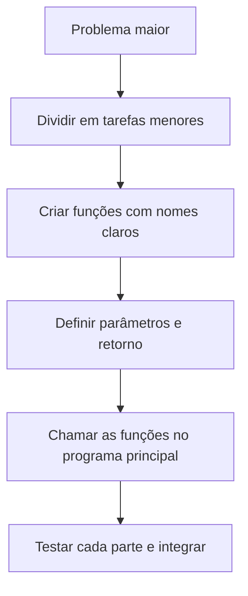
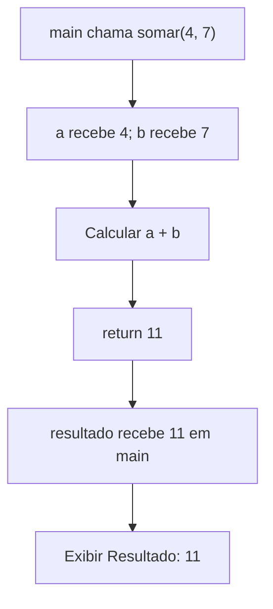

# Capítulo 8 — Funções e modularização

> **Ideia central:** um programa bem organizado não precisa concentrar todas as instruções em um único bloco. Podemos dividir o problema em partes menores, dar um nome a cada tarefa e reutilizar essas partes sempre que necessário. Em C, fazemos isso por meio de funções.

## Objetivos de aprendizagem

Ao concluir este capítulo, você deverá ser capaz de:

- explicar por que a modularização melhora a organização de um programa;
- declarar e chamar funções em C;
- diferenciar parâmetros e argumentos;
- compreender o papel do tipo de retorno e da instrução `return`;
- utilizar funções `void` quando não há valor de retorno;
- criar protótipos de funções e organizar o código;
- compreender o escopo básico de variáveis locais;
- dividir um problema em funções menores e testáveis.

## 1. Por que dividir um programa em funções?

Imagine um sistema escolar que precisa calcular médias, verificar aprovação e exibir resultados para vários estudantes. Se toda a lógica ficar em `main()`, o programa pode crescer rapidamente, tornar-se repetitivo e ficar difícil de testar.

A **modularização** consiste em dividir um problema maior em partes menores, cada uma responsável por uma tarefa bem definida. Em C, as funções são uma das principais ferramentas para isso.

Uma função pode receber dados, realizar um processamento e devolver um resultado. Ela também pode executar uma tarefa sem retornar um valor.

### Mapa visual do capítulo



### Benefícios da modularização

- **Reutilização:** a mesma função pode ser chamada em diferentes pontos do programa.
- **Legibilidade:** o nome da função comunica a intenção do trecho de código.
- **Manutenção:** uma alteração pode ficar restrita à função responsável pela tarefa.
- **Testabilidade:** funções pequenas são mais fáceis de testar isoladamente.
- **Redução de duplicação:** evita copiar e colar blocos de código semelhantes.

## 2. A função `main()`

Nos programas C apresentados nesta apostila, a execução começa pela função `main()`.

```c
#include <stdio.h>

int main(void) {
    printf("Ola, mundo!\n");
    return 0;
}
```

A expressão `int main(void)` indica que `main` retorna um inteiro e não recebe parâmetros nesse formato. O comando `return 0;` sinaliza, convencionalmente, que o programa terminou com sucesso.

A função `main()` também pode chamar outras funções. Assim, ela pode funcionar como ponto de organização do fluxo principal do programa.

## 3. Declarando e chamando uma função

Uma função em C possui, de forma geral, um tipo de retorno, um nome, uma lista de parâmetros e um corpo.

```c
tipo_retorno nome_da_funcao(parametros) {
    // comandos
    return valor;
}
```

O `return valor;` é usado quando a função precisa devolver um resultado compatível com seu tipo de retorno. Funções do tipo `void` não retornam um valor.

### Exemplo 1 — Função que soma dois inteiros

```c
#include <stdio.h>

int somar(int a, int b) {
    return a + b;
}

int main(void) {
    int resultado = somar(4, 7);
    printf("Resultado: %d\n", resultado);
    return 0;
}
```

**Saída:**

```text
Resultado: 11
```

O programa chama `somar(4, 7)`. Os valores `4` e `7` são os **argumentos** da chamada. Dentro da função, os parâmetros `a` e `b` recebem esses valores. A função calcula `a + b` e retorna o resultado para quem a chamou.

### Fluxo simplificado da chamada



### Exemplo 2 — Função que calcula o quadrado

```c
#include <stdio.h>

int quadrado(int numero) {
    return numero * numero;
}

int main(void) {
    int valor = 6;
    printf("Quadrado: %d\n", quadrado(valor));
    return 0;
}
```

A função recebe um inteiro e retorna seu quadrado. Como o cálculo está encapsulado em uma função, ela pode ser reutilizada para diferentes valores.

## 4. Parâmetros e argumentos

Embora sejam termos relacionados, eles não significam exatamente a mesma coisa.

- **Parâmetro:** variável declarada na definição da função, que recebe o dado usado pela função.
- **Argumento:** valor ou expressão fornecido na chamada da função.

Observe:

```c
float calcularMedia(float nota1, float nota2) {
    return (nota1 + nota2) / 2.0f;
}

/* Em outro ponto do programa: */
float media = calcularMedia(8.0f, 6.0f);
```

`nota1` e `nota2` são parâmetros. `8.0f` e `6.0f` são argumentos nessa chamada.

Em C, os parâmetros escalares, como `int` e `float`, recebem seus valores por cópia. Alterar o parâmetro dentro da função não altera diretamente a variável original usada como argumento.

### Exemplo — Alteração de um parâmetro

```c
#include <stdio.h>

void tentarAlterar(int numero) {
    numero = 100;
    printf("Dentro da funcao: %d\n", numero);
}

int main(void) {
    int valor = 5;
    tentarAlterar(valor);
    printf("Em main: %d\n", valor);
    return 0;
}
```

**Saída:**

```text
Dentro da funcao: 100
Em main: 5
```

A função modificou sua cópia local de `numero`; a variável `valor` continuou valendo 5.

## 5. Tipo de retorno e `return`

O tipo de retorno informa qual tipo de valor a função devolve à chamada.

| Tipo de retorno | Finalidade | Exemplo de retorno |
|---|---|---|
| `int` | Devolver um inteiro | `return 10;` |
| `float` | Devolver um número real de precisão simples | `return 7.5f;` |
| `char` | Devolver um caractere | `return 'A';` |
| `void` | Não devolver um valor | Não usar `return` com valor |

### Exemplo — Verificar se um número é par

```c
#include <stdio.h>

int ehPar(int numero) {
    if (numero % 2 == 0) {
        return 1;
    }

    return 0;
}

int main(void) {
    int valor = 14;

    if (ehPar(valor)) {
        printf("O numero e par.\n");
    } else {
        printf("O numero e impar.\n");
    }

    return 0;
}
```

A função devolve `1` quando o número é par e `0` caso contrário. Em C, zero é interpretado como falso em uma condição e valores diferentes de zero como verdadeiro. Para este exemplo didático, a função usa explicitamente `1` e `0` como resultado lógico.

> **Atenção:** não confunda `return` com `printf`. `printf` exibe informação na tela; `return` devolve um resultado ao ponto em que a função foi chamada (ou encerra a função, quando usado sem valor em uma função `void`).

## 6. Funções `void`: executar uma tarefa

Quando a função precisa executar uma ação, mas não precisa devolver um resultado, podemos usar `void`.

### Exemplo — Exibir uma mensagem

```c
#include <stdio.h>

void exibirLinha(void) {
    printf("--------------------\n");
}

int main(void) {
    exibirLinha();
    printf("RELATORIO\n");
    exibirLinha();
    return 0;
}
```

A função `exibirLinha` não recebe parâmetros e não retorna valor. O `void` entre parênteses indica que ela não recebe argumentos.

Uma função `void` pode ter um `return;` sem valor para encerrar sua execução antecipadamente, mas isso não é necessário no exemplo acima.

### Função `void` com parâmetros

```c
void exibirDobro(int numero) {
    printf("Dobro: %d\n", numero * 2);
}
```

Essa função recebe um número e exibe seu dobro. Ela não devolve o dobro para ser armazenado em uma variável; apenas executa a saída.

## 7. Protótipos e organização do código

Em C, o compilador precisa conhecer a declaração de uma função antes de uma chamada que dependa dela. Uma estratégia comum é escrever o **protótipo** antes de `main()` e colocar a definição completa depois.

```c
#include <stdio.h>

int multiplicar(int a, int b);  // prototipo

int main(void) {
    printf("%d\n", multiplicar(3, 4));
    return 0;
}

int multiplicar(int a, int b) {
    return a * b;
}
```

O protótipo informa ao compilador o nome da função, o tipo de retorno e os tipos dos parâmetros. Ele termina com ponto e vírgula e não contém o corpo da função.

Também é possível definir a função antes de `main()`. Nesse caso, o protótipo separado pode ser dispensável, pois a definição já foi apresentada antes da chamada.

## 8. Escopo de variáveis

O **escopo** determina a região do código em que um identificador pode ser usado.

Uma variável declarada dentro de uma função ou bloco normalmente é uma variável local e só pode ser acessada nesse escopo.

```c
#include <stdio.h>

void exemplo(void) {
    int numero = 10;
    printf("%d\n", numero);
}

int main(void) {
    exemplo();
    /* numero não pode ser usado aqui */
    return 0;
}
```

A variável `numero` pertence ao escopo de `exemplo`. Tentar usá-la em `main()` gera erro de compilação, porque ela não foi declarada naquele escopo.

### Boas práticas

- Prefira variáveis locais quando os dados forem necessários apenas dentro da função.
- Dê nomes que indiquem a finalidade da função e de seus parâmetros.
- Evite depender de variáveis globais para compartilhar informações sem necessidade.
- Procure manter cada função responsável por uma tarefa clara.

## 9. Dividindo um problema em funções

Vamos construir um programa que calcule a média de duas notas e informe se o estudante atingiu a média mínima 6.

### Versão com funções

```c
#include <stdio.h>

float calcularMedia(float nota1, float nota2) {
    return (nota1 + nota2) / 2.0f;
}

void exibirSituacao(float media) {
    if (media >= 6.0f) {
        printf("Situacao: aprovado\n");
    } else {
        printf("Situacao: em recuperacao\n");
    }
}

int main(void) {
    float nota1;
    float nota2;
    float media;

    printf("Digite a primeira nota: ");
    scanf("%f", &nota1);

    printf("Digite a segunda nota: ");
    scanf("%f", &nota2);

    media = calcularMedia(nota1, nota2);

    printf("Media: %.2f\n", media);
    exibirSituacao(media);

    return 0;
}
```

Observe a divisão de responsabilidades:

- `calcularMedia()` recebe as duas notas e devolve a média.
- `exibirSituacao()` recebe a média e apresenta a situação.
- `main()` coordena a entrada, chama as funções e organiza a saída.

A função `exibirSituacao()` poderia devolver uma classificação em vez de imprimir diretamente. A escolha depende do objetivo: separar cálculo e apresentação pode facilitar a reutilização em outros contextos.

## 10. Erros comuns e depuração

### Erro 1 — Chamar uma função com quantidade incorreta de argumentos

```c
int somar(int a, int b) {
    return a + b;
}

/* Chamada incorreta: */
int resultado = somar(5);
```

A função exige dois argumentos, mas recebeu apenas um. A chamada deve fornecer os dois valores, por exemplo, `somar(5, 3)`.

### Erro 2 — Esquecer o `return` de uma função que deve devolver um valor

```c
int dobrar(int numero) {
    numero * 2;
}
```

A expressão é calculada, mas não é devolvida. Uma forma correta é:

```c
int dobrar(int numero) {
    return numero * 2;
}
```

Em uma função não `void`, chegar ao fim sem devolver um valor quando o resultado é utilizado pode levar a comportamento indefinido. Garanta que os caminhos relevantes retornem um valor adequado.

### Erro 3 — Declarar retorno incompatível com o objetivo

Se uma função precisa devolver uma média decimal, `float` pode ser mais apropriado do que `int`, que não representa a parte fracionária da mesma forma.

### Erro 4 — Confundir exibição com retorno

```c
int somar(int a, int b) {
    printf("%d\n", a + b);
    return 0;
}
```

Esse exemplo exibe a soma, mas devolve zero. Se a intenção é permitir que o programa utilize a soma em outro cálculo, deve retornar `a + b`.

### Erro 5 — Usar uma variável local fora do escopo

Uma variável declarada dentro de uma função não se torna automaticamente acessível em outras funções. Passe os dados por parâmetros ou retorne o resultado.

### Estratégia de depuração

1. Confira o protótipo e a definição da função.
2. Compare o número e os tipos dos argumentos com os parâmetros.
3. Verifique se o tipo de retorno corresponde ao resultado desejado.
4. Confirme que todos os caminhos relevantes retornam um valor.
5. Teste a função com entradas simples antes de integrá-la ao programa principal.

## 11. Atividade guiada — Calculadora modular

Desenvolva uma calculadora que leia dois números reais e apresente a soma, a subtração, a multiplicação e, quando possível, a divisão.

### Etapa 1 — Planejamento

- Entrada: dois números reais.
- Processamento: funções para soma, subtração, multiplicação e divisão.
- Saída: os quatro resultados, exceto a divisão quando o divisor for zero.

### Etapa 2 — Implementação em C

```c
#include <stdio.h>

float somar(float a, float b) {
    return a + b;
}

float subtrair(float a, float b) {
    return a - b;
}

float multiplicar(float a, float b) {
    return a * b;
}

int dividir(float a, float b, float *resultado) {
    if (b == 0.0f) {
        return 0;
    }

    *resultado = a / b;
    return 1;
}

int main(void) {
    float a;
    float b;
    float resultadoDivisao;

    printf("Digite dois numeros: ");
    if (scanf("%f %f", &a, &b) != 2) {
        printf("Entrada invalida.\n");
        return 1;
    }

    printf("Soma: %.2f\n", somar(a, b));
    printf("Subtracao: %.2f\n", subtrair(a, b));
    printf("Multiplicacao: %.2f\n", multiplicar(a, b));

    if (dividir(a, b, &resultadoDivisao)) {
        printf("Divisao: %.2f\n", resultadoDivisao);
    } else {
        printf("Nao e possivel dividir por zero.\n");
    }

    return 0;
}
```

### Por que a função `dividir` é diferente?

Ela recebe um ponteiro `float *resultado`. O endereço da variável é passado na chamada, e a função armazena o resultado nesse endereço usando `*resultado`. Além disso, a função retorna `1` se a divisão foi realizada ou `0` se o divisor era zero.

Esse exemplo introduz o uso de ponteiros como mecanismo para uma função produzir um resultado adicional. O assunto será estudado em mais profundidade no capítulo dedicado a ponteiros, se fizer parte da sequência da disciplina.

### Etapa 3 — Testes sugeridos

| Entrada | Resultados esperados |
|---|---|
| `8 2` | Soma 10, subtração 6, multiplicação 16, divisão 4 |
| `5 0` | Soma 5, subtração 5, multiplicação 0 e aviso de divisão por zero |
| `-4 2` | Soma -2, subtração -6, multiplicação -8, divisão -2 |

## 12. Exercícios propostos

Para cada exercício, identifique a responsabilidade de cada função, seus parâmetros e seu tipo de retorno. Sempre que possível, teste as funções com mais de uma entrada.

### Nível 1 — Compreensão

1. Explique o que é modularização e cite dois benefícios.
2. Qual é o papel da função `main()` em um programa C?
3. Diferencie parâmetro e argumento.
4. Qual é a diferença entre uma função `int` e uma função `void`?
5. Qual é a finalidade de `return`?
6. O que um protótipo de função informa ao compilador?
7. Explique por que a variável local de uma função não pode ser acessada livremente em outra função.
8. O que será exibido?

   ```c
   int dobro(int n) {
       return n * 2;
   }

   int main(void) {
       printf("%d\n", dobro(5));
       return 0;
   }
   ```

9. Qual é o problema da função abaixo?

   ```c
   int somar(int a, int b) {
       printf("%d\n", a + b);
       return 0;
   }
   ```

   Considere que a intenção é usar a soma em outro cálculo.
10. Por que funções pequenas e com responsabilidades claras tendem a facilitar a manutenção?

### Nível 2 — Aplicação

11. Crie uma função `int somar(int a, int b)` que retorne a soma de dois inteiros.
12. Crie uma função `float calcularMedia(float a, float b, float c)` que retorne a média de três notas.
13. Crie uma função `int maior(int a, int b)` que retorne o maior de dois inteiros.
14. Crie uma função `int ehPar(int numero)` que retorne 1 se o número for par e 0 caso contrário.
15. Crie uma função `void exibirTabuada(int numero)` que mostre a tabuada de 1 a 10.
16. Crie uma função `int fatorial(int n)` para calcular o fatorial de um inteiro não negativo. Defina como o programa deve tratar entradas negativas.
17. Crie uma função `float converterCelsiusParaFahrenheit(float celsius)` usando a fórmula \(F = \frac{9}{5}C + 32\).
18. Crie uma função `int contarPositivos(int v[], int tamanho)` que conte quantos elementos de um vetor são positivos.
19. Crie uma função `int buscar(int v[], int tamanho, int valor)` que retorne 1 se o valor estiver no vetor e 0 caso contrário.
20. Organize um programa de notas em funções para ler as notas, calcular a média e exibir a situação do estudante.

### Nível 3 — Desafio

21. Crie uma função que receba três números e retorne o menor deles. Teste também casos em que existam valores iguais.
22. Crie uma função que receba um inteiro e retorne 1 se ele for primo e 0 caso contrário.
23. Crie uma função que receba um vetor e seu tamanho e retorne a soma de seus elementos.
24. Crie uma função que receba uma matriz 3 × 3 e retorne a soma da diagonal principal. Defina claramente os parâmetros da função.
25. Projete uma calculadora modular com funções para as quatro operações. A divisão deve indicar quando o divisor for zero e o programa principal deve apresentar os resultados.

## 13. Gabarito comentado

As implementações são exemplos de solução. Para manter o foco na modularização, alguns trechos apresentam apenas as funções que devem ser chamadas por `main()`.

### 1 a 7 — Conceitos

1. Modularização é dividir um programa em partes menores. Benefícios: reutilização, legibilidade, manutenção e testes.
2. `main()` é o ponto de entrada dos programas C apresentados e coordena o fluxo principal.
3. Parâmetros aparecem na definição; argumentos são os valores fornecidos na chamada.
4. Uma função `int` devolve um inteiro; uma função `void` não devolve valor.
5. Devolver um resultado à chamada ou encerrar a execução da função, conforme seu uso.
6. Nome da função, tipo de retorno e tipos dos parâmetros.
7. Porque a variável pertence ao escopo em que foi declarada.
8. Exibe `10`.
9. Exibe a soma, mas retorna zero. Para reutilizar o resultado, deve retornar `a + b`.
10. Porque cada função tem um propósito definido e pode ser localizada, testada e alterada com mais facilidade.

### 11 — Soma

```c
int somar(int a, int b) {
    return a + b;
}
```

### 12 — Média de três notas

```c
float calcularMedia(float a, float b, float c) {
    return (a + b + c) / 3.0f;
}
```

### 13 — Maior de dois inteiros

```c
int maior(int a, int b) {
    if (a > b) return a;
    return b;
}
```

Se os valores forem iguais, a função retorna esse valor, sem diferença prática entre as duas entradas.

### 14 — Verificar paridade

```c
int ehPar(int numero) {
    return numero % 2 == 0;
}
```

A expressão relacional resulta em 1 ou 0 em C.

### 15 — Tabuada

```c
void exibirTabuada(int numero) {
    for (int i = 1; i <= 10; i++) {
        printf("%d x %d = %d\n", numero, i, numero * i);
    }
}
```

Inclua `#include <stdio.h>` no arquivo que contém a função.

### 16 — Fatorial

Uma versão simples que devolve `-1` como indicação didática de entrada inválida:

```c
long long fatorial(int n) {
    if (n < 0) return -1;

    long long resultado = 1;
    for (int i = 1; i <= n; i++) {
        resultado *= i;
    }

    return resultado;
}
```

Em um sistema real, é preferível separar explicitamente o estado de erro do resultado, e o tipo numérico limita os valores que podem ser representados. O fatorial de zero é 1.

### 17 — Celsius para Fahrenheit

```c
float converterCelsiusParaFahrenheit(float celsius) {
    return (9.0f / 5.0f) * celsius + 32.0f;
}
```

O uso de `9.0f / 5.0f` garante que a razão seja calculada com ponto flutuante.

### 18 — Contar positivos em um vetor

```c
int contarPositivos(int v[], int tamanho) {
    int quantidade = 0;

    for (int i = 0; i < tamanho; i++) {
        if (v[i] > 0) quantidade++;
    }

    return quantidade;
}
```

Em parâmetros de função, `int v[]` representa acesso aos elementos do vetor recebido; o tamanho deve ser fornecido separadamente.

### 19 — Busca em vetor

```c
int buscar(int v[], int tamanho, int valor) {
    for (int i = 0; i < tamanho; i++) {
        if (v[i] == valor) return 1;
    }

    return 0;
}
```

A função encerra imediatamente quando encontra o valor.

### 20 — Programa de notas modular

```c
float calcularMedia(float a, float b) {
    return (a + b) / 2.0f;
}

void exibirSituacao(float media) {
    if (media >= 6.0f) printf("Aprovado\n");
    else printf("Em recuperacao\n");
}
```

Em `main()`, leia as duas notas, chame `calcularMedia()` e passe a média para `exibirSituacao()`.

### 21 — Menor de três números

```c
int menorDeTres(int a, int b, int c) {
    int menor = a;
    if (b < menor) menor = b;
    if (c < menor) menor = c;
    return menor;
}
```

### 22 — Verificar número primo

```c
int ehPrimo(int n) {
    if (n < 2) return 0;

    for (int i = 2; i <= n / i; i++) {
        if (n % i == 0) return 0;
    }

    return 1;
}
```

O teste `i <= n / i` evita a necessidade de calcular `i * i` e reduz a quantidade de divisores testados. Valores menores que 2 não são primos.

### 23 — Somar vetor

```c
int somarVetor(int v[], int tamanho) {
    int soma = 0;

    for (int i = 0; i < tamanho; i++) {
        soma += v[i];
    }

    return soma;
}
```

### 24 — Soma da diagonal de uma matriz 3 × 3

```c
int somarDiagonal(int matriz[3][3]) {
    int soma = 0;

    for (int i = 0; i < 3; i++) {
        soma += matriz[i][i];
    }

    return soma;
}
```

O parâmetro declara a quantidade de colunas necessária para que o compilador calcule o acesso aos elementos.

### 25 — Calculadora modular

As funções `somar`, `subtrair` e `multiplicar` podem seguir o padrão dos exercícios anteriores. Para a divisão, uma função pode retornar um indicador de sucesso e escrever o resultado por meio de um ponteiro, como na atividade guiada. O `main()` lê os operandos, chama as funções e exibe os resultados, verificando o indicador antes de apresentar a divisão.

## 14. Resumo visual

| Conceito | Lembrete |
|---|---|
| Função | Bloco de código com tarefa definida |
| Chamada | Ponto em que a função é executada |
| Parâmetro | Variável que recebe o dado dentro da definição |
| Argumento | Valor fornecido na chamada |
| Tipo de retorno | Define o tipo de valor devolvido |
| `return` | Devolve o resultado ou encerra a função |
| `void` | Indica ausência de valor de retorno |
| Protótipo | Declaração que informa a assinatura da função |
| Escopo local | Região em que uma variável local pode ser acessada |
| Modularização | Organização do programa em partes menores |

### Checklist de revisão

- [ ] Sei declarar e chamar uma função?
- [ ] Diferencio parâmetros de argumentos?
- [ ] Escolho um tipo de retorno adequado?
- [ ] Sei quando utilizar `void`?
- [ ] Consigo escrever um protótipo?
- [ ] Entendo por que variáveis locais não são compartilhadas automaticamente?
- [ ] Dividi o problema em funções com responsabilidades claras?
- [ ] Testei cada função com entradas diferentes, incluindo casos-limite?

## 15. Glossário

- **Função:** bloco nomeado de código que realiza uma tarefa.
- **Modularização:** divisão do programa em partes menores e organizadas.
- **Parâmetro:** variável definida na assinatura de uma função.
- **Argumento:** valor ou expressão passada para uma função.
- **Retorno:** valor devolvido pela função à chamada.
- **Protótipo:** declaração antecipada da assinatura de uma função.
- **Escopo:** região do código em que um identificador pode ser usado.
- **Ponteiro:** variável que armazena um endereço de memória; será explorado em capítulo próprio, quando previsto na disciplina.

## 16. Referências para consulta

- KERNIGHAN, Brian W.; RITCHIE, Dennis M. *The C Programming Language*. 2. ed. Englewood Cliffs: Prentice Hall, 1988.
- SCHILDT, Herbert. *C: The Complete Reference*. 4. ed. Berkeley: Osborne/McGraw-Hill, 2000.
- ISO/IEC. *ISO/IEC 9899: Programming Languages — C*. International Organization for Standardization.
- cppreference.com. *C language: Functions*. Disponível em: https://en.cppreference.com/w/c/language/functions. Acesso em: 24 out. 2026.

---

## Integração ao portal MkDocs

Salve este arquivo como `docs/ALP/apostila/08-funcoes-e-modularizacao.md`.

No bloco `nav` do `mkdocs.yml`, adicione o item dentro do grupo `Apostila de ALP`, respeitando a indentação dos capítulos anteriores:

```yaml
- Capítulo 8 — Funções e modularização: ALP/apostila/08-funcoes-e-modularizacao.md
```

Execute `atualizar-portal` e confira a página publicada. Os exemplos utilizam recursos de C99 ou posterior, como declarações de variáveis dentro do `for`.
